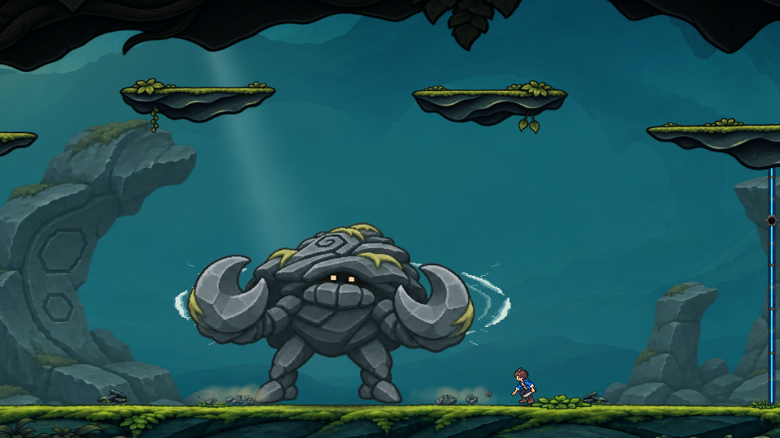

# B1 바위 소라게 둥지 · 레이어와 조명

습한 암굴에 남은 옛 수로를 배경으로 삼았다. 중앙의 소라게, 주인공과 파동이 먼저 읽히도록 큰 석재는 양옆에 두고 기존 보행선과 장치를 기준으로 배치했다. 게임 테스트는 낙석 직후의 구도를 보여 준다.



[보스방 전체 SDL 캡처 (2,410 × 790)](previews/full-room.png)는 양쪽 레일, 상단 발판 4개, 오른쪽 입구와 보스·주인공을 한 화면에 담는다.

| 레이어 | 독립 PNG | 표현과 렌더링 |
| --- | --- | --- |
| 원경 | [먼 암굴](far-background.png) | 2,690 × 950 불투명 파노라마. 멀리 겹친 둥근 암반과 옅은 물빛. 이동 계수 0.25와 가장자리 여유를 사용한다. |
| 중경 | [무너진 수로](midground.png) | 2,410 × 790 투명판. 왼쪽의 육각 홈 수문 파편과 오른쪽 기둥이 보스 양옆을 채운다. 공기색을 RGB에 섞고 알파는 유지한다. 이동 계수 0.62. |
| 근접 전경 | [어두운 뿌리와 잎](near-foreground.png) | 2,410 × 790 투명판. 양 끝의 큰 잎과 아래쪽의 낮은 뿌리를 캐릭터 앞에 그린다. 이동 계수 1.10. |

천장 암반과 통로에 이어진 벽은 원래 월드에 고정한다. 보행선 `y=703`, 발판 4개, 양쪽 레일, 고정부, 입구 석문은 같은 변환을 사용한다. 바닥의 판석은 그대로 쓰고, 가까운 장식에는 [맵 장식 세트](../../../terrain/moss-grotto-floor-decor/README.md)의 낮은 이끼, 옆으로 눕는 잎과 둥근 잎을 함께 배치했다. [원본 크롭과 배치](placement.json) · [ImageGen 프롬프트와 참고 ID](imagegen-prompts.txt)

천장 왼쪽 틈에서 차가운 빛이 중앙 쪽으로 넓어진다. 낮은 안개는 원경과 중경 사이에 두었다. 오른쪽 입구의 따뜻한 빛은 통로 뒤 공기와 바위 표면, 아래 바닥에만 닿는다. 발밑의 얕은 접지 그림자를 먼저 그린 뒤 소라게와 주인공, 파동을 그려 공격 실루엣을 읽을 수 있게 했다.

카메라가 오른쪽 입구에서 중앙으로 0.82초 동안 이동하면서 시야 폭을 1,040에서 1,280 아트 단위로 넓힌다. 중앙에 도착하면 카메라를 고정해 포효와 주인공 반응을 한 화면에 담는다. 시차는 기준 카메라 중심 `(1168, 397)`에서 이동한 양에 적용한다. [카메라 이동 영상](previews/camera-tour.webp) · [오른쪽 입구](previews/right-entry.png) · [왼쪽 레일](previews/left-rail.png) · [상단 발판](previews/upper-platforms.png)

SDL에서 네 고정 구도와 이동 영상을 확인했다. 이 테스트는 입구와 포효 장면을 검토하며 본편의 C 전실에서 B1로 들어가는 경로는 연결 전이다.

```powershell
.\.venv\Scripts\python.exe -m tools.preview_b1_roar_game --camera-tour
.\.venv\Scripts\python.exe -m tools.preview_b1_roar_game --stills assets/concepts/b1-hermit-crab/room-art-v3/previews
.\.venv\Scripts\python.exe -m tools.preview_b1_roar_game --camera-tour --capture assets/concepts/b1-hermit-crab/room-art-v3/previews/camera-tour.webp
```
