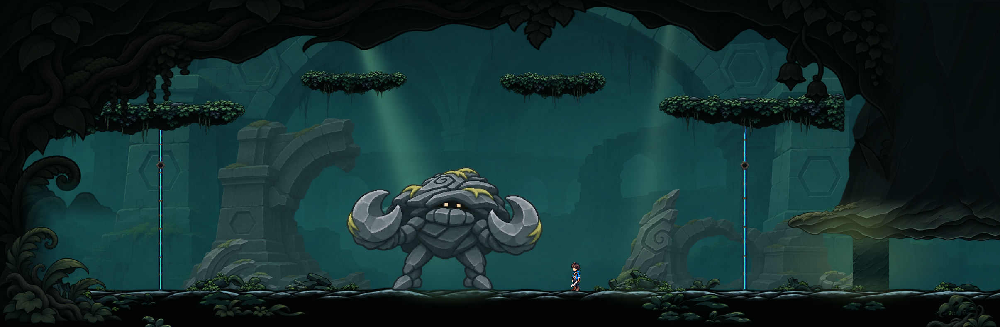

# B1 바위 소라게 둥지 · 청록빛 지하 수로 유적

원경을 거대한 지하 수로 유적실로 그렸다. 육각 홈이 있는 큰 기둥과 아치 뒤로 작은 회랑이 이어진다. 첫 전투방의 짙은 청록을 기준으로 멀어지는 회랑을 안개에 묻었다. 보스 뒤쪽은 어둡고 넓게 열어 전투 중 실루엣을 읽기 쉽게 했다.



중경에는 같은 쐐기돌과 육각 홈을 가진 무너진 수문, 낮은 물받이, 끊어진 회랑을 배치했다. 왼쪽 수문 밑동에서 판석 부속과 물받이가 이어지고, 오른쪽 회랑 앞에는 나선 비석과 깨진 석재 고리가 남아 있다. 나선과 판석의 겹이 바위 소라게 등딱지의 형태를 받쳐 준다.

바닥은 [첫 전투방의 판석 바닥](../../../terrain/combat-room-v2/floor.png)을 사용한다. 발판 4개에는 같은 전투방의 [왼쪽](../../../terrain/combat-room-v2/platform-left.png)·[중앙](../../../terrain/combat-room-v2/platform-center.png)·[오른쪽](../../../terrain/combat-room-v2/platform-right.png) 이끼 발판을 사용했다. B1의 기존 보행선 `y=703`, 발판 폭과 높이, 레일과 입구 위치로 맞췄다. 중앙 발판 원화는 짧은 두 안쪽 발판에 맞게 중앙부를 잇고, 두 끝의 둥근 윤곽을 살렸다. 레일 끝은 상단 이끼 발판 안에 고정된다. 바닥에는 [기존 장식 세트](../../../terrain/moss-grotto-floor-decor/README.md)의 낮은 이끼와 풀을 간격을 두고 배치했다.

| 레이어 | 색·거리와 카메라 이동량 |
| --- | --- |
| 원경 | 청록 안개와 낮은 대비의 기둥·회랑. 지형 대비 0.25배 이동 |
| 중경 | 그보다 뚜렷한 회녹색 석재 조형물. 가로 0.62배 이동. 밑동은 전투 바닥과 높이를 맞춤 |
| 전투 지형 | 판석 바닥, 발판, 레일, 천장과 입구. 1.0배 이동 |
| 바닥 앞 가장자리 | 판석 단면에 붙은 낮은 잎과 이끼, 뿌리. 지형과 같이 이동 |
| 가까운 전경 | 가장자리의 어두운 뿌리와 잎. 1.10배 이동 |

중경 밑의 판석 잔해와 바닥 뒤쪽 이끼를 겹치고, 양옆 바닥 단면은 낮은 잎과 뿌리로 감쌌다. 중앙 전투 공간은 비워 뒀다. 천장 틈의 녹색 빛 두 줄기는 중앙과 오른쪽 비석 쪽으로 내려오고, 바닥 이끼와 앞쪽 잎이 같은 위치에서 반사광을 받는다. 빛은 각 자산의 실루엣 안에서 적용된다. [기존 가까운 전경](../room-art-v3/near-foreground.png)은 색을 맞춰 독립 레이어로 그린다. SDL에서 좌우 레일, 오른쪽 입구, 상단 발판, 포효와 입구에서 중앙으로 이동하는 시점을 확인했다. B1 테스트 장면에 적용했다.

- [원경 PNG](far-background.png) · [원경 원화](source-far-ruined-hall.png) · [원경 프롬프트와 참고 ID](imagegen-far-prompt.txt)
- [중경 투명 PNG](midground.png) · [수문·물받이·회랑 원화](source-midground-architecture.png) · [수로 건축 프롬프트와 참고 ID](imagegen-midground-architecture-prompt.txt)
- [소형 조형물 원화](source-midground-props.png) · [소형 조형물 프롬프트와 참고 ID](imagegen-prompt.txt) · [중경 배치](midground-placement.json) · [바닥 앞 가장자리 PNG](attached-foreground.png)
- [전체 게임 화면](previews/full-room.png) · [일반 전투 카메라의 포효](previews/boss-roar.png) · [입구에서 포효까지 카메라 이동](previews/camera-tour.webp)

```powershell
.\.venv\Scripts\python.exe -m tools.preview_b1_roar_game --camera-tour
.\.venv\Scripts\python.exe -m tools.preview_b1_roar_game --stills .cache/b1-room-inspection
```
