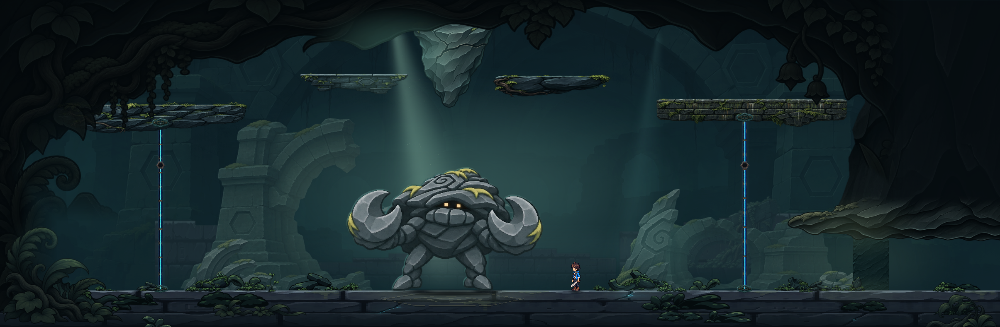

# B1 고대 수호자의 수로 전당



B1은 게임의 카메라, 플레이어 스프라이트, SDL 렌더러를 쓰는 독립 포효 테스트다. 본편은 C 전실의 봉인문까지 플레이할 수 있다. B1 테스트의 바닥과 발판은 설계 좌표에 맞춘 시각 지형이며, 실제 보스 AI·피격 판정·입장과 퇴장은 후속 구현이다. [B1 전투 설계](../../../../docs/b1-hermit-crab-combat-design.md)

## 기존 장면과 개선

기존 v4는 반투명 중경 수문과 좌우 틈빛, 동일한 계열의 이끼 발판, 원경·중경·전경 시차를 사용했다. 넓고 균일한 청록 원경과 얇은 바닥 때문에 보스 뒤의 깊이와 바닥의 석재가 약하게 읽혔다. v5는 천장 암석 왼쪽에서 들어오는 빛을 소라게와 바닥의 나선·육각 각인에 모으고, 수문과 앞쪽 뿌리에 빛이 닿는 부분을 밝혔다. 원경의 아치는 차가운 먹빛으로 낮추고 바로 뒤 계단은 안개 아래로 사라지게 했다. HK-GP07의 부분적인 식생 반사광과 SS-HH-06의 열린 전투 공간, 약한 원경 대비를 참고했다. [v4 방](../room-art-v4/README.md) · [프로젝트 참고 자료](../../../../docs/reference-production-guide.md#우리-구역별로-먼저-볼-자료)

| 렌더 층 | 처리 |
| --- | --- |
| 원경 | v4의 아치·기둥 원경을 감광하고 보스 뒤 명도를 완만하게 높였다. 시차 0.16을 적용하고 카메라 끝에서는 이미지 범위로 원점을 제한한다. |
| 중원경 | 기존 석판을 계단과 부서진 단으로 잘라 합성하고 첫 전투방의 아치를 안개 뒤로 내렸다. 시차 0.34를 쓴다. |
| 중경 | v4 수문, 비석, 잔해를 유지하고 빛을 받는 면만 밝힌다. 가로 시차 0.62를 적용하고 밑동은 바닥 높이에 고정한다. |
| 전투 지형·배우 | 월드 시차 1.0으로 빛줄기, 지형, 암석, 먼지·포자, 접지 그림자, 포효 파동, 보스, 자갈, 플레이어 순으로 그린다. 광막과 반사광은 정적 텍스처로 합성한다. |
| 전경 | 천장과 바닥에 붙은 식생은 월드에 고정한다. 독립 잎·뿌리는 1.08로 움직이며, 안쪽과 입구의 실루엣 알파를 낮췄다. |

카메라는 960×540 SDL 화면을 기준으로 월드 좌표를 투영한다. 방 원화 1px은 월드 2단위이며 왼쪽 위의 원화 좌표를 게임 좌표로 바꿀 때 바닥 y=703을 기준으로 삼는다. 보스 x=1090과 플레이어 x=1388은 기존과 같다. 환경광은 방에 고정되고, 청록 윤곽광과 눈·금색 장식의 약한 발광은 보스 포효 아틀라스 19장에 합성돼 자세를 따라간다. 접지 그림자는 배우 위치를 따른다. 광막, 반사광, 안개에는 Pillow의 알파 합성과 SDL 텍스처를 사용한다. 먼지 17개와 포자 12개는 광막과 식생 주변에서 한 번의 SDL 지오메트리 호출로 그린다.

## 지형과 유물 레일

- 바닥 y=703에서 아래로 마모된 프로젝트 석판과 균열을 드러낸다. 중앙 각인, 바닥 가장자리의 잔해와 식생은 장식이다.
- 왼쪽부터 뿌리 암반, 육각 석대, 짧은 뿌리 돌턱, 물때 낀 수로석을 사용했다. 원본의 보행선 기준점으로 기존 네 착지면에 맞췄다. [원본과 좌표 명세](../../../terrain/ruin-platforms/README.md)
- 레일은 x=387과 x=1795를 사용한다. 기존 운반부와 파란 코어를 유지하며 착지면 아래와 바닥에 돌 고정구를 붙였다. 광량이 낮은 파란 번짐은 레일 주변에만 들어간다.

## 실행과 검증

```powershell
.\.venv\Scripts\python.exe -m tools.preview_b1_roar_game --camera-tour
.\.venv\Scripts\python.exe -m tools.preview_b1_roar_game --stills .cache/b1-room-inspection
.\.venv\Scripts\python.exe -m tools.preview_b1_roar_game --full-room .cache/b1-room-inspection/full-room.png
```

입구, 양쪽 레일, 상단, 전투 구도 및 이동 경로의 SDL 카메라 49개 지점에서 원경이 화면을 채우는지 확인했다. 보스 아틀라스 19장의 알파와 발판 네 곳·레일 두 곳의 좌표를 비교했다. 카메라와 포효 프레임을 고정하고 환경 시간만 움직였을 때 143픽셀이 변했다. 포효 파동과 자갈, 플레이어의 가독성은 현재 구현된 SDL 연출로 검수했다. 기존 회귀 테스트 222개가 통과했다.

동일 장비에서 960×540 카메라 투어 360프레임의 그리기와 SDL 화면 제출을 측정했다. 숨긴 창에서 측정한 CPU 경과 시간이며 GPU 완료 시간과 실플레이 FPS는 포함하지 않는다.

| 렌더러 | v4 중앙값 / p95 | v5 중앙값 / p95 |
| --- | --- | --- |
| Direct3D 11 | 0.43 / 0.60 ms | 0.57 / 0.85 ms |
| SDL 소프트웨어 | 25.29 / 35.44 ms | 18.43 / 24.02 ms |

[전체 방](previews/full-room.png) · [포효 화면](previews/boss-roar.png) · [입구에서 중앙까지](previews/camera-tour.webp)
