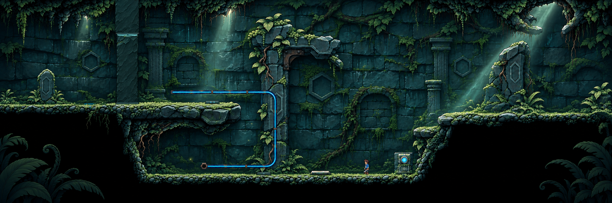

# A파트 가까운 석벽 시안 v1

2026-11-26 사용자와 정한 유적 지하 통로의 미술을 검토한 전체 이미지다. 기존 A파트의 장치와 지형을 포함한 렌더 화면을 편집 기준으로 삼았다. 사용자 승인 뒤 [별도 레이어를 제작해 본편에 적용했다](../../terrain/lower-route-a-wall-v1/README.md).

## 공간과 빛

- 뒤쪽에는 가까운 청회색 석벽이 하층 보행면까지 이어진다. 막힌 벽감과 석벽에 새긴 육각 문양, 오래된 부벽의 흔적으로 고대 문명을 표현했다.
- 갈라진 천장에서 들어오는 빛이 젖은 돌의 윗면과 이끼에 닿는다. 오른쪽 기존 낙하구의 빛이 가장 밝고, 중앙과 왼쪽에는 작은 틈빛을 배치했다.
- 균열의 물자국과 벽 밑동에 이끼를 모았다. 어두운 곳의 작은 황록색 반딧불이 빛은 천장빛과 장치 청색보다 약하게 표현했다.
- 가까운 잎과 뿌리는 모서리와 암반 아래에 붙였다. 중경의 유적 흔적은 배경 석벽에 묻힌 형태로 구성했다.

## 배치 기준

[배치 원본](layout-reference.png)은 현재 `LowerRouteA.draw`와 플레이어를 2172 × 724, 줌 0.4로 렌더한 것이다. 기존 ㄷ자 레일의 두 도크와 곡선, 지지 석주, 가동 버튼, 회수 장치, 두 발판과 왼쪽 봉인 돌문을 유지하도록 생성했다. 오른쪽 낙하구, 착지면과 계단, 하층 바닥, 왼쪽 상층 출구의 위치를 시각 비교했다.

이 파일은 배경·중경·근접 전경의 방향을 함께 보는 합성 시안이다. 독립 게임용 레이어 제작과 이동 중 검수는 본편 제작 단계에 해당한다.

## 생성과 참고

내장 ImageGen을 사용했다. [정확한 생성 프롬프트](generation-prompt.txt)에 입력 이미지의 역할과 고정 좌표를 기록했다. 생성 PNG와 저장한 시안의 SHA256 일치를 확인했고, PNG 디코드와 2172 × 724 크기를 검사했다.

- 주 배치 입력은 [현재 A 렌더](layout-reference.png)다.
- 주 미술 입력은 [전투방 화면](../../../docs/combat-room-lighting-gameplay.png)이다. 어두운 단면, 청회색 석재, 둥근 이끼와 잎의 선, 제한된 빛을 참고했다.
- HK-GP07은 [관찰 이미지](../../../docs/references/hollow-knight-greenpath/images/gp07.png)의 식생·석재에 닿는 국소광과 그 사이 어둠을 참고했다.
- SS-MG-02는 [관찰 이미지](../../../docs/references/hollow-knight-silksong/images/ss-mg-02.png)의 불규칙한 이끼 군집과 어두운 앞쪽 잎의 겹침을 참고했다.
