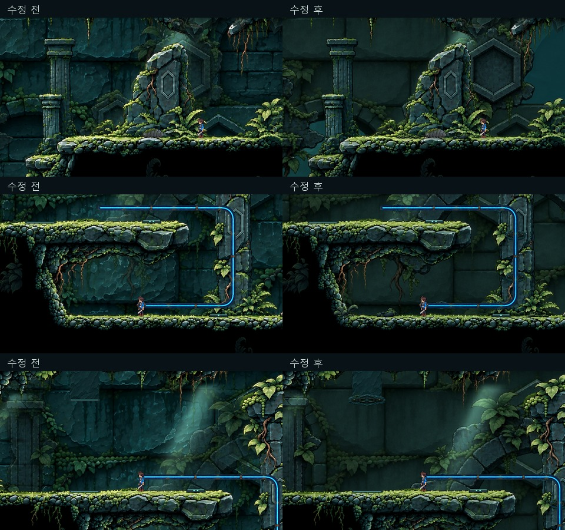

# A파트 석벽 통로의 독립 미술 레이어

승인한 [A 시안](../../concepts/map1-route-a-wall-v1/README.md)을 본편에 적용했다. 뒷벽, 중경, 전경과 고정 지형을 내장 ImageGen으로 각각 제작했고, 추가 요청에 따라 두 아치 안쪽의 회랑과 작은 레일 고정구를 제작했다. 생성한 투명 이미지의 알파와 외곽을 그대로 사용한다.



## 이미지

| 파일 | 사용 |
| --- | --- |
| `wall-depth.png` | 현재 가까운 석벽이다. 중앙 하단과 오른쪽 상단 아치의 안쪽만 투명하다. 작은 균열·줄눈·잎의 대비를 원화에서 낮췄다. |
| `recess.png` | 투명한 아치 안에서 보이는 저대비 회랑이다. 닳은 기둥과 뒤쪽 아치가 청록 공기 속으로 멀어진다. |
| `midground.png` | 별도로 그린 부벽, 아치 테두리와 문양석이다. 뒷벽과 같은 변환으로 이동하며 붙어 있는 구조의 접합을 유지한다. |
| `terrain.png` | 기존 보행면과 고정 장치의 배치에 맞춰 독립 제작한 지형이다. 레일·파츠·돌문·두 발판은 원래 런타임에서 그린다. |
| `foreground.png` | 독립 제작한 가까운 잎과 뿌리다. 생성 이미지의 빈 여백 안에서 두 군집을 나눠 사용한다. |
| `rail-bracket.png` | 기존 레일의 위치에 붙이는 고정구다. 여섯 곳의 받침과 돌문 하우징의 짧은 테두리로 사용한다. |
| `background.png` | 첫 석벽 제작 원본이며 `wall-depth.png`와 회랑 제작의 재질 참고 입력이다. |
| `layout-baseline.json` | 작업 전 지형·장치 상수와 레일 경로다. 미리보기 실행 때 현재 코드와 대조한다. |

[독립 레이어 생성 프롬프트](generation-prompts.md) · [아치와 고정구 생성 프롬프트](depth-prompts.md)

## 거리와 배치

`lower_route_a_art.py`의 카메라 이동 반영 비율은 회랑 가로 0.42·세로 0.38, 가까운 석벽과 중경 가로 0.84·세로 0.93, 독립 전경 가로 1.08이다. 지형과 레일 고정구, 장치 받침, 식생과 접촉 그림자는 기존 월드 변환을 사용한다. 석벽에는 가로 양쪽 900과 세로 여유 영역을, 회랑에는 더 넓은 여유 영역을 둔다. 두 레이어는 화면에서 보이는 부분만 작은 메시로 그려 SDL 소프트웨어 렌더의 큰 삼각형 오류를 피한다.

통로 연결부는 기존 배경, 새 A 석벽, 기존 연결 지형 순서로 겹친다. 석벽이 시작되는 구간을 완만하게 드러내 바닥 높이와 출입구를 잇는다.

## 빛과 표면

네 천장 빛의 위치·크기·강도와 처음 닿는 표면은 `LIGHTS`에 있다. 왼쪽 상층과 오른쪽 착지면에 막힌 빛은 그 표면에서 잘라낸다. 하층 가동 버튼 부근에는 더 약한 틈빛을 둔다. 같은 광원의 도달점을 지형 메시의 윗면 색과 얇은 반사광에 공유한다.

중앙 지지 석주와 오른쪽 조형물, 회수 장치의 밑동에는 접촉 그림자를, 레일 고정부에는 약한 청색 반사광을 더한다. 오른쪽 암반의 아래쪽은 큰 그림자로 눌렀다. 기존 장식 세트의 이끼, 고사리와 돌조각은 크기와 간격이 다른 군집으로 배치한다. 장치와 착지점 주변은 낮게 유지한다.

천장빛 안의 먼지는 열두 점으로 제한했고, 황록 반딧불이는 더 낮은 밝기에서 천천히 움직인다.

## 실행 확인

프로젝트 루트에서 다음 명령으로 현재 렌더러·플레이어·유물 카메라를 다시 확인할 수 있다.

```powershell
.\.venv\Scripts\python.exe -B -m tools.preview_lower_route_a_wall --output-dir .cache/a-depth-review
.\.venv\Scripts\python.exe -B -m unittest discover -s tests -p "test_lower_route*.py"
```

지형·장치·레일의 작업 전 스냅샷 일치, 배율 0.4·0.5·0.65의 왕복 카메라와 레일 추적, 실제 플레이어의 세 지점 점프·착지로 SDL 779개 화면을 확인했다. 별도의 뷰포트 가장자리 검사는 카메라 양 끝에서 석벽 아래·위와 좌우 끝의 노출을 검사한다. 하단 동선 23개, 유물 8개, 벽 이동 16개 테스트가 통과했다.

[본편 여섯 화면](../../../docs/a-passage-wall-runtime.jpg) · [레일 유물 추적 영상](../../../docs/a-passage-wall-rail-motion.webp)

캡처는 SDL 소프트웨어 렌더와 자동 입력으로 확인했다. 전체화면 장시간 수동 조작과 기기별 성능은 미측정이다.
