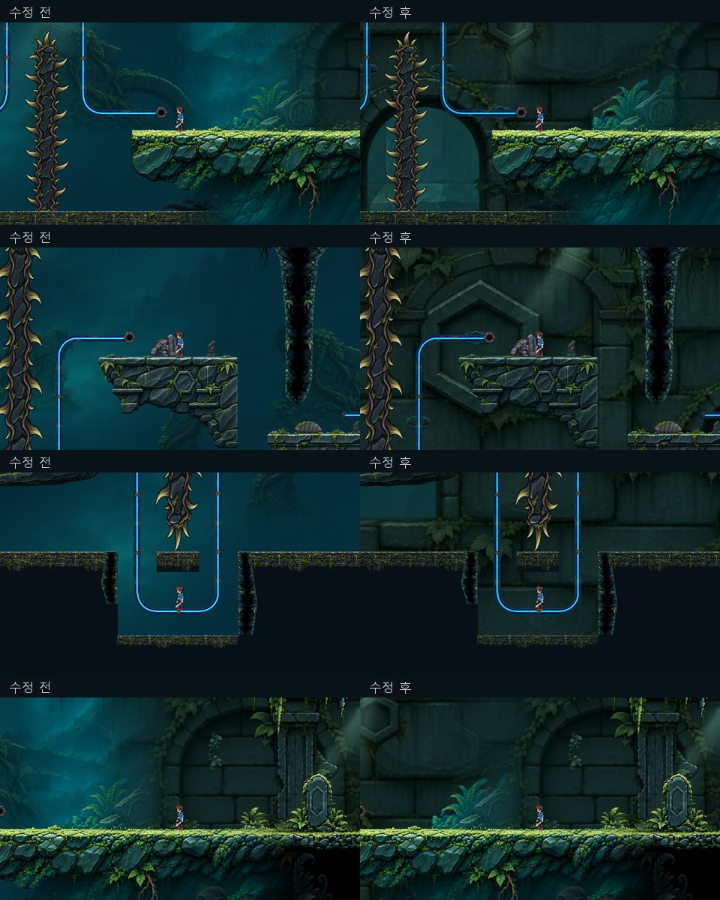

# B파트 석벽 통로 독립 레이어

A파트의 젖은 청회색 석벽, 둥근 이끼, 제한된 균열빛과 약한 황록 반딧불이 분위기를 B파트로 이어 적용했다. 배경·중경·전경은 내장 ImageGen으로 각각 새로 제작했다.



## 자산과 그리는 순서

| 파일 | 용도 |
| --- | --- |
| `background.png` | 가까운 석벽과 두 개의 투명한 아치 개구부다. A와 돌 크기·줄눈·이끼색을 맞추고 아래 레일까지 석벽을 이어 그린다. |
| `midground.png` | 별도 부벽·아치 테두리·육각 문양석이다. 석벽과 같은 시차로 움직인다. |
| `foreground.png` | 가까운 뿌리와 잎의 독립 투명 원화다. 가시와 벽점프 면, 장치와 착지점을 피해 작은 군집으로 배치한다. |
| `layout-baseline.json` | 작업 전 지형, 가시 판정, 레일 곡선, 안전 발판, 카메라와 연결부의 좌표 기록이다. 검수 실행 때 현재 값과 대조한다. |

[정확한 생성 프롬프트](generation-prompts.md)에 입력과 참고 판단을 기록했다. 투명도와 자연스러운 외곽은 생성 원본을 보존한다.

A의 [회랑](../lower-route-a-wall-v1/recess.png)과 [레일 받침](../lower-route-a-wall-v1/rail-bracket.png)을 함께 사용한다. B의 기존 발판·암벽·가시·장치 이미지는 같은 배치로 그리며 석재 색을 차갑고 어두운 환경색으로 맞췄다. 레일의 청색은 A와 같은 색상 배율을 사용한다. 빛과 받침의 조정은 `lower_route_b_scenery.py`의 `LIGHTS`, `SUPPORTS`, 시차 상수에 있다.

회랑은 카메라 이동량의 가로 0.42·세로 0.38, 석벽과 중경은 가로 0.84·세로 0.93, 가까운 전경은 가로 1.08을 반영한다. 붙어 있는 장치·받침·그림자는 기존 월드 변환을 쓴다. 석벽은 비밀 통로 바닥과 B 카메라의 위·아래 끝까지 여유 영역으로 덮는다.

## 연결과 가독성

A–B 연결부의 예전 푸른 동굴 원경을 걷고, 새 B 석벽과 A 석벽을 겹친다. 기존 연결 지형과 비석, 바닥 식생은 같은 보행선에 남겨 그린다. C쪽은 기존 전실 원화 아래에서 석벽이 점차 드러난다. 카메라 x가 0을 지날 때 C 아치를 통째로 끄던 분기는 없애 연속해서 겹친다.

레일 일곱 위치에는 같은 시대의 작은 고정구와 어두운 접촉 그림자를 두고 약한 청색 반사광을 더했다. 천장빛은 출발대와 전투 발판의 상면에서 멈추고, 그 도달점에서 표면 반사광을 그린다. 기존 세 가시 구간과 두 레일의 경로는 기존 코드에서 그린다.

비밀 통로의 배경과 반딧불이는 암반보다 뒤에서 그린다. 공개 전 암반이 내부를 가리고, 공개 후 호박빛 유물의 표시와 획득은 기존 조건을 사용한다.

## 실행과 검수

```powershell
.\.venv\Scripts\python.exe -B -m tools.preview_lower_route_b_wall --output-dir .cache/b-wall-review
.\.venv\Scripts\python.exe -B -m unittest discover -s tests -p "test_lower_route*.py"
```

일반 카메라 세 배율의 높이·왕복, 두 레일의 유물 추적과 도착, A–B·B–C 양방향 연결, 실제 플레이어의 세 지점 점프·착지를 SDL에서 재생했다. 지형·가시·레일·장치 스냅샷이 일치하고 1,207개 렌더 화면에서 SDL 오류가 없었다. 비밀방은 숨김·공개·획득 후 상태를 각각 확인했다. 전체 지도용 특수 축소 이미지는 일반 플레이 화면 모음에서 분리했다.

하단 동선 25개, 유물 8개, 벽 이동 16개 검사가 통과했다. 별도 회귀 검사는 아래 레일 시점의 배경 끝 노출과 C 아치가 카메라 경계에서 사라지는 문제를 검사한다.

[본편 화면 모음](../../../docs/b-passage-wall-runtime.jpg) · [A–B 왕복 영상](../../../docs/b-passage-wall-connection.webp) · [두 번째 레일 추적](../../../docs/b-passage-wall-rail-motion.webp)

검수는 SDL 소프트웨어 렌더와 자동 입력으로 진행했다. 전체화면 장시간 수동 조작과 기기별 성능은 미측정이다.
