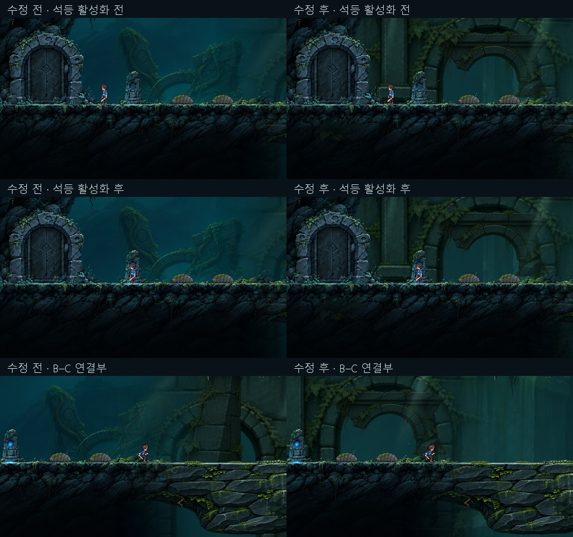

# C파트 석벽 전실 독립 레이어

A·B의 젖은 청회색 석벽, 둥근 이끼, 제한된 균열빛과 약한 황록 반딧불이를 C 전실에 이어 적용했다. 내장 ImageGen 기본 모드로 배경·중경·전경을 각각 새 원화로 만들었다. 기존 봉인문과 재시작 석등, 바닥·천장, 두 공벌레와 B 연결 보행선은 같은 원화·월드 좌표를 사용한다.



## 자산과 거리

| 파일 | 역할 |
| --- | --- |
| `background.png` | 큰 젖은 석벽과 투명한 벽감 개구부. 작은 줄눈 대비를 낮추고 아래와 위로 충분한 석재를 이어 그린다. |
| `midground.png` | 자연스러운 알파 윤곽을 가진 부벽과 끊긴 아치 부조. 벽과 같은 이동량으로 얕은 두께를 만든다. |
| `foreground.png` | 별도로 그린 낮은 잎·뿌리와 매달린 식생. 투명 여백에서 나눈 두 군집으로 문·석등·전투 공간을 비운다. |
| `layout-baseline.json` | 변경 전 C 지형·봉인문·석등·B 연결·공벌레 배치 기록. 현재 값과 비교한다. |

[생성 프롬프트와 참고 판단](generation-prompts.md)을 함께 저장했다. PNG의 원본 알파를 보존하며, A의 [낮은 대비 회랑](../lower-route-a-wall-v1/recess.png)을 벽감 뒤에서 공유한다. 모든 게임 참조 PNG는 이 저장소에 있다.

벽감 속 회랑의 카메라 이동 반영량은 가로 0.42·세로 0.38, 석벽·부조는 가로 0.84·세로 0.93, 가까운 독립 전경은 가로 1.08이다. 문·석등·접촉 그림자·지형은 기존 월드 변환을 사용한다. `lower_route_c_scenery.py`의 상수와 배치로 조정한다.

## 연결과 조명

`LowerCaves.draw_lower_route`에서 B 배경 → C 배경·부조·배경 빛 → B 지형·레일 → C 문·석등·지형 → 적·플레이어 → 독립 전경 순으로 그린다. B의 기존 깊은 C 비석·아치·광막은 새 C 레이어로 교체했다. B 석벽은 연결부 아래에 연속해서 두고, C는 월드 `x=0~690`에서 부드럽게 사라진다. 양쪽 지형 위로 배경을 덮지 않는다.

두 균열빛은 보행면 `y=590`에서 멈추며 같은 위치에 작은 표면 반사광을 둔다. 왼쪽 빛은 약하게, 오른쪽 전투 공간의 빛은 넓게 두었다. 석등의 기존 청색 활성 효과는 그대로 유지한다. 문·석등 밑동에는 접촉 그림자를 두고, 반딧불이는 이끼 주변에 작고 느리게 움직인다.

바닥 앞의 잎은 보행면 아래에, 오른쪽 뿌리는 천장 가까이에 놓았다. 붙어 있는 본체와 그림자를 서로 다른 시차로 움직이지 않는다. 석벽은 일반 점프 카메라와 낮은 B 비밀 통로 카메라까지 여유 있게 덮는다.

## 실행과 확인

```powershell
.\.venv\Scripts\python.exe -B -m tools.preview_lower_route_c_wall --output-dir .cache/c-wall-review
.\.venv\Scripts\python.exe -B -m unittest discover -s tests -p "test_lower_route*.py"
```

C 검수 도구는 실제 `LowerCaves`·`Player`·SDL 렌더를 사용한다. 세 배율, B↔C 실제 왕복, 점프·착지, 석등 지상 도착과 공중 활성 거부, 봉인문 이동 제한, 석등 재시작 입구와 유물 유지에서 565개 화면을 확인했다. 지형·문·석등·연결부·공벌레 기준값이 작업 전과 일치한다.

하단 동선 28개, 유물 8개, 벽 이동 16개 검사로 관련 52개가 통과했다. 새 회귀 검사는 일반 카메라의 열린 벽 영역 누락, B–C 경계의 레이어 소실, 낮은 B 비밀 통로로 새는 C 전경을 검사한다. 기존 지형 스프라이트의 1px 반올림은 허용하되 넓은 레이어 누락은 거부한다.

B 검수 도구도 다시 실행해 기존 지형·레일·장치 기준값과 1,207개 SDL 화면, 세 지점 점프·착지, 두 레일 도착과 비밀방 세 상태를 확인했다. B 출발대·첫 레일 상단·방패병 발판·A–B 접합의 네 대표 화면은 이전 B 적용 결과와 픽셀이 일치한다.

[본편 화면 모음](../../../docs/c-passage-wall-runtime.jpg) · [B–C 왕복](../../../docs/c-passage-wall-connection.webp) · [석등 앞 점프](../../../docs/c-passage-wall-jump.webp)

봉인문 열림과 C→B1 전환은 현재 본편에 없는 기능이다. 기존 닫힌 상태를 유지했다. 검수는 SDL 소프트웨어 렌더와 자동 입력으로 진행했으며, 장시간 전체화면 수동 조작과 기기별 성능은 미측정이다.
