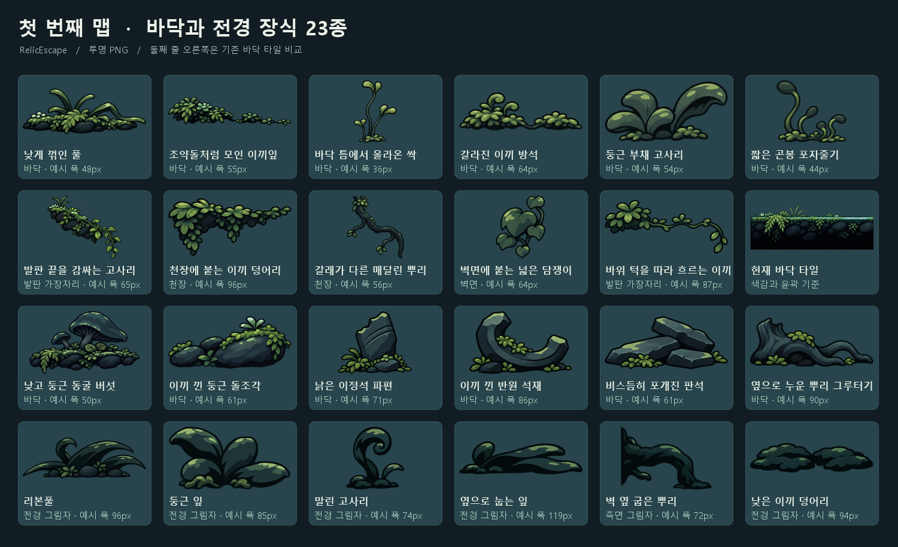

# 맵1 바닥과 전경 장식 23종

실제 이끼 바닥 타일의 검은 윤곽, 청록 그림자, 잎 윗면의 짧은 이끼빛을 기준으로 만든 장식이다. 모양과 높이가 다른 개별 투명 PNG 23종으로 구성했다.

| 용도 | 개별 PNG |
| --- | --- |
| 바닥 식생 6종 | [낮게 꺾인 풀](low-hooked-grass.png) · [조약돌처럼 모인 이끼잎](bead-moss-patch.png) · [바닥 틈에서 올라온 싹](moss-crack-shoots.png) · [갈라진 이끼 방석](split-moss-cushion.png) · [둥근 부채 고사리](round-fan-fern.png) · [짧은 곤봉 포자줄기](low-club-spores.png) |
| 천장·암벽·발판 5종 | [발판 끝을 감싸는 고사리](overhanging-fern.png) · [천장에 붙는 이끼 덩어리](ceiling-moss-drip.png) · [갈래가 다른 매달린 뿌리](crooked-root-drop.png) · [벽면에 붙는 넓은 담쟁이](wall-flat-ivy.png) · [바위 턱을 따라 흐르는 이끼](ledge-moss-cascade.png) |
| 버섯·암석·유적 6종 | [낮고 둥근 동굴 버섯](squat-cave-fungi.png) · [이끼 낀 둥근 돌조각](moss-rock-chips.png) · [낡은 이정석 파편](weathered-marker-fragment.png) · [이끼 낀 반원 석재](mossy-ring-shard.png) · [비스듬히 포개진 판석](split-slate-scrap.png) · [옆으로 누운 뿌리 그루터기](dark-root-stump.png) |
| 앞쪽 그림자 6종 | [리본풀](near-shadow-ribbon-grass.png) · [둥근 잎](near-shadow-rounded-leaves.png) · [말린 고사리](shadow-fern-scroll.png) · [옆으로 눕는 잎](shadow-stoop-leaves.png) · [벽 옆 굽은 뿌리](shadow-wall-root-hook.png) · [낮은 이끼 덩어리](shadow-low-moss-lobes.png) |

초반의 어두운 동굴에는 판석이나 뿌리 조각, 이끼 통로에는 작은 싹과 이끼 덩어리, 하단 유적에는 닳은 석재 조각을 섞을 수 있다. 전경 그림자는 화면 양옆에 낮게 놓고, 크기와 간격이 다른 장식 사이에 빈 구간을 둔다. [전투방 배치 예시](layout-preview.png)

[배치 기준점·예시 크기](placement.json) · [생성 프롬프트·원본 시트](prompts.md)
