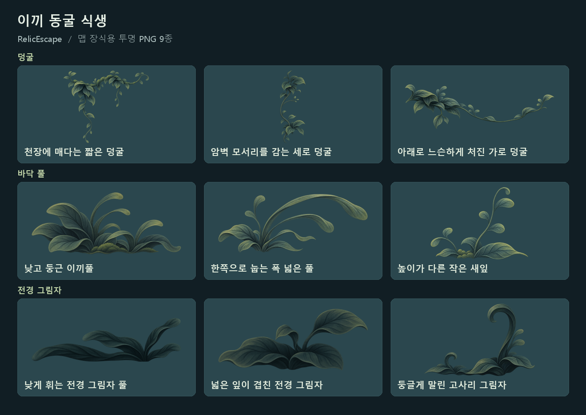

# 이끼 동굴 식생 9종

전투방의 호박빛 열매와 어울리는 청록·이끼색, 완만하게 휘는 줄기와 둥근 잎을 사용했다. 잎의 높이와 간격, 덩어리의 밀도에 차이를 줘 서로 다른 역할의 식생을 같은 맵에 섞을 수 있다.

| 용도 | 개별 투명 PNG |
| --- | --- |
| 덩굴 | [천장에 매다는 짧은 덩굴](vine-ceiling-drape.png) · [암벽을 감는 세로 덩굴](vine-wall-creeper.png) · [아래로 처진 가로 덩굴](vine-loose-swag.png) |
| 바닥과 발판 | [둥근 이끼풀](grass-rounded-tuft.png) · [한쪽으로 눕는 풀](grass-soft-sedge.png) · [높이가 다른 작은 새잎](grass-small-sprigs.png) |
| 화면 양옆 전경 | [낮게 휘는 그림자 풀](shadow-arching-grass.png) · [겹쳐진 넓은 잎](shadow-overlapping-leaves.png) · [말린 고사리](shadow-curled-ferns.png) |

같은 풀 사이에 빈 구간을 두고 넓거나 낮은 잎을 섞으면 윤곽이 반복되는 구간을 줄일 수 있다. 전경 그림자 풀은 화면 양끝에서 낮게 쓰고 중앙 전투면을 비운다. [전투방 배치 예시](layout-preview.png)

[배치 기준점과 가시 영역](placement.json) · [원본 생성 프롬프트와 참고 이미지](prompts.md)
