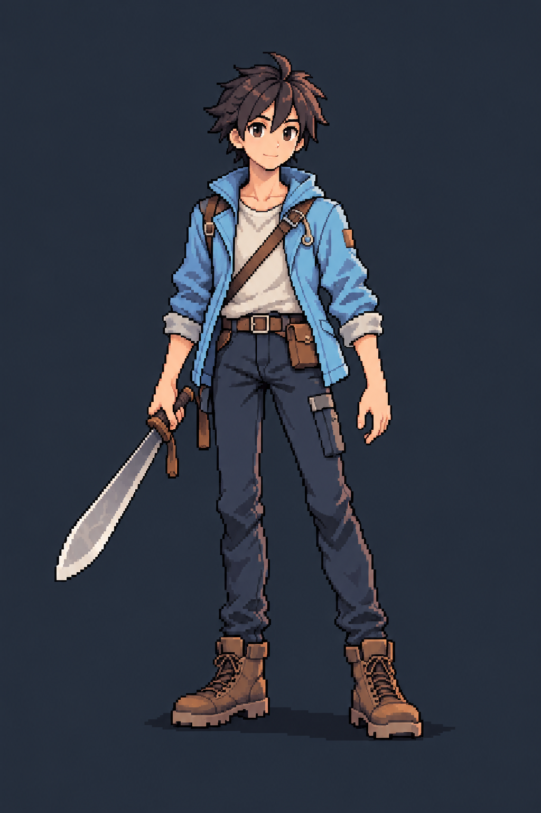
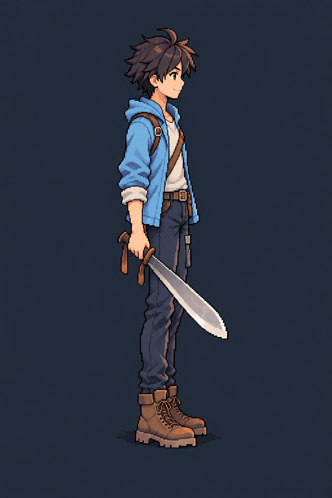
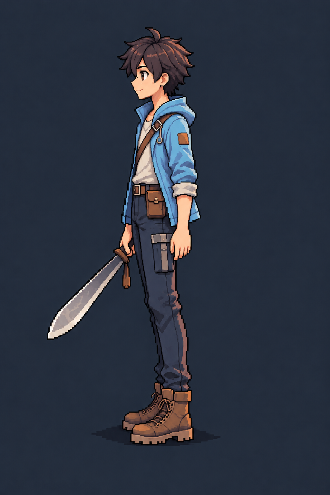
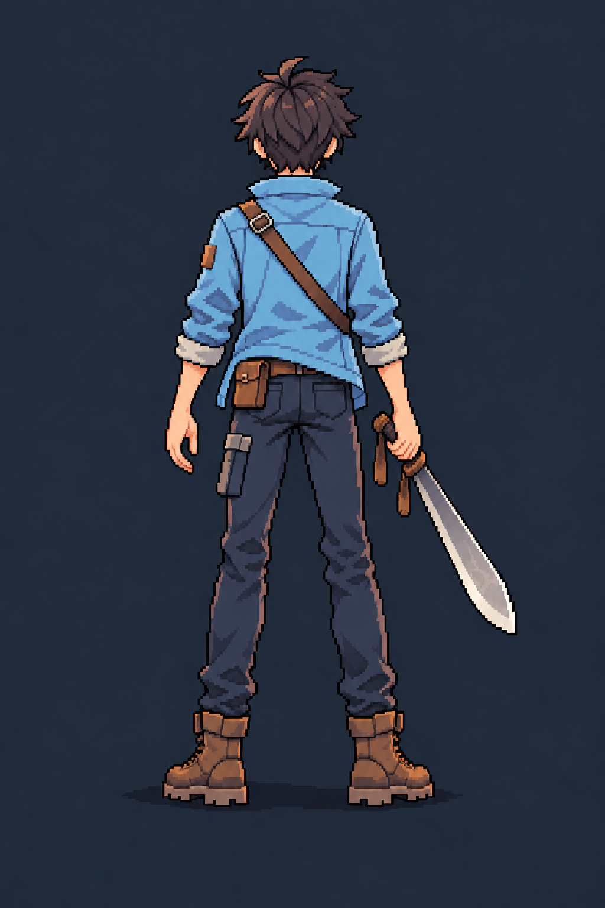

# 주인공 A안 LD 콘셉트

- 작성일: 2026-11-02
- 이미지 버전: v2
- 제작: 내장 이미지 생성 도구
- 용도: 캐릭터 외형과 방향별 복장 확인
- 상태: 사용자가 승인한 LD 캐릭터 콘셉트. 실제 게임용 SD 스프라이트와 구분해 보관한다.

## 이번 수정 방향

처음 만든 비교 이미지의 A안을 체형과 복장의 기준으로 사용했다. 이후 굵은 도트 시안의 커진 머리·짧아진 체형은 채택하지 않고, 처음 A안의 날씬한 비율과 짧은 머리, 하늘색 재킷을 유지한다. 눈매와 입을 부드럽게 조정해 친근한 인상을 주는 방향으로 정리했다.

얼굴과 어깨까지 일관된 픽셀 표현을 목표로 생성했다. 각 이미지는 고해상도 콘셉트 출력이며, 픽셀 격자와 원본 해상도가 검증된 구현용 스프라이트로 간주하지 않는다.

## 방향별 이미지

### 정면

### 오른쪽 측면

### 왼쪽 측면

### 뒷모습

## 유지한 설정

- 16~19세의 탐험과 새로운 발견을 즐기는 주인공.
- 짧은 어두운 머리와 하늘색 탐험 재킷.
- 밝은 안쪽 상의, 짙은 남색 바지, 갈색 부츠와 작은 주머니.
- 오른손의 정글도와 비어 있는 왼손.
- 유물은 주머니 안에 보관되어 휴대 중 외부에 드러나지 않는다.

## 자료

- [처음 A/B/C 비교 이미지](../assets/concepts/character-concepts-v1.png)
- [이번 네 방향 생성 프롬프트](../assets/concepts/character-a-turnaround-v2.prompt.txt)

실제 스프라이트 제작 시 각 방향의 손잡이, 주머니 위치, 어깨끈과 복장 세부를 같은 기준으로 맞추고, 원본 해상도와 기준점을 통일한다.

## 게임용 이미지

이 문서의 LD 이미지는 외형 참고 자료이며, 게임에서 사용할 작은 SD 캐릭터는 [게임용 주인공 스프라이트](PLAYER_SPRITES.md)에 따로 정리한다.
