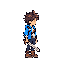
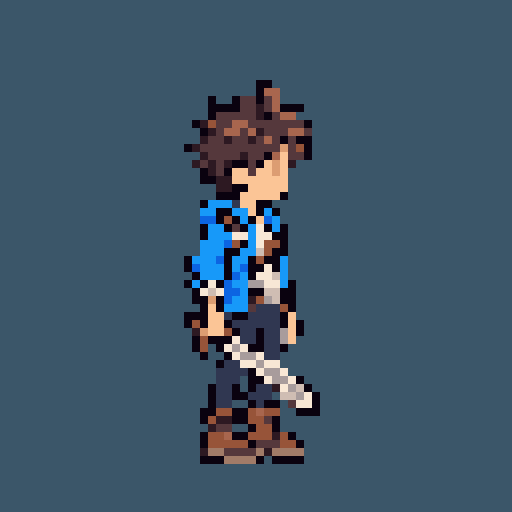

# 게임용 주인공 스프라이트

- 작성일: 2026-11-02
- 이미지 버전: v3
- 상태: 사용자 승인으로 확정한 게임용 기본 이미지, 대기 프레임 1장
- 제작: 내장 이미지 생성 도구로 SD 캐릭터 생성 후 게임용 크기로 내보내기

## LD 콘셉트와 게임용 표현

[승인된 LD 네 방향 이미지](CHARACTER_TURNAROUND.md)는 캐릭터의 외형과 복장을 보여주는 콘셉트 자료로 유지한다. 게임 안에서는 같은 짧은 머리·하늘색 재킷·남색 바지·갈색 부츠·오른손 정글도를 SD 비율로 단순화한다.

SD 방향은 사용자가 제공한 산나비 참고 이미지의 작은 캐릭터 비율과 간결한 얼굴 표현을 따른다. 얼굴은 무표정이며 작은 눈만 남기고 코·입은 그리지 않는다. 유물은 주머니 안에 보관되어 휴대 중 보이지 않는다.

## v2 체형 조정

사용자는 첫 SD 버전이 너무 어린아이처럼 보인다고 판단했다. v2는 그보다 큰 체형의 무표정 시안과 SD v1의 중간을 목표로, 머리 비중을 줄이고 몸통·다리를 늘렸다. 약 3.5등신 내외의 간결한 게임용 비율을 목표로 하며, 16~19세 탐험가의 인상을 유지한다. 얼굴은 눈만 표현하고 코·입은 생략한다. 이 체형을 유지하고 코 돌출을 제거한 v3를 사용자가 게임용 기본 이미지로 확정했다.

## v3 코 돌출 제거

v2의 체형과 복장을 유지하고 옆얼굴의 코가 튀어나온 한 픽셀만 제거했다. 내장 이미지 생성 도구의 국소 수정 결과를 게임용 원본에 반영했으며, v2와 디코딩한 픽셀을 비교해 (36, 22)의 한 픽셀만 투명해지고 나머지는 동일함을 확인했다.

## 게임에서 사용할 파일

[오른쪽을 보는 대기 PNG](../assets/sprites/player/idle-right.png)

| 항목 | 값 |
| --- | --- |
| 파일 크기 | 64 × 64 픽셀 |
| 방향과 동작 | 오른쪽을 보는 기본 대기 자세 |
| 프레임 수 | 1 |
| 배경 | 투명 |
| 불투명 색상 수 | 14색, 투명색을 포함한 최대 16색 팔레트 |
| 알파 | 0 또는 255, 반투명 경계 없음 |
| 불투명 영역 | 왼쪽 23, 위쪽 10부터 오른쪽 39, 아래쪽 57까지 |
| 발 기준점 | 이미지 왼쪽 위 기준 (32, 58) |

좌표와 내보내기 정보는 [프레임 메타데이터](../assets/sprites/player/idle-right.json)에 기록한다. 충돌 영역은 실제 게임 구현 시 별도로 정한다.

## 확대 확인

아래 이미지는 게임용 64×64 파일을 최근접 방식으로 8배 확대한 512×512 미리보기다. 구분을 위해 배경색을 넣었으며 실제 게임용 파일은 투명 배경이다.

## 생성 자료와 검증

- [SD 생성 원본](../assets/concepts/player-sd-idle-right-source-v3.png)
- [생성 프롬프트](../assets/concepts/player-sd-idle-right-v3.prompt.txt)
- 생성 원본에서 불투명 영역을 기준으로 크기를 맞추고, 최근접 축소로 64×64 프레임에 배치했다.
- 팔레트는 최대 16색, 알파는 완전 투명과 완전 불투명으로 정리했다.
- PNG를 다시 읽어 64×64 크기, 투명 배경, 반투명 픽셀 없음과 색상 수를 확인했다.
- 아직 이동·점프·공격 애니메이션이나 실제 게임 구동 검증은 수행하지 않았다.

## 이전 버전 비교

- [SD v1 게임용 PNG](../assets/sprites/player/idle-right-v1.png)
- [SD v1 확대 미리보기](../assets/concepts/player-sd-idle-right-preview-v1.png)
- v1은 큰 머리와 짧은 몸통·다리의 체형 비교 자료로 보관한다.

- [코 수정 전 v2 PNG](../assets/sprites/player/idle-right-v2.png)
- [코 수정 전 v2 미리보기](../assets/concepts/player-sd-idle-right-preview-v2.png)

## 기본 이미지 확정

2026-11-02 사용자 승인으로 v3를 기본 이미지로 확정했다. 고정 경로 idle-right.png는 v3와 바이트 단위로 동일하며, 승인 메타데이터에 원본 버전과 SHA-256을 기록했다. [캐릭터 소개 이미지](../assets/concepts/character-introduction-v1.png)와 [발표 자료](../deliverables/2026-11-03/README.md)를 함께 보관한다.
