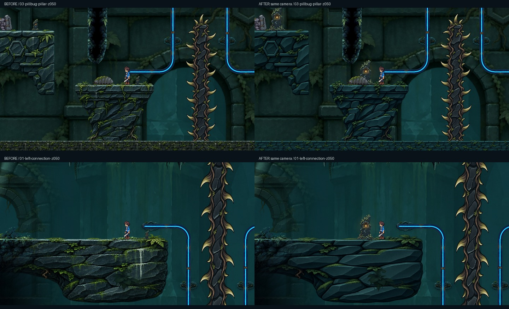
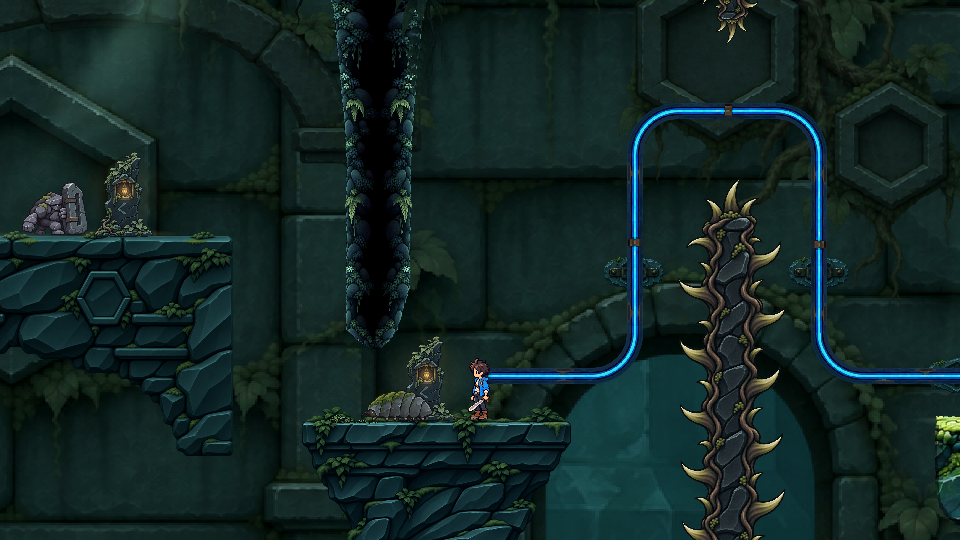
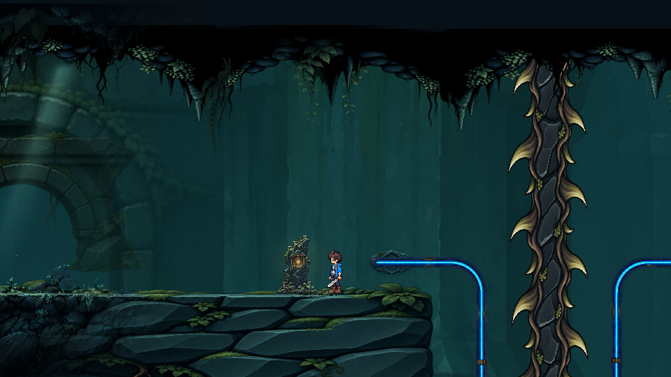

# B 통로 발판·석등과 하단 통로 카메라

2026-11-27. 사용자가 잔랙은 느끼지 않는다고 확인한 뒤, B 발판의 이질적인 표면과 작은 석등, 바닥 아래가 과하게 보이는 구도를 수정했다.

## 변경

기존 B 발판 5종을 개별 투명 이미지로 다시 그렸다. 작은 점각·흰 얼룩·잔금 대신 첫 전투방에 맞는 큰 청록 판석, 어두운 틈과 둥근 이끼 덩어리를 사용한다. 실제 밟는 선, 오른쪽 벽점프 면, 발판 폭·높이와 레일·장치 데이터는 보존했다. 공유 원화는 덮어쓰지 않고 [별도 팩](../assets/terrain/lower-route-b-surfaces-v1/README.md)으로 연결했다. 내장 ImageGen 편집이며 [최종 프롬프트와 출처](../assets/terrain/lower-route-b-surfaces-v1/prompts.json)를 함께 저장했다.

기존 길잡이 석등은 완전한 원화를 유지한 채 높이 66/86에서 190 월드 단위로 키웠다. 플레이어 높이는 140이다. C 접근 바닥 x930, 방패병 발판 x2660, 공벌레 발판 x3330에 두어 레일 입구와 기존 착지·복귀 자리를 비운다. 석등은 기존 안내 장식이며 저장·회복 기능을 추가하지 않았다. 렌즈 좌표에 국소 호박빛, 바닥 상면에 약한 반사광, 밑동에 접촉 그림자를 합성한다. 본체와 모든 빛은 지형과 같은 월드 변환을 사용하고 화면 밖 광원은 생략한다.

A·B·C 통로는 할로우 나이트의 안정적인 보행 구도를 참고해 줌 0.45, 발선은 화면 아래에서 22%로 잡았다. 일반 탐험·전투방의 기본 0.5는 유지한다. 일반 점프는 마지막 지상 구도를 유지하고, 발이 상승 44%·하강 16% 경계를 넘을 때만 세로 추적한다. 큰 높이 변화와 가로 이동은 시간 기반 지수 보간한다. 입장·순간이동·안전 복귀는 즉시 재설정하고 유물 관찰 뒤에는 원래 카메라로 돌아온다. 조절 값은 `route_camera.py`에 모았다.

B 카메라 상단만 1370→1610으로 늘렸다. 물리 천장은 그대로이며, 높아진 시야에서 배경 끝이 드러나는 부분은 실제 천장 위의 불투명 암반으로 채우고 기존 천장 식생을 겹친다. A–B 경계의 보간 카메라가 A 원화 위로 약 6px 올라가는 부분도 같은 천장 내부로 채웠다.

## 비교

아래는 동일한 960×540 렌더 해상도, 카메라 위치·줌, 플레이어 위치, 배경 시간 1.25초에서 미술만 비교한 화면이다. 위는 공벌레 발판, 아래는 C 접근 발판이다. 5구도×3배율의 카메라 기록 15개가 수정 전후 정확히 일치한다.



카메라까지 반영한 현재 보행 구도:





## 실행 검증

- 전체 unittest 229개 통과. 일반 점프의 세로 고정, 큰 상승·긴 낙하, 30/60/120Hz 보간 일관성, 순간이동·유물 시야 복구, 전투방 복귀와 통로 재진입 줌을 포함한다.
- 실제 `LowerCaves` SDL 렌더러에서 동일 카메라 15장과 현재 카메라 5장을 캡처했다. SDL 오류 없음. 지형·레일·위험·장치·연결·안전 위치는 원래 스냅샷과 정확히 일치하며 카메라 상단 변경은 따로 기록한다.
- B 이동 검수 1,207 SDL 화면에서 실제 점프 3곳과 두 레일의 끝 도착, 비밀 통로 상태와 양방향 연결을 확인했다. 추가 광원의 프레임 성능을 측정한 검사는 아니다.
- A 779화면에서 점프3곳·유물 레일 시야, C 565화면에서 점프·B/C 왕복·지상 체크포인트·재입장·닫힌 문 경계를 확인했다. A 연결부 보완은 상단6px 이외의 렌더 픽셀이 그대로임을 재검사했다. C→B1 문 열림은 기존에 미구현인 상태다.
- 이전 전체화면에서 잔랙이 없다는 것은 사용자의 직접 확인이다. 이번 수정 뒤 전체화면 장시간 수동 조작과 프레임 성능을 새로 측정하지는 않았다.

정확한 카메라와 검증 결과는 [수치 기록](b-passage-surfaces-results.json)에 있다. 다음 명령으로 재현한다.

```powershell
.\.venv\Scripts\python.exe -B -m tools.preview_lower_route_b_surfaces --output-dir .cache/b-surfaces-final
.\.venv\Scripts\python.exe -B -m tools.preview_lower_route_b_surfaces --reference-cameras docs/b-passage-surfaces-results.json --output-dir .cache/b-surfaces-same-camera
.\.venv\Scripts\python.exe -B -m tools.preview_lower_route_b_wall --output-dir .cache/b-surfaces-motion
.\.venv\Scripts\python.exe -B -m unittest discover -s tests
```

`--reference-cameras`는 `views` 배열을 가진 캡처 보고서 또는 위 합본 수치 기록의 `before` 항목을 받는다. 일반 실행은 현재 0.45 보행 구도 5장을 저장한다.
