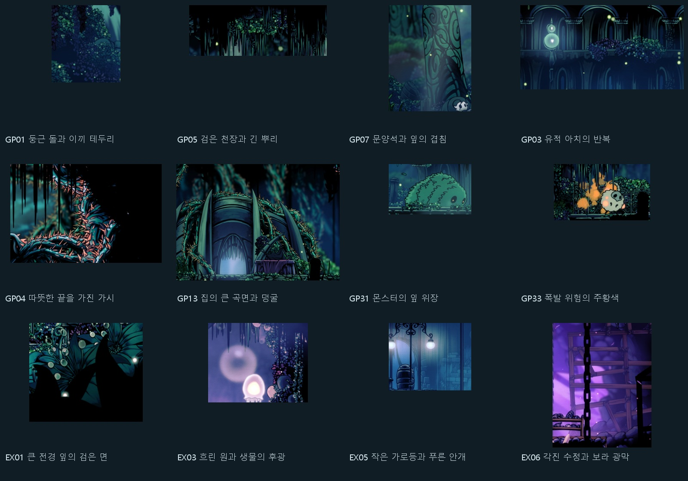

# 녹색 거리 미술과 공간 구성 분석

녹색 거리 39장과 다른 지역 6장을 조사해 RelicEscape의 이끼 통로·전투방·하강 통로에 적용할 수 있는 표현을 정리했다. 녹색 거리의 인상은 녹색 텍스처의 양보다 **검은 지형 내부, 작은 돌과 잎으로 강조한 경계, 푸른 원경, 이동 공간의 여백, 제한된 밝은 지점**에서 나온다. 기존 프로젝트 미술 방향과도 일치한다.

이미지는 [오프라인 갤러리](references/hollow-knight-greenpath/index.html)와 [이미지별 분석 목록](references/hollow-knight-greenpath/README.md)에서 볼 수 있다. 화면 앞쪽 그림자·배경층·조명은 [레이어와 조명 상세 분석](hollow-knight-layer-lighting-study.md)에 따로 정리했다.

## 자료 범위와 읽는 방법

| 자료 | 수량 | 내용 |
| --- | ---: | --- |
| GP01–GP18 | 18 | 녹색 거리의 휴식 공간, 유적, 가시 통로, 전투면, 수직 공간, 지역 경계 |
| GP19–GP21 | 3 | Team Cherry 공식 개발 중 이미지. 출시판과 구별해 표시 |
| GP22–GP30 | 9 | 이동·덩굴 타격·발판·가시·구출 보상의 연속 플레이 장면 |
| GP31–GP39 | 9 | 이끼 돌진충, 이끼족, 폭발하는 이끼족, 이끼 기사, 식물형 적, 오블, 모기, 두란다 |
| EX01–EX06 | 6 | 여왕의 정원 2장, 안개 협곡, 버섯 황무지, 눈물의 도시, 수정 봉우리 |
| 합계 | **45** | 주석 이미지 8장·확대 자료·연락표는 별도이며 수량에서 제외 |

45장 모두 이미지 파일을 열어 확인했다. 파일 SHA-256 중복은 없다. 같은 구역의 다른 시점이나 공략 연속 장면이 있으므로 45개 방을 조사했다는 의미는 아니다. Wiki 이미지는 800px 미리보기, 공식·공략 이미지는 제공 해상도로 보관했다. 모든 자료에 출처 페이지·이미지 URL·접근일·크기·해시가 있다. [메타데이터](references/hollow-knight-greenpath/sources.json) · [구조화 분석](references/hollow-knight-greenpath/analysis.json) · [CSV](references/hollow-knight-greenpath/catalog.csv).

이 문서에서 **관찰**은 스크린샷에서 읽히는 특징이며, **적용안**은 RelicEscape에 대한 제안이다. 맵 연결·적 행동처럼 정지 이미지 밖의 정보는 별도의 출처를 붙였다. 레이어 구분은 시각적 해석이며 실제 엔진의 레이어 수·시차 수치·광원 계산을 역설계한 결과가 아니다.

## 스타일을 만드는 큰 규칙

### 검은 덩어리와 밝은 테두리

GP02·GP06·GP18·GP23에서는 지형 내부가 거의 검고, 통행면과 바깥 테두리에만 이끼·돌·뿌리가 보인다. 검은 면이 큰 덩어리를 맡기 때문에 작은 잎이 많아도 화면 구조가 무너지지 않는다. 바닥 전체를 밝은 돌 텍스처로 채우면 이 위계가 사라진다.

RelicEscape는 현재의 검은 바닥 속과 표면 암전을 유지한다. 지면 기둥·발판·벽의 테두리가 지형의 위치를 설명하도록 하고, 덩굴은 접합부를 부드럽게 만드는 데 사용한다. 장식의 요철과 실제 충돌 상면은 구별한다.

### 둥근 자연과 규칙적인 유적

자연물은 작은 둥근 돌, 잎 뭉치, 굽은 줄기, 길이가 다른 뿌리가 반복된다. 유적에는 아치, 가는 기둥, 난간, 문양석처럼 규칙적인 큰 구조가 남아 있다. 둘이 같은 밀도로 뒤섞이지 않고, 유적의 큰 실루엣 위에 식생이 부분적으로 침식한다. GP03·GP07·GP09·GP13이 비교하기 좋다.

유물 장착기·레일·발사 장치는 규칙적이고 읽기 쉬운 인공 형태를 유지한다. 주변 돌에만 식생을 붙이고 작동부·장착 홈·이동 궤적은 드러낸다. 할로우 나이트의 소용돌이 비석이나 난간 무늬를 그대로 옮기는 대신 프로젝트의 문양 언어를 쓴다.

### 차가운 공간과 작은 강조색

GP01·GP05·GP17은 어두운 남색과 청록색 공간 위에 작은 연녹색 포자와 흰 광점이 놓인다. GP33·GP37의 주황 위험 신호는 이 차가운 바탕에서 강하게 구별된다. EX06의 보라색은 지역 고유 재질과 결합하므로 이끼 구간 전체에 추가할 색으로 해석하지 않는다.

프로젝트에서는 유물의 청색을 기능색으로 유지하고, 경고는 자세·윤곽과 함께 따뜻한 색을 쓰는 방향을 검토한다. 포자·배경 광점은 유물의 밝기와 선명도에 도달하지 않게 한다. 아래 색은 원작의 추출 팔레트가 아니라 제작을 시작할 때 사용할 **제안색**이다.

| 역할 | 제안색 | 사용 위치 |
| --- | --- | --- |
| 지형 내부 | `#03080B` | 바닥·벽의 검은 속 |
| 가까운 돌과 뿌리 | `#112831` | 어두운 표면과 근접 전경 |
| 먼 동굴 | `#163B52` | 큰 줄기와 먼 구조 |
| 대기광 | `#31717B` | 빈 공간과 안개 |
| 이끼의 중간색 | `#477866` | 표면의 일부 잎 |
| 밝은 잎 | `#A4B97B` | 상면의 짧은 강조 |
| 유물 기능빛 | `#8DDEFF` | 장착점·순간이동 목적지 |
| 적 경고 | `#EEAA69` | 공격 준비 신호. 범위·지속은 별도 검증 |

## 텍스처를 제작할 때 구분할 요소

| 재질 | 이미지에서 보이는 방식 | 제작 적용안 | 참고 |
| --- | --- | --- | --- |
| 둥근 돌 | 큰 덩어리 사이 작은 돌, 바깥으로만 약한 하이라이트 | 코어는 검게 두고 테두리용 돌을 크기별로 만든다 | GP01, GP06 |
| 이끼와 잎 | 점 같은 작은 잎과 큰 잎 뭉치가 군집을 이룸 | 균일한 노이즈를 뿌리지 않고 빈 곳과 뭉친 곳을 나눈다 | GP05, GP12 |
| 천장 뿌리 | 검은 덩어리에서 길이가 다른 가는 선이 내려옴 | 긴 뿌리·짧은 수염·빈 틈을 섞고 반복 주기를 감춘다 | GP05, GP10 |
| 발판 하부 | 상면은 짧고 명료하며 하부는 불규칙하게 늘어짐 | 표면·검은 몸체·뿌리의 세 범위를 따로 설계한다 | GP17, GP26 |
| 가시 | 끝이 밝고 따뜻한 뾰족한 외곽 | 식생보다 선명하고 다른 형태를 유지한다 | GP04, GP08 |
| 유적 석재 | 큰 곡면·기둥·아치와 단순하고 굵은 문양 | 문양 하나의 크기를 확보하고 잎은 일부에만 얹는다 | GP03, GP07 |
| 근접 잎 | 넓은 거의 검은 면과 가는 줄기 | 작은 디테일을 줄이고 큰 실루엣으로 화면을 감싼다 | EX01, EX04 |
| 배경 식물 | 낮은 대비의 큰 줄기·덩어리 | 앞 지형보다 부드럽고 단순하게 만든다 | GP17, EX05 |
| 빛과 안개 | 선명한 작은 중심과 넓고 부드러운 번짐 | 원본 재질에 밝기를 전부 굽지 말고 효과층을 분리한다 | GP01, GP15, EX03 |

현재 벽의 확대 표시, 승인된 발판, 검은 속, 기존 캐릭터 원본은 유지한다. 새 자산이 필요할 때도 기존 해상도를 고정 규격으로 가정하지 말고 실제 화면에서 읽히는 크기를 기준으로 정한다.

## 맵과 지형지물 배치

### 방마다 이동 목적을 하나씩 선명하게 만든다

| 방의 역할 | 읽히는 구성 | RelicEscape 적용안 | 참고 |
| --- | --- | --- | --- |
| 지역 진입 | 이전 지역 형태와 다음 지역 식생이 겹침 | 기존 착지방에서 옆 이끼 통로로 넘어갈 때만 새 재질을 집중시킨다 | GP11, GP18 |
| 탐색 통로 | 평평한 진행선 옆에 높은 작은 목표 | 주 경로를 먼저 보이고 유물로 접근할 샛길을 옆에 둔다 | GP22, GP25 |
| 전투방 | 넓은 보행면, 낮은 장애물 밀도, 둘레의 장식 | 현재 중앙 등장과 적 4마리 구성을 보존하고 중앙 시야를 비운다 | GP05, GP07, GP34 |
| 수직 이동 | 높이가 다른 짧은 발판과 큰 세로 배경 | 다음 착지면·유물 목적지·벽점프 벽을 같은 시야에서 구별한다 | GP17, GP22 |
| 위험 구간 | 안전면과 위험면의 다른 외곽·명암 | 순간이동 목적지는 실제 안전한 폭을 읽히게 한다 | GP04, GP28, GP29 |
| 휴식 포켓 | 작은 기능점, 주변 암전, 넓은 빈 공간 | 전투 뒤 긴장 완화 지점을 좁은 빛과 고유 표식으로 만든다 | GP01, GP10, GP15 |
| 보상방 | 보상이 먼저 보이고 접근로가 단계적으로 이어짐 | 유물 경로를 발견하는 보상과 귀환 경로를 함께 설계한다 | GP25, GP30 |

지역 전체의 실제 연결은 [Greenpath 지역 자료](https://hollowknight.wiki/w/Greenpath)에 별도로 정리되어 있다. 위 표는 개별 화면의 공간 문법을 프로젝트에 번역한 것이며, 스크린샷만으로 원작 전체 맵의 길이나 난도를 추정한 것은 아니다.

### 큰 형태부터 배치하고 작은 식생을 얹는다

1. 이동 경로·충돌면·낙하 위험을 단색으로 만든다.
2. 방에서 기억할 큰 형태를 하나 정한다. 비석·문틀·거대한 파편·폭포 중 하나면 충분하다.
3. 목표 뒤에 단순하고 낮은 대비의 배경을 둔다.
4. 화면 상단·양옆에는 어두운 큰 뿌리와 잎을 배치한다.
5. 모서리·접합부·휴식점에만 작은 이끼·돌·포자를 집중시킨다.
6. 밝은 지점을 목표·안전면·기능 장치와 맞춘다.

모든 곳을 같은 촘촘함으로 채우면 지형·적·장치가 서로 경쟁한다. GP05의 중앙 전투면, GP15의 벤치 앞, GP17의 공중 빈 공간이 밀도를 낮추는 기준이다.

### 유물 이동에 맞게 바꿀 부분

원작의 대시·하향 공격 경로를 그대로 복제하기보다, RelicEscape의 **유물 설치 → 장치 이동 → 원하는 순간 순간이동 → 귀환 판단**에 맞춰 경로를 만든다.

- 출발점에서는 도착점이나 유물이 이동할 방향을 먼저 보여 준다.
- 레일 장치의 선은 장식 덩굴보다 규칙적이고 선명하게 그린다.
- 유물의 도착점 주변에는 넓은 잎 전경·짙은 안개·동색의 밝은 포자를 피한다.
- 도착점과 귀환 문양이 동시에 존재하면 현재 목적지와 귀환점의 형태를 다르게 만든다.
- 카메라가 아래를 보여 주기 전에는 낙하 목적지를 숨겨 난도를 올리지 않는다. 현재 전투방의 접근 조명은 별도 연출로 유지한다.

## 몬스터의 형태와 공간 역할

환경과 같은 잎·이끼 재질을 공유하면서도 **몸체 크기, 공격 방향을 가리키는 외곽, 눈·입 같은 밝은 부분**으로 구분하는 방식이 핵심이다. 색만 바꾸는 방식보다 역할이 잘 읽힌다.

| 참고 적 | 형태의 관찰 | 행동과 공간 역할 | 프로젝트에 가져올 원리 |
| --- | --- | --- | --- |
| 이끼 돌진충 GP31 | 가로로 긴 잎 덩어리와 작은 얼굴 | 잎 위장 후 돌진, 피격하면 내부 작은 벌레가 드러남 | 공벌레의 등갑 재질은 환경과 맞추고 방향·얼굴은 남긴다 |
| 이끼족 GP32 | 작고 밝은 몸체와 잎 같은 외곽 | 기본 근접 위협 | 현재 약한 공벌레를 한눈에 분류할 밝은 부분을 둔다 |
| 폭발하는 이끼족 GP33 | 둥근 돌기와 주황색 구름 | 흔들림 후 폭발, 사후에도 폭발 | 공격 준비와 종료 후 위험을 다른 상태로 읽히게 하는 참고 |
| 이끼 기사 GP34 | 둥근 방패와 가로로 긴 무기 | 방어와 근접 공격을 함께 사용 | 골렘의 공격 팔·투사체 발사 방향을 큰 자세로 보여 준다 |
| 식물형 고정 적 GP35 | 잎과 같은 모양의 몸체, 작은 입 | 경로의 다른 높이에 압력을 줄 수 있는 형태 | 현재 적을 바꾸는 대신 향후 벽부착 적의 배치 참고로 둔다 |
| 바보잡이풀 GP36 | 잎 속에 숨는 큰 이빨 | 접근 시 예비 동작 뒤 닫히는 함정형 적 | 첫 등장에는 단서를 주고 순간이동 착지점을 바로 공격하지 않는다 |
| 오블 GP37 | 둥근 몸과 둥근 발사체 | 공중에서 네 방향 대각선 탄환 | 골렘 탄환 주변의 배경과 포자 밀도를 낮추는 참고 |
| 모기 GP38 | 가늘고 긴 침과 작은 날개 | 예비 동작 후 직선 돌진 | 적 추가 시 공격 방향과 회피 공간을 함께 설계한다 |
| 두란다 GP39 | 단단하고 가시 있는 껍질 | 가시 통로와 결합해 공중 위험을 형성 | 고급 이동 구간의 위험 조합 참고로만 둔다 |

행동 참고: [이끼 돌진충](https://hollowknight.wiki/w/Moss_Charger), [폭발하는 이끼족](https://hollowknight.wiki/w/Volatile_Mosskin), [이끼 기사](https://hollowknight.wiki/w/Moss_Knight), [바보잡이풀](https://hollowknight.wiki/w/Fool_Eater), [오블](https://hollowknight.wiki/w/Obble), [모기](https://hollowknight.wiki/w/Squit). 표의 프로젝트 적용은 신규 몬스터 구현이나 기존 전투 변경을 확정한 결정이 아니다.

## 다른 지역에서 보완할 표현

| 지역 | 가져올 표현 | 적용할 위치 | 주의할 차이 |
| --- | --- | --- | --- |
| 여왕의 정원 EX01–02 | 큰 근접 잎과 규칙적 인공 구조의 겹침 | 장치 방의 화면 가장자리·레일 주변 | 녹색 거리보다 화려한 장식 밀도를 그대로 옮기지 않는다 |
| 안개 협곡 EX03 | 발광 중심·후광·흐린 큰 입자의 다른 깊이 | 유물의 국소빛과 제한된 근접 입자 | 화면 전체를 흐리게 하지 않는다 |
| 버섯 황무지 EX04 | 하단 검은 실루엣과 중앙 여백 | 아래쪽 전경 식생 | 플레이어 발과 실제 착지선을 비운다 |
| 눈물의 도시 EX05 | 뒤로 갈수록 대비가 낮아지는 유적 | 큰 인공 장치실의 원경 | 얇은 난간을 밟는 지형처럼 보이게 하지 않는다 |
| 수정 봉우리 EX06 | 넓은 지역광과 작은 등불의 크기 차이 | 미래 지역 전이의 팔레트 설계 | 현재 이끼 구간의 색 정체성을 유지한다 |

## 현재 프로젝트와의 차이 및 우선 적용안

현재 [이끼 통로](green-style-gallery.png)와 [전투방](green-style-combat.png)은 푸른 원경·검은 지형 속·얇은 이끼 테두리라는 큰 방향이 이미 맞다. 참고 장면에 비해 배경이 넓고 비교적 균일하게 밝고, 가까운 천장 장식은 반복 패턴이 읽히기 쉽다. 이는 확인한 저장 화면 기준의 관찰이며 최신 실행 화면의 전 구간 검증을 뜻하지 않는다.

| 순서 | 제안 작업 | 구체적 결과 | 확인할 기준 |
| --- | --- | --- | --- |
| 1 | 전경과 배경의 명암 분리 | 가장자리의 큰 어두운 잎, 목표 뒤의 낮은 대비 | 발·발판·적의 실루엣·유물 위치가 모두 읽힘 |
| 2 | 조명의 집중점 만들기 | 넓은 희미한 빛 1개와 작은 기능광 1개부터 시도 | 전체 화면을 밝히지 않고 목적지가 먼저 보임 |
| 3 | 천장 장식 반복 완화 | 긴 뿌리·짧은 뿌리·빈 틈의 다른 조합 | 같은 윤곽이 화면 폭마다 반복되지 않음 |
| 4 | 접합부 재질 통일 | 기둥 밑동·발판 끝·벽 연결에 같은 돌과 이끼 | 상면이 실제 충돌 높이와 다르게 보이지 않음 |
| 5 | 방별 큰 랜드마크 추가 검토 | 고유 문양석·큰 파편·뒤쪽 구조물 중 하나 | 전투 궤적과 도착점 뒤의 시야를 가리지 않음 |

후속 자산을 만들 경우 `near-foliage`, `midground-ruin`, `light-shaft`, `local-glow`, `fog-band`를 분리해 제작하는 편이 배치와 밝기 조정에 유리하다. 구체적인 레이어 순서와 수치의 시작점은 [레이어와 조명 문서](hollow-knight-layer-lighting-study.md)에 있다.

이번 작업은 자료 수집과 분석이다. 기존 시작 동굴·최초 착지방 유지, 승인된 벽·발판, 방 배치·충돌·등장·덮개 두께112·접근 조명 규칙은 [현재 미술 방향](environment-art-direction.md)을 따른다. 별도의 구현 변경은 하지 않았다.

## 주요 원문과 출처

- [Team Cherry 녹색 거리 공식 소개](https://www.teamcherry.com.au/blog/the-green-path-a-hollow-knight-tour): 개발 중 이미지 GP19–GP21과 산성 호수·식생·주변 생명체·조명에 관한 제작사 설명.
- [Team Cherry 개발 전후 비교](https://www.teamcherry.com.au/blog/hollow-knight-then-and-now): 배경과 전경 풍경의 추가로 녹색 거리가 풍부해졌다는 제작사 설명. 이번 45장 이미지 수에는 비교 글의 사진을 별도 추가하지 않았다.
- [Hollow Knight Wiki 녹색 거리](https://hollowknight.wiki/w/Greenpath): 지역·인접 구역·주요 공간과 적 목록. 개별 파일 출처는 자료집에 연결.
- [Monster Soluce 녹색 거리 이미지 자료](https://www.monster-soluce.com/jeux/hollow-knight/guide-solution/vertchemin-guide-exploration-et-secrets-boss-personnages): GP22–GP30의 플레이 스크린샷 출처. 설명문을 게임 규칙의 유일한 근거로 사용하지 않았다.

참고 이미지는 분석용 보관 자료다. 제작 시에는 배치 원리·명암·재질의 위계를 활용해 프로젝트 고유 자산을 만든다.
