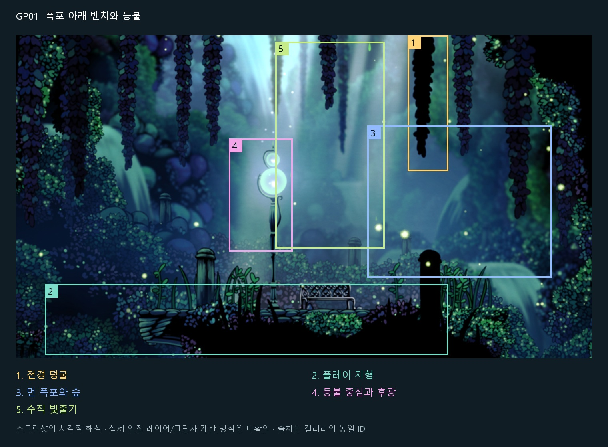
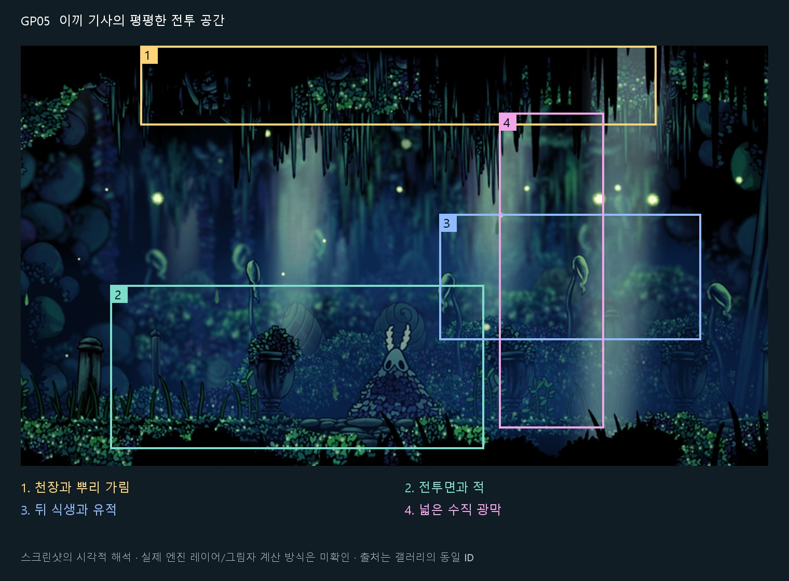
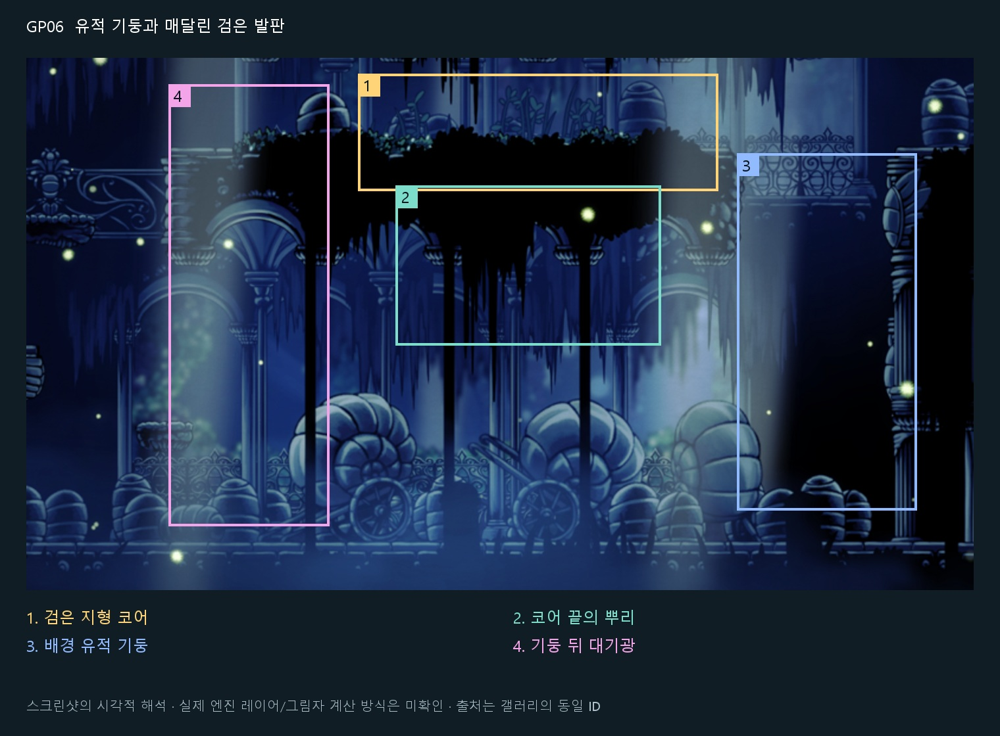
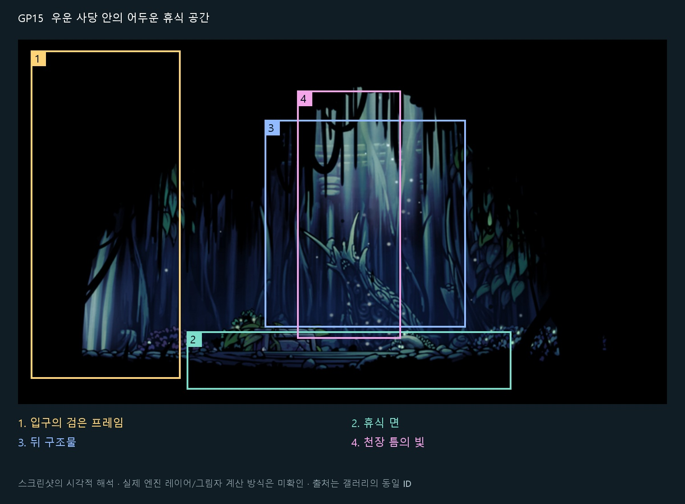
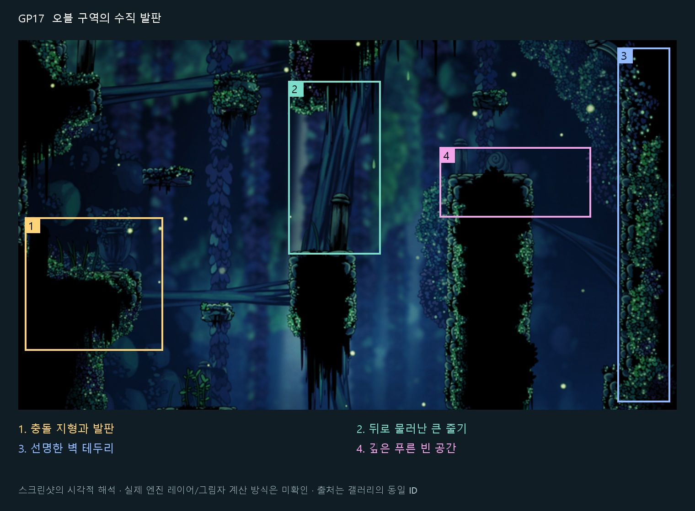
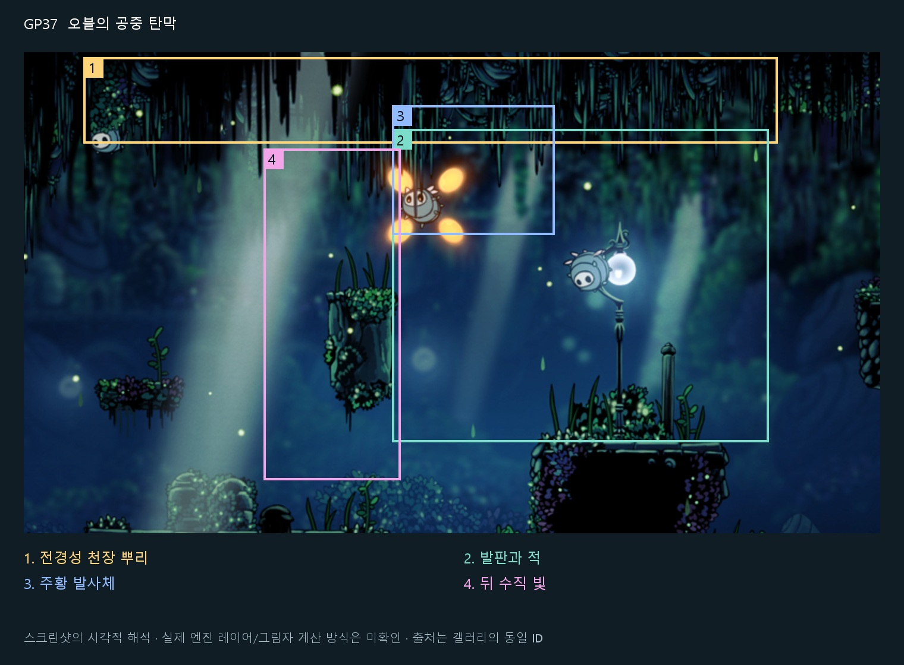
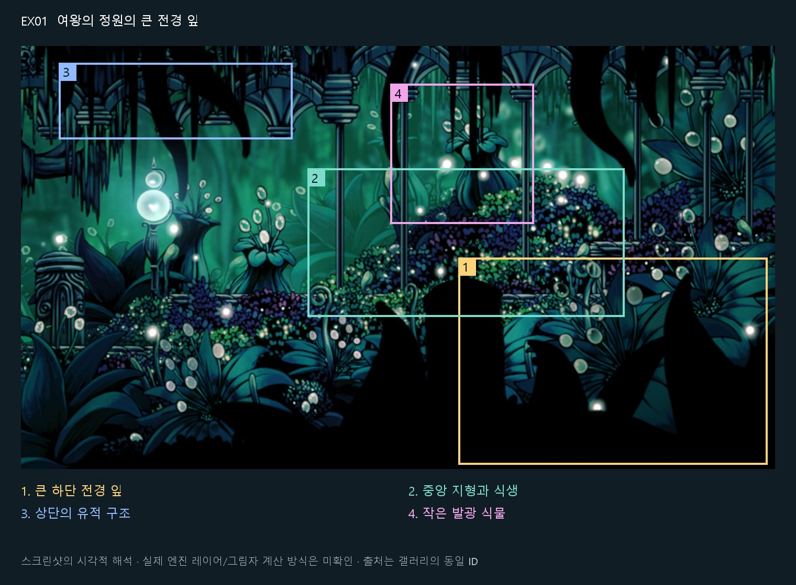
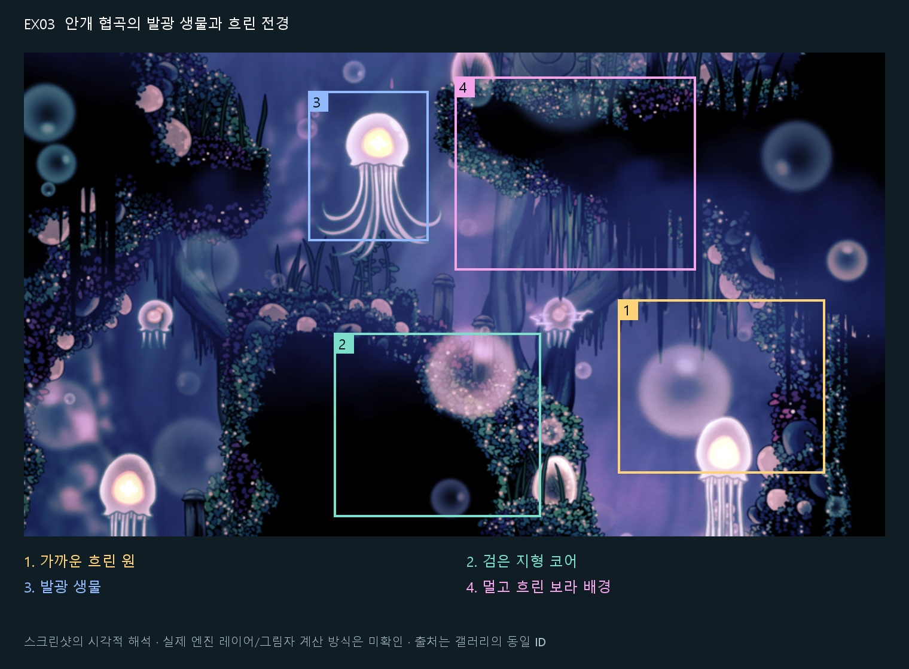

# 녹색 거리 전경 배경과 조명 분석

화면 앞쪽의 검은 잎과 뿌리, 검게 가린 지형 내부, 푸른 배경, 빛줄기와 안개를 구분해 RelicEscape의 제작 단위로 정리한다. **전경 가림물·지형 내부 암전·화면 가장자리 암전은 서로 다른 역할**을 맡는다. 이 셋을 하나의 검은 덧칠로 처리하면 이동 경계와 깊이가 함께 사라진다.

[이미지 갤러리](references/hollow-knight-greenpath/index.html) · [45장 전체 분석](references/hollow-knight-greenpath/README.md) · [맵 텍스처 몬스터 종합 분석](hollow-knight-greenpath-study.md)

## 화면에서 추정할 수 있는 범위

여기서 전경·중경·원경은 스크린샷의 겹침, 크기, 선명도와 명암을 바탕으로 구분한 **시각적 깊이**다. 박스 주석은 위치를 가리키며 실제 엔진 레이어를 분리한 마스크가 아니다. 한 장의 이미지로 원작의 시차 속도·광원 블렌드 모드·실시간 그림자·동적 빛 가림을 확정하지 않는다. 아래 구현 순서와 수치는 RelicEscape용 제안이다.

Team Cherry는 [개발 전후 비교 글](https://www.teamcherry.com.au/blog/hollow-knight-then-and-now)에서 녹색 거리의 배경·전경 풍경을 더 풍부하게 추가했다고 설명했다. [녹색 거리 소개 글](https://www.teamcherry.com.au/blog/the-green-path-a-hollow-knight-tour)은 주변 생명체·바람·조명 등의 보완을 소개한다. 구체적인 레이어 분리는 이번 이미지의 시각적 분석이다.

## 뒤에서 앞으로 나눈 제작 단위

| 깊이 또는 효과 | 화면에서 보이는 특징 | 역할 | 충돌과의 관계 | 대표 이미지 |
| --- | --- | --- | --- | --- |
| 가장 먼 색과 안개 | 넓고 부드러운 청록·남색 면 | 동굴 전체의 깊이와 기본 정서 | 배경 장식 | GP01, GP17 |
| 먼 숲과 유적 | 큰 줄기·기둥·폭포, 낮은 대비와 적은 디테일 | 실제 방보다 큰 세계를 암시 | 배경 장식 | GP06, EX05 |
| 중경 식물과 구조 | 앞 지형보다 흐리고 원경보다 선명한 덩어리 | 구역의 재질과 장소성을 만듦 | 플레이면처럼 읽히지 않게 처리 | GP07, EX02 |
| 플레이 지형 | 검은 속과 선명한 돌·이끼 테두리 | 서거나 매달리거나 피할 경계 표시 | 프로젝트에서는 실제 충돌면과 정렬 | GP02, GP28 |
| 지형 부착 장식 | 상면의 풀, 끝의 덩굴, 벽의 잎 | 직선과 접합부를 부드럽게 함 | 장식 요철 자체는 충돌 근거가 아님 | GP23, GP26 |
| 캐릭터와 상호작용 | 밝고 선명한 작은 형태 | 시선과 행동의 중심 | 현재 충돌 규칙 사용 | GP24, GP31 |
| 가까운 전경 | 큰 검은 잎·뿌리·난간, 화면 바깥까지 이어짐 | 화면을 감싸고 거리감을 만듦 | 장식 가림과 실제 벽을 구별 | GP10, EX01, EX04 |
| 근접 입자 | 크고 흐린 원, 작은 선명한 포자와 다른 크기 | 카메라 가까운 공간을 암시 | 별도 효과 | EX03 |
| 광막과 화면 암전 | 경계가 흐린 빛·어두운 가장자리 | 주목점과 명암 정리 | 지형의 모양과 별도 제어 | GP15, EX03 |

## 검게 보이는 부분을 네 가지로 나누기

### 지형 내부의 검은 면

GP06의 위쪽 발판, GP18의 중앙 상부, GP23의 통로 속은 검은 덩어리다. 밝은 가장자리가 경계를 설명하고 속은 세부 묘사를 생략한다. 빛을 가려 생긴 투사 그림자라고 확정할 근거는 없다.

RelicEscape의 바닥·천장·벽은 기존 검은 코어를 유지한다. 장식에 투명 틈이 있더라도 속이 비쳐 밝은 배경이 새지 않게 한다. 검은 내부 때문에 발판이 끊겨 보이지 않도록 상면의 돌·이끼 띠는 이어져야 한다.

### 가까운 잎과 뿌리의 실루엣

EX01의 아래 큰 잎과 EX04의 아래 검은 버섯은 재질을 설명하는 작은 음영보다 **앞에서 화면을 가리는 별도 물체**로 읽힌다. GP10·GP15에서는 위·양옆의 긴 검은 형태가 안쪽 밝은 공간을 액자처럼 감싼다.

전경 자산은 잎 면·줄기·빈 공간이 한 덩어리로 읽히게 만든다. 검정에 가까운 색을 쓰되 모든 가장자리를 같은 직선으로 자르지 않는다. 한 장면의 중앙·바닥·상단을 모두 가리면 답답해지므로 가장자리 중 일부에 집중한다.

### 틈과 접합부의 어두운 부분

돌끼리 맞닿는 틈, 이끼 밑, 기둥 아래가 어두워 재질의 깊이를 만든다. GP01의 둥근 돌과 GP13의 집 표면이 예다. 이것은 이미지에 그려 넣은 재질 음영일 수도 있으며 실시간 접촉 그림자로 확정하지 않는다.

기둥의 밑동을 바닥보다 먼저 그려 겹치고, 얇은 어두운 틈으로 땅에 묻힌 느낌을 준다. 검은 타원 하나를 캐릭터 발밑이나 기둥 옆에 무조건 추가하면 배경 지형과 따로 노는 반점이 될 수 있다.

### 화면 가장자리의 암전

GP10·GP15는 어두운 가장자리와 중앙의 열린 빛을 함께 사용한다. 보이는 암전에는 실제 검은 지형·전경 가림도 섞여 있으므로 원형 비네트 하나의 결과라고 단정하지 않는다.

구현에서는 장식 실루엣과 화면 암전을 따로 조절한다. 전자는 공간 안의 물체이며 카메라 이동 시 위치 관계를 유지해야 하고, 후자는 화면 전체의 시선을 정리하는 후처리다. UI는 읽기 쉬운 상태로 마지막에 그린다.

## 주석으로 보는 대표 장면

### GP01 폭포와 등불

1. 위에서 늘어진 어두운 덩굴이 가까운 프레임을 만든다.
2. 낮은 검은 지형과 밝은 이끼 테두리가 실제 서 있을 면을 읽히게 한다.
3. 오른쪽 폭포와 숲은 더 부드럽고 멀게 보인다.
4. 등불은 작은 흰 중심과 약한 주변 번짐을 갖는다.
5. 위에서 내려오는 넓은 광막은 등불과 다른 크기의 조명 요소다.

### GP05 전투 공간의 빛과 여백

전투는 낮은 수평면에 모이고, 큰 천장 장식과 세로 빛은 그 주변에서 공간을 만든다. 시선을 빼앗는 가는 잎과 작은 점을 공격 궤적 뒤에 과밀하게 두지 않는 기준으로 사용한다.

### GP06 검은 발판 속과 먼 유적

중앙의 검은 면은 지형의 속이며 뒤 기둥의 푸른 음영과 다르다. 속을 밝게 묘사하는 대신 가장자리의 짧은 식생과 아래 뿌리가 발판의 두께를 설명한다.

### GP15 어두운 입구와 좁은 빛

입구의 큰 검은 형태가 안쪽의 조용한 공간을 감싼다. 벤치를 드러내는 빛은 방 전체를 밝히지 않는다. 하강 이후의 작은 휴식 공간에 가져올 수 있는 구조다.

### GP17 수직 공간과 배경 줄기

세로로 긴 뒤 줄기와 조그만 앞 발판의 크기 차가 깊이를 만든다. 배경 줄기를 선명하게 그리거나 발판처럼 똑바른 상면을 만들면 실제 이동 경계로 오해하기 쉽다.

### GP37 공격 신호와 뒤의 빛

탄환은 작지만 선명하고 따뜻하며, 뒤의 큰 광막은 부드럽다. 현재 골렘 투사체 주변에도 이 크기·색·선명도 차를 적용한다.

### EX01 가까운 큰 잎

하단 큰 잎은 작은 이끼 텍스처와 다른 제작 단위다. 가까운 전경을 작은 잎 여러 장만으로 채우는 대신 큰 면을 가진 실루엣을 일부 배치하는 참고다.

### EX03 가까운 흐린 원과 발광 생물

큰 흐린 원, 작은 선명한 발광 생물, 뒤쪽 보라 안개의 역할이 다르다. 모든 층을 똑같이 흐리게 만들면 캐릭터와 위험물까지 함께 사라진다.

## 조명 효과를 제작 단위로 나누기

| 효과 | 관찰되는 모양 | 역할 | RelicEscape 구현 제안 |
| --- | --- | --- | --- |
| 주변광 | 넓은 남색·청록색 밝기 변화 | 지역 전체 색과 깊이 | 원경 색조와 낮은 알파의 넓은 색층부터 조정 |
| 빛줄기 | 길고 넓은 세로·사선 띠, 부드러운 끝 | 천장과 아래 공간을 연결 | 그라데이션이 있는 긴 쐐기 자산. 원경·중경 쪽에 합성 |
| 광원 중심 | 등불의 작고 밝은 흰 점 | 기능 위치를 찾게 함 | 별도 작은 스프라이트. 최종 크기에서 형태 유지 |
| 후광 | 중심보다 넓고 흐린 청록·흰 번짐 | 주변 재질과 대기의 연결 | 중심·중간광·외곽광을 분리해 각각 알파 조정 |
| 대기 산란 | 빛이 있는 곳에서 배경 대비가 낮아짐 | 먼 공간의 깊이 | 배경 위 얇은 안개층. 앞 지형까지 균일하게 덮지 않음 |
| 표면 강조 | 잎 끝·돌 경계의 얇은 밝은 선 | 지형 윤곽과 재질 식별 | 재질에 포함한 하이라이트와 국소 효과의 역할을 나눔 |
| 발광면 | 산성 수면의 긴 밝은 면 | 넓은 위험 경계 표시 | 긴 경계 스프라이트와 제한된 번짐. 경계 자체는 선명하게 유지 |
| 포자와 작은 광점 | 노랑·연녹색 작은 점 | 생명감과 공중 깊이 | 크기와 밝기를 적게 변주. 유물·탄환보다 약하게 |
| 큰 흐린 입자 | 넓고 초점이 나간 둥근 모양 | 카메라 가까운 공기 | 소수만 주변부에 사용. 안전면·적 앞에는 배치하지 않음 |
| 타격 섬광 | 짧은 흰 선과 따뜻한 밝은 덩어리 | 공격 방향과 피격 확인 | 현재 이펙트 체계 안에서 배경 조명과 독립적으로 조절 |
| 암전 | 가장자리·지형 속·닫힌 공간의 어두움 | 큰 명암과 시선 집중 | 코어·전경·화면 암전을 별개 파라미터로 유지 |

정지 이미지에서 볼 수 있는 것은 모양과 상대 대비다. 흔들림·호흡·포자 이동·섬광 지속시간은 여기서 측정하지 않았다. 원작이 특정 블렌드 모드를 쓴다는 전제도 두지 않는다.

## 현재 구현과 연결되는 지점

2026년 11월 23일 작업 중인 `moss_art.py`를 읽어 확인한 값이다. 파일이 이후 변경되면 최신 소스를 우선한다.

| 현재 요소 | 확인한 동작 | 후속 작업에 줄 의미 |
| --- | --- | --- |
| `draw_background` | 큰 배경 PNG 한 장을 반복. 가로 카메라 이동 계수0.16, 세로0.08 | 다중 원경 자산은 아직 별도 분리되지 않음 |
| 배경 색조 | SDL 색조 보정172·199·214 | 밝기·색 조정 시작점은 이미 존재 |
| `draw_canopy` | 현재는 `roof`에 붙은 월드 좌표로 배치 | 상단 덩굴을 화면 위에 고정하는 방식과 혼동하지 않음 |
| `draw_floor`, `shadow_floor` | 검은 속과 표면 아래56월드 단위 암전 | 코어를 밝게 채우는 새 자산은 기존 방향과 충돌 |
| `draw_motes` | 최대32개 포자, 시간에 따른 작은 위치·알파 변화 | 배경 포자와 적 탄환의 대비를 함께 점검 |
| 전투방 후속 개선 | `CombatScenery`의 중경 폐아치·배경 명암·사선 빛·월드 고정 전경. 전투방 포자는18개 | 배경만 다르게 합성하고 지면 아래 효과를 차단. [최신 화면](combat-atmosphere-combat.png) |
| `draw_pillar` | 메타데이터의 `collision_rect`로 돌몸체와 실제 경계를 맞춤 | 잎을 더해도 밟는 면과 폭을 왜곡하지 않음 |
| 전투방 하강 접근 조명 | 기존 미술 방향 문서에 정해진 개방·접근 조건 | 새 안개·광막도 현재 공개 범위 밖으로 먼저 비치지 않게 연결 |

천장 장식은 현재 `draw_canopy`의 월드 좌표 방식을 기준으로 읽는다. 이번 분석에서는 원작 시차 수치를 측정하지 않았고, 프로젝트 시차를 변경하지도 않았다.

## RelicEscape용 합성 순서 제안

1. 가장 먼 청록·남색 배경과 흐린 큰 구조물을 그린다.
2. 필요하면 중경 식물·유적을 낮은 대비로 추가한다.
3. 뒤쪽 안개와 큰 빛줄기를 그린다. 검은 지형 코어는 그 위에서 빛을 가린다.
4. 검은 코어, 벽·바닥·발판의 표면, 접합부의 잎을 그린다.
5. 장치·아이템·적·플레이어·공격 이펙트를 그린다. 물체별 국소빛은 필요한 위치에서 제한해 합성한다.
6. 앞쪽 잎·뿌리·소수의 흐린 입자를 그린다. 목적지와 공격 궤적은 비운다.
7. 접근 조명·국소 암전 등 방의 노출 범위를 적용한다. 이미 숨긴 하강 공간을 후광이 다시 드러내지 않게 한다.
8. UI를 마지막에 그린다.

전체 화면에 더하기 합성으로 흰빛을 올리는 방식부터 시작하면 검은 지형 내부가 떠 보인다. 우선 뒤쪽에 제한된 광막을 두고, 지형보다 앞에서 그려야 하는 후광은 범위를 좁힌다. 정교한 실시간 그림자보다 현재 아트 구조에 맞는 그리기 순서가 우선이다.

### 조절값의 시작점 제안

아래 값은 **960×540 미리보기에서 시도할 제안**이며 원작 실측·현재 확정 설정·성능 측정 결과가 아니다. 해상도가 달라지면 비율에 맞춰 바꾼다.

| 항목 | 시작점 | 조정 기준 |
| --- | --- | --- |
| 큰 빛줄기 | 주목점 근처1개부터, 화면 폭의8~18%, 낮은 알파0.04~0.12 | 발판·적의 선명도를 해치지 않는 범위 |
| 작은 기능광 | 중심4~10px, 중간 후광 반경20~45px, 외곽60~110px | 화면 전체보다 장치의 위치가 먼저 읽힘 |
| 배경 안개 | 알파0.03~0.08의 큰 색층1개부터 | 원경 대비만 부드럽게 낮춤 |
| 근접 흐린 입자 | 한 화면0~3개부터 | 캐릭터·탄환·발판과 겹치면 제거 |
| 전경 가림 | 상단·좌우 중 일부에 집중 | 중앙 이동·도착 공간을 가리지 않음 |
| 시차 | 기존 배경0.16/0.08 유지에서 시작 | 별도 중경을 만들 때만 새 계수를 비교 |

빛의 핵심은 양이 아니라 대비다. 기능광의 외곽 번짐을 키우기 전에 광원 주변 배경을 단순하게 만들고 포자를 줄여 본다.

## 후속 자산 제작 명세 제안

| 자산 | 포함할 모양 | 분리할 이유 | 배치 기준 |
| --- | --- | --- | --- |
| 먼 배경 | 큰 줄기·기둥·색 안개 | 조밀한 전경과 다른 대비·시차 | 목표 뒤는 단순하게 |
| 중경 유적 | 낮은 대비의 아치·파편 | 같은 배경 반복을 줄이고 방별 기억점 제공 | 충돌처럼 보이는 상면은 피함 |
| 천장 전경 | 검은 큰 뿌리, 길이 다른 덩굴, 빈 틈 | 카메라와 천장 관계를 명확하게 유지 | 화면 상단 경계 기준이 아니라 월드 천장 기준 |
| 측면 전경 잎 | 큰 잎 면과 적은 내부 디테일 | 위쪽 반복 패턴에서 벗어남 | 출입구·벽점프 면·장치 경로에서 비켜 배치 |
| 빛줄기 | 부드러운 긴 쐐기, 투명 끝 | 방향·폭·밝기를 방마다 조절 | 뒤 공간에 적용 |
| 국소 후광 | 흰 중심·색 중간광·투명 외곽 | 과도한 화면 밝기 상승 방지 | 유물·장착점·휴식점 |
| 안개 띠 | 넓고 대비 낮은 불규칙한 흐림 | 지형 텍스처를 다시 만들지 않고 깊이 조절 | 하강 통로의 노출 규칙과 연결 |

공통 좌표·피벗·표면선 메타데이터를 자산과 함께 보관한다. 조명과 전경을 지형 PNG 한 장에 모두 합쳐 두면 나중에 밝기·가림·시차를 따로 조절하기 어렵다.

## 실제 적용 시 확인할 장면

- 지형 내부: 빛줄기와 후광을 켜도 바닥·벽 속의 검정이 들뜨지 않는가.
- 이동 경계: 주인공의 발, 발판 양 끝, 벽점프 가능한 벽이 보이는가.
- 유물: 설치점·이동 중 위치·목적지·귀환 문양이 포자와 분리되는가.
- 전투: 골렘 투사체와 공벌레 실루엣이 밝은 원경·잎 전경에 묻히지 않는가.
- 카메라: 수직 이동 때 천장 장식이 화면 위에 다시 붙거나 갑자기 위치를 바꾸지 않는가.
- 방 공개: 덮개가 닫혔거나 플레이어가 멀리 있을 때 새 빛이 하강 공간을 먼저 드러내지 않는가.
- UI: 화면 암전과 빛 효과를 적용해도 체력·상호작용 안내가 읽히는가.
- 정지와 이동: 정지 화면에서 좋은 장식이 이동 때 반복·깜빡임·떨림을 만들지 않는가.

위 항목은 구현 검수 기준이다. 조사 이후 전투방에는 중경·근접 전경·배경 조명을 적용했고 SDL 화면·카메라 GIF와 관련 검사를 확인했다. 다른 구역의 신규 조명과 장시간 수동 플레이는 별도 검토 범위다.
