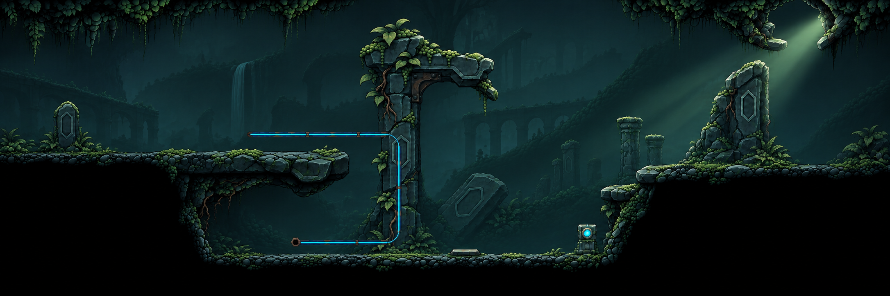
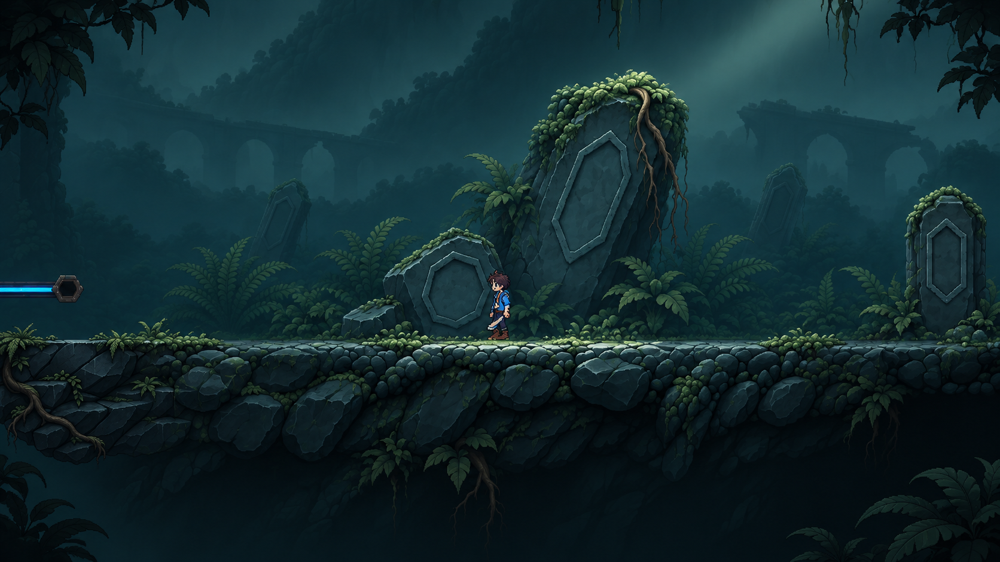
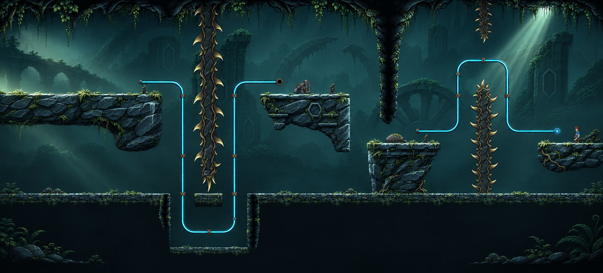
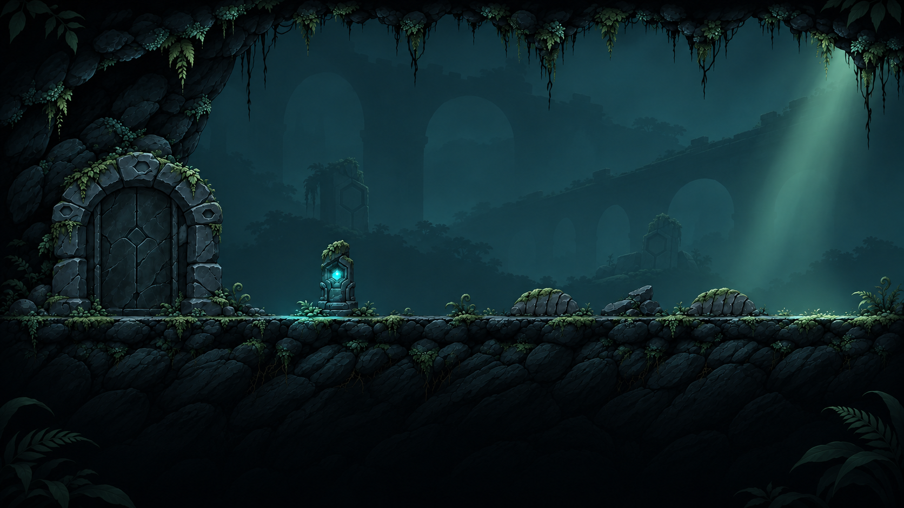

# 맵 1 공통 미술과 하단 동선 시안

**공통 미술 기준**은 현재 첫 전투방의 원화와 게임 화면이다. 하단 동선의 v2 시안을 바탕으로 전투방 하강로에서 C 전실의 B1 봉인문까지 미술을 적용했다. [하단 동선 본편 화면](map1-lower-route-runtime.jpg) · [현재 전투방](combat-room-lighting-gameplay.png) · [맵 공통 미술 지침](../MAP_VISUAL_GUIDE.md)

본편의 청록 수로 원경은 A와 B–C에 각각 배치하고 카메라 이동량의 0.25배로 움직인다. 재사용한 비석과 아치는 0.60배로 움직이고 밑동을 안개 속에 묻힌다. A의 승강 석주와 C의 봉인문, 연결 절벽의 보행면, 레일과 지지대는 기존 월드 좌표로 그린다. 천장 틈빛은 월드에 고정하고 C 석등이 활성화되면 바닥에서 작은 반사광이 켜진다. [게임용 이미지와 원본](../assets/terrain/lower-route-art-v2/README.md)

## 공통 미술 기준

| 요소 | 맵 1에서 이어갈 표현 | 기준 자산 |
| --- | --- | --- |
| 바닥과 발판 | 차가운 청회색 돌에 어두운 단면을 붙인다. 작고 둥근 돌을 상면 가장자리에 섞고 낮은 이끼를 듬성듬성 얹는다. 발 디딜 선과 착지 끝은 선명하게 읽히게 한다. | [바닥](../assets/terrain/combat-room-v2/floor.png) · [좌측 발판](../assets/terrain/combat-room-v2/platform-left.png) · [중앙 발판](../assets/terrain/combat-room-v2/platform-center.png) · [우측 발판](../assets/terrain/combat-room-v2/platform-right.png) |
| 벽과 천장 | 암반 속은 짙게 두고 노출된 곡면과 모서리에만 잎과 뿌리를 붙인다. 통행하는 틈과 점프에 쓰는 벽면의 윤곽을 남긴다. | [왼쪽 암벽](../assets/terrain/combat-room-v2/left-wall.png) · [오른쪽 암벽](../assets/terrain/combat-room-v2/right-wall.png) · [천장](../assets/terrain/combat-room-v2/ceiling.png) |
| 식생 | 둥근 이끼잎, 얕은 담쟁이, 부채 고사리와 길게 휘는 뿌리를 크기가 다른 군집으로 쓴다. 바닥 틈, 벽과 천장이 만나는 모서리, 유적 밑동에 밀도를 준다. | [맵 장식 23종](../assets/terrain/moss-grotto-floor-decor/README.md) · [식생 배치 기준](../assets/terrain/moss-grotto-foliage/placement.json) |
| 유적 | 얕게 파인 육각 문양, 기울어진 비석, 부서진 아치가 같은 시대의 흔적으로 보이게 한다. 가까운 유적에는 재질을 남기고 먼 비석은 안개색에 가까워지게 한다. | [육각 비석](../assets/terrain/combat-room-v2/midground-stele.png) · [부서진 아치](../assets/terrain/combat-room-v2/midground-broken-arch.png) |
| 공기와 빛 | 먼 동굴과 유적은 저대비의 푸른 안개 속에 둔다. 실제 열린 틈에서 내려오는 빛은 노출된 석재 윗면과 바닥 이끼, 가까운 잎 끝까지 이어진다. 아래쪽 바위와 뿌리는 어둠으로 자연스럽게 잦아든다. | [원경](../assets/terrain/combat-room-v2/background.png) · [근접 전경](../assets/terrain/combat-room-v2/foreground.png) · [현재 전투방](combat-room-lighting-gameplay.png) |

전투방에서 가져오는 것은 돌의 재질, 끝선, 식생의 형태, 유적 문양과 빛의 원리다. 방마다 보행면과 충돌 외곽을 기준으로 이를 다시 맞춘다. 이끼의 밀도와 빛의 색·세기는 구간의 역할에 맞춰 조절한다. 레일과 재도전 석등의 청색, 비밀 통로 내부의 호박빛처럼 이미 역할이 있는 색은 장식보다 선명해야 한다.

## 레이어 구성

| 위치 | 하단 동선에 사용하는 요소 |
| --- | --- |
| 원경 | 청록이 감도는 깊은 암굴, 희미하게 반복되는 비석과 수로 아치, 넓고 옅은 안개. 크고 단순한 윤곽을 사용한다. |
| 중경 | A의 레일 지지 석주, A–B 절벽의 육각 비석, B 협곡의 무너진 기둥, C 전실의 먼 유적. 이동에 쓰는 발판보다 대비를 낮춘다. |
| 지형과 장치 | 바닥·발판·벽·천장을 독립적으로 맞추고, 레일 고정대와 착지 발판은 같은 좌표 기준을 쓴다. 광막이 닿는 석재 상면의 작은 반사광과 레일·석등의 발광을 구분한다. |
| 전경 | 화면 양끝의 낮은 잎과 천장에 붙은 뿌리를 사용한다. 드러난 잎 끝이나 바닥 이끼만 빛을 받고, 식생의 원래 윤곽이 유지되게 한다. |

원경은 지형보다 천천히 움직이고 중경은 그 사이에 둔다. 하강과 A에서는 높이 차, A–B와 협곡에서는 좌우 이동에 따라 드러나는 겹침을 중심으로 검토한다. 스크롤 구도에서는 미술 지침의 원경 0.25, 중경 0.60, 지형 1.00을 시차의 시험값으로 사용하고, 화면 가장자리에 이음새가 생기면 실제 카메라 폭에 맞춰 조정한다. 벽에 붙은 식생, 바닥과 연결된 전경, 레일과 지지대는 접합이 벌어지지 않도록 각각 같은 변환을 사용한다. 착지점, 적의 실루엣, 레일 및 장치의 신호는 각 구간의 우선순위에 둔다.

## 하강로와 A파트

2026-11-26 A파트는 가까운 젖은 석벽 통로로 미술을 갱신했다. 중앙과 오른쪽 아치 안에 별도 회랑을 두고, 레일 고정구·식생 군집·접촉 그림자와 광원 표면 반사를 적용했다. 다음 이미지는 이전 방향 시안이며, 현재 구현은 [A 수정 전후](a-passage-wall-comparison.jpg)와 [독립 레이어](../assets/terrain/lower-route-a-wall-v1/README.md)에서 확인한다.

전투방의 중앙 하강로를 지나면 A 오른쪽 천장 틈으로 떨어진다. 좁은 위쪽 틈에서 내려오는 청록빛이 오른쪽 착지면과 비석의 윗면, 바로 옆 잎 끝을 밝힌다. 낙하 뒤 보이는 하층 바닥과 왼쪽 상층 목적지는 같은 돌 재질로 잇되 높이와 실루엣으로 구분한다. 오른쪽으로 올라가는 ㄷ자 레일은 육각 석주에 붙인다. 출발 파츠, 위층 유물 설치 발판, 바닥 버튼과 3초 불빛, 오른쪽 복귀 장치 주변을 비운다. [A 현행 구조](map1-lower-route-a-v3-open.png)

## A–B 연결 절벽

왼쪽으로 이어지는 같은 암반 위에서 큰 육각 비석과 작은 파편을 한 무리로 묶는다. 그 뒤에 낮은 대비의 비석과 끊긴 수로 아치를 배치한다. 바닥의 돌 윗선을 왼쪽 레일 출발대까지 연속해서 맞추고, 아래층은 표면에 붙은 뿌리와 안개로 깊이를 읽게 한다. [현재 접합과 깊이](lower-route-ab-depth.md) · [절벽 보행선](lower-route-ab-terrain-join.md)

## B파트 레일 협곡

오른쪽 출발대에서 두 레일을 따라 왼쪽 C 방향으로 건너간다. 가까운 곳에는 발판 상면, 벽점프 면, 두 레일의 곡선과 가시 세 구간을 또렷하게 남긴다. 깊은 U자 레일이 지나는 하단의 돌바닥 세 구간과 두 틈은 현재 배치대로 읽히게 한다. 받침이나 이끼는 열린 레일 구간을 가로지르지 않게 붙인다. 뒤쪽 기둥과 수로는 어두운 안개 속에 두고, 낮은 위치의 비밀 통로를 알리는 호박빛은 내부에 국한한다. [B 레일과 이동 규칙](map1-lower-route-b-v2.md)

## C 전실과 B1 봉인문

2026-11-26 C 본편은 A·B와 같은 젖은 가까운 석벽으로 갱신했다. 별도 벽감·부조·근접 식생을 겹치고 기존 봉인문·석등·공벌레는 같은 위치에 둔다. B 연결부의 배경은 보행면보다 먼저 겹쳐 그린다. 아래 이미지는 이전 방향 시안이다. [현재 전후 비교](c-passage-wall-comparison.jpg) · [독립 레이어](../assets/terrain/lower-route-c-wall-v1/README.md)

B에서 오른쪽으로 이어 들어오는 보행선의 돌 결을 왼쪽 봉인문까지 유지한다. 입구에서 들어온 약한 빛은 오른쪽 바닥과 이끼에 머물고, 깊어질수록 어두운 청회색 석재가 드러난다. 육각 재도전 석등의 청색은 발밑의 작은 돌과 잎에만 반사되게 한다. 왼쪽 봉인문은 가장 큰 실루엣으로 남기고 주변의 이끼와 유적은 밀도를 낮춘다. 평가 범위는 봉인문 앞까지다. [현재 전실 원화](../assets/terrain/lower-route-c/antechamber-v2-plate.png)

이 이미지는 미술의 방향과 장치 가독성을 검토하는 합성 시안이다. 실제 제작에서는 현재 월드 좌표의 착지점, 발판 상면, 레일 경로, 가시와 봉인문의 판정을 기준으로 각 레이어를 맞춘다. [세부 프롬프트와 참고 이미지 기록](../assets/concepts/map1-route-art-v2/generation-prompts.md)

## 이동 미리보기

현재 게임의 플레이어 이동, 카메라 추적, 레일과 유물 순간이동을 재생하고 위 네 구간의 미술 시안을 합성했다. 하강·A 첫 착지, A–B 연결 절벽, B의 두 번째 레일과 착지, C 봉인문 접근 순으로 발췌했다. A–B 카메라 화면은 시안이 있는 폭 안에서 잘랐다. B의 적은 시안에 그려진 모습이고, C는 공벌레를 처리한 뒤 석등을 통과하는 상태다. 정지 시안은 한 판으로 합성했으므로 거리별 시차는 레이어 제작 단계에서 별도로 검토한다. [이동 GIF](../assets/concepts/map1-route-art-v2/movement-preview.gif) · [장면별 정지 이미지](../assets/concepts/map1-route-art-v2/movement-stills.png)
