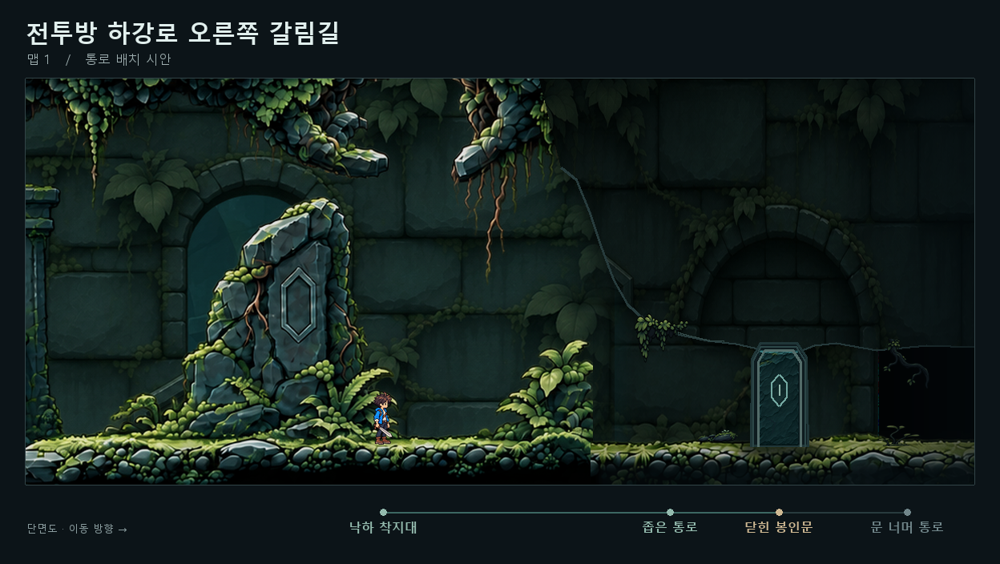

# 전투방 하강로 오른쪽 갈림길

## 푸른 장벽과 맵 2 연결 계획

전투방 하강 뒤 A 착지대 오른쪽 끝으로 걸어가면 별도 구역으로 넘어간다. 왼쪽 진입부는 낮게 시작하고, 넓어진 다리 너머로 천장이 높아진다. 다리 중간의 푸른 장벽 너머로 이어지는 길이 보인다.

- B1 격파 전에는 장벽에 닿는 순간 푸른 파문이 생기고 플레이어는 다리 위로 조금 밀려난다. 체력 피해 없이 통과를 막고, 점프나 유물 이동으로 장벽을 건널 수 없게 한다.
- 격파 연출에서 오른쪽으로 날아간 푸른 에너지 구체가 장벽을 해제한다. 격파 뒤 장벽에 처음 접근하면 잔광이 같은 구체로 모였다 사라진다. 이때도 바로 오른쪽으로 건널 수 있고, 이후 방문에도 열린 상태가 유지된다. [B1 격파 연출과 상태 유지](b1-hermit-crab-combat-design.md#격파-연출과-다리-장벽-해제-계획)
- 격파 후 C 전실에서 복귀할 때 B의 두 레일을 왼쪽 고정부에서도 사용할 수 있다. 오른쪽을 보고 기존 `E → X → E`를 써 가시 구간을 건너고, A의 오른쪽 바위 면을 벽점프로 올라가면 다리 입구로 이어진다.

### 다리 화면과 장벽 연출

별도 구역의 폭은 2240 월드 단위다. 다리 상면을 높이 0에 맞추고, 구역 중간의 장벽은 바닥에서 왼쪽 천장 끝까지 이어진다. 천장은 그 지점부터 오른쪽 위로 벌어진다. 고정 카메라에서 다리의 두 아랫아치와 보행면, 장벽의 양쪽이 한 화면에 보인다.

먼 석조 아케이드를 어둡게 깔고 A구간 벽과 식생을 왼쪽에 이어 붙였다. 다리 윗면과 아랫아치는 기존 맵의 석조 다리 자산을 사용한다. 에너지는 상하 고정부의 중심에 맞추고, 푸른 속광과 주변 반사는 다른 레이어로 그린다. 닿은 높이에서 왼쪽으로 짧은 반원 파문이 퍼진다. 해제 후에는 접근했을 때부터 약 1.8초간 잔광이 세로 가운데로 모인다. [다리와 장벽 렌더러](../right_bridge.py)

## 초기 석문 배치 시안

전투방에서 떨어지는 A구간 착지대의 오른쪽에 짧고 낮은 통로를 붙인다. 착지대에서 오른쪽으로 걷다 보면 가운데 석문에 막히고, 문 너머로 같은 높이의 바닥이 어둠 속에 이어진다.

| 구간 | 배치 시안 |
| --- | --- |
| 착지대 | 기존 착지대 끝인 월드 `x=11330`에서 바닥 높이 `y=85`를 그대로 이어간다. |
| 통로 | 전체를 약 900 월드 단위로 잡고, 입구에서 천장이 내려와 바닥과 약 240 단위 간격을 유지한다. 캐릭터는 서서 걸어 들어갈 수 있다. |
| 봉인문 | 입구에서 약 500 단위 안쪽에 석문을 둔다. 문틀이 바닥부터 천장까지 닿고, 닳은 육각 문양에 약한 청록빛을 남긴다. |
| 문 너머 | 같은 바닥을 짧게 보여 주고, 석벽과 바닥의 대비를 낮춰 시야 끝을 어둡게 처리한다. |

시안은 A구간의 청록 석벽과 이끼 바닥을 재사용했다. 문 주변에서만 석재 윤곽과 문양이 조금 더 읽히도록 했다. [A구간 미술 레이어](../assets/terrain/lower-route-a-wall-v1/README.md)

석문 위치와 재질을 검토할 때 사용한 초기 시안이다. 진행 조건은 위의 푸른 장벽 계획에 따른다.
