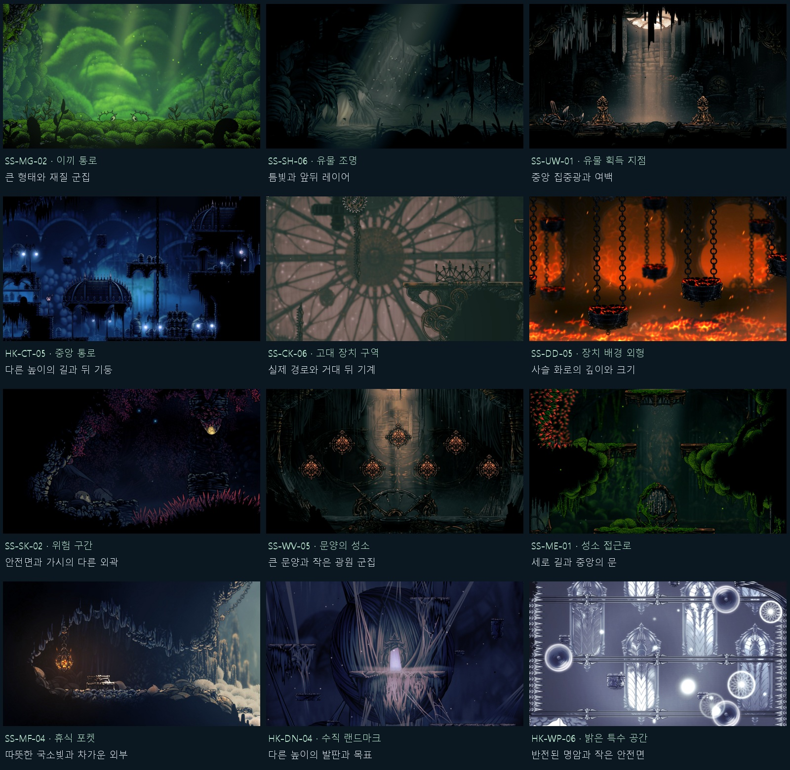

# RelicEscape 맵 제작용 참고 데이터 활용

할로우 나이트와 실크송의 화면을 **우리 맵에서 어떤 형태·재질·조명·배치를 만들 것인가**로 연결한 제작 자료다. 기존45장에 신규199장을 추가해 총244장을 보관했고, 이미지마다 관찰·깊이·조명·적용 패턴·자산 명세를 기록했다. 원작 이미지를 게임에 넣는 대신 공간을 구성하는 원리를 프로젝트 고유 자산으로 옮긴다.

[이미지 검색 갤러리](references/hollow-knight-silksong/index.html) · [전체 관찰 목록](references/hollow-knight-silksong/README.md) · [JSON 데이터](references/hollow-knight-silksong/analysis.json) · [CSV](references/hollow-knight-silksong/catalog.csv)

## 맵 미술 제작과 렌더링 기준

새 맵을 만들거나 기존 구역을 손볼 때 [맵 장식 23종](../assets/terrain/moss-grotto-floor-decor/README.md)에서 해당 구역에 어울리는 식생·뿌리·석재를 골라 배치한다. 새 자산도 검은 윤곽, 짙은 청록 그림자, 둥글고 불규칙한 형태, 잎 윗면의 짧은 이끼빛을 기준으로 삼는다. 덩어리의 크기와 간격을 달리하고 빈 구간을 두어 반복감을 줄인다.

| 레이어 | 제작과 구현 |
| --- | --- |
| 뒷배경(원경) | 먼 동굴, 안개, 큰 실루엣을 독립 이미지로 제작한다. 플레이 지형보다 낮은 대비로 뒤에 그리고, 시차를 쓰면 지형보다 느리게 움직인다. |
| 중경 | 깊이가 더 필요한 구역에서는 뒤쪽 암반·유적·큰 식생을 별도 이미지로 둔다. 밟는 면과 구분되도록 색과 명암을 낮춘다. |
| 바닥·발판 | 보행면과 발판을 독립 타일이나 스프라이트로 만든다. 충돌 상면과 그림의 보행선을 맞춘다. |
| 천장 | 천장 암반과 윤곽을 독립 자산으로 만든다. 천장에 붙는 덩굴은 월드 좌표에서 천장을 따라가도록 배치한다. |
| 벽 | 필요한 구역에서 벽 타일과 출입구 외곽을 따로 만든다. 벽점프 면과 통행 위치가 읽히게 한다. |
| 맵 조형물 | 풀, 덩굴, 이끼, 돌, 유적 조각을 개별 투명 스프라이트로 배치한다. 위치와 크기는 지형에서 독립적으로 조정한다. |
| 앞 배경(근접 전경) | 어두운 잎·뿌리·풀 그림자를 별도 투명 이미지로 제작한다. 캐릭터보다 앞에 그리며, 화면 양옆이나 구석에 낮고 작게 둬서 이동 경로와 전투 신호가 보이게 한다. |

한 번에 한 레이어씩 제작하고 각 레이어의 단독 시안을 먼저 확인한다. 이후 같은 월드 좌표 기준으로 합성 미리보기를 만든다. 게임에서는 **원경 → 중경 → 지형과 맵 조형물 → 캐릭터와 전투 효과 → 근접 전경** 순으로 독립적으로 그린다. 합성 후 바닥 경계, 출입구, 캐릭터, 유물, 공격 예고가 카메라 이동 중에도 잘 보이는지 확인한다.

[하단 A–B 비석 구간](lower-route-ab-depth.md)은 비석 주변의 식생을 같은 지역 장식으로 묶은 구현 예다. 위아래 두 보행선이 한 화면에 들어오는 구간이라, 근경을 암반 앞에 배치하고 캐릭터와 유물·흔적이 그 위에 보이도록 그리기 우선순위를 적용했다.

## 자료 범위

| 구분 | 수량 | 의미 |
| --- | ---: | --- |
| 할로우 나이트 | 128장 | 녹색 거리 포함16개 지역 |
| 실크송 | 116장 | Moss Grotto, Deep Docks, Shellwood, Cogwork Core 등20개 지역 |
| 합계 | **244장** | 기존45장과 이번 신규199장. 서로 다른 방244개라는 뜻은 아님 |
| 공간 참고 | 233장 | 보행면·지형·공간 구성을 읽는 이미지 |
| 개발 중 자료 | 3장 | 기존 공식 녹색 거리 초기 자료. 출시판과 구별 |
| 재질과 조명 상세 | 2장 | 수정 면과 큰 빛 등 세부 표현 |
| 연출 효과 | 2장 | 목표 집중·방사 흐림 등. 맵 구조 자료와 구별 |
| 상태 비교 변형 | 4장 | 비슷한 공간의 물체·빛 상태를 비교. 독립된 새 방으로 세지 않음 |
| 제작 패턴과 자산 명세 | 각20개 | P01~P20과 B01~B20을 이미지에 연결 |
| 이번 영역 주석 | 12장·49개 영역 | 전경·중경·원경·상면·빛의 위치를 표시. 실제 레이어 추출 아님 |

모든 신규 이미지는 실제 PNG로 저장했다. 기존45장은 [원래 폴더](references/hollow-knight-greenpath/README.md)의 파일을 연결해 중복 보관을 피했다. 파일 해시와 디코딩한 RGB 픽셀 해시가 모두 다르며, 비슷한 구도 후보는 별도로 표시했다. 근접 구도나 상태 변화 장면이 있으므로 이미지 수를 맵 다양성의 유일한 지표로 사용하지 않는다.

신규199장의 관찰은 `observations-hk.txt`와 `observations-ss.txt`, 기존45장의 재질·공간 분류·주요 적용 구역 보정은 `legacy-curation.txt`에서 관리한다. 설명 문장에 비교 대상으로 등장하는 재질을 실제 재질로 잘못 태그하지 않도록 기존 자료도 직접 분류했다. 예를 들어 HK-EX06의 재질은 수정·석재·금속이며 이끼 통로의 우선 자료로 추천하지 않는다.

## 우리 구역별로 먼저 볼 자료



아래 ID는 갤러리의 검색어 또는 직접 링크다. 공간의 용도는 프로젝트에 활용할 분류이며 원작에서 해당 방의 실제 기능을 확정한 표시가 아니다.

**현재 두 맵 기획과의 대응:** ‘중앙 통로’ 태그는 맵2의 작은 중앙 홀, ‘고대 장치 구역’은 맵2의 레일·석궁·복합 퍼즐 구간, ‘문양의 성소’는 맵2 최종 보스방의 문양·제단을 뜻한다. 독립된 세 번째 성소 맵을 계획하지 않는다. [현재 구역 대응 데이터](references/hollow-knight-silksong/project-targets.json)에 구현 상태와 활용 범위를 기록했다. 방의 진행 순서는 [최신 두 맵 기획](INITIAL_DESIGN.md)과 [승인 지도](world-map-progress-2026-11-23.png)를 따른다.

| 만들 구역 | 먼저 볼 ID | 가져올 구조 | 적용할 패턴 |
| --- | --- | --- | --- |
| 이끼 통로 | [SS-MG-02](references/hollow-knight-silksong/index.html#SS-MG-02), [SS-MG-03](references/hollow-knight-silksong/index.html#SS-MG-03), [SS-SH-05](references/hollow-knight-silksong/index.html#SS-SH-05), HK-GP22 | 큰 이끼 덩어리와 작은 군집의 차이, 넓은 중앙 여백, 짧고 선명한 발판 | P01·P02·P12 |
| 현재 전투방 | HK-GP05, [SS-MG-04](references/hollow-knight-silksong/index.html#SS-MG-04), [SS-HH-06](references/hollow-knight-silksong/index.html#SS-HH-06) | 적과 탄환 뒤의 단순한 공간, 둘레의 큰 형태 | P11·P14·P15·P17 |
| 유물 획득 지점 | [SS-UW-01](references/hollow-knight-silksong/index.html#SS-UW-01), [SS-ME-04](references/hollow-knight-silksong/index.html#SS-ME-04), [SS-SH-06](references/hollow-knight-silksong/index.html#SS-SH-06), HK-AY-06 | 천장 틈에서 아래 목표로 떨어지는 빛, 작은 중심·후광·반사광 | P04·P08·P14·P16 |
| 하강 통로 | [HK-CT-05](references/hollow-knight-silksong/index.html#HK-CT-05), HK-KE-03, SS-WW-03 | 다음 착지면·벽의 경계·깊은 뒤 구조의 구별 | P01·P05·P13 |
| 중앙 통로 | HK-CT-02, HK-CT-05, SS-GM-05, SS-CC-04 | 여러 높이의 연결과 멀리 큰 기억점, 작은 기능광 | P03·P05·P09·P16 |
| 고대 장치 구역 | [SS-CK-06](references/hollow-knight-silksong/index.html#SS-CK-06), [SS-DD-05](references/hollow-knight-silksong/index.html#SS-DD-05), HK-CP-02, HK-WP-06 | 선명한 실제 경로와 거대하고 흐린 뒤 기계, 사슬과 금속의 다른 크기 | P03·P06·P07 |
| 문양의 성소 | [SS-WV-05](references/hollow-knight-silksong/index.html#SS-WV-05), [SS-ME-01](references/hollow-knight-silksong/index.html#SS-ME-01), HK-RG-01, HK-WP-01 | 큰 문양 축과 작은 기능점, 어두운 둘레와 제한된 중앙빛 | P04·P09·P16·P18 |
| 보스방 | SS-HH-06, HK-GP07, SS-SK-04, HK-HI-06 | 넓은 판독 공간과 둘레의 대표 형체, 공격 신호의 대비 | P11·P15·P16 |
| 전투 후 작은 휴식점 | [SS-MF-04](references/hollow-knight-silksong/index.html#SS-MF-04), SS-WV-03, HK-CT-03, SS-HM-04 | 작은 기능점을 감싸는 큰 어둠, 따뜻한 국소빛 | P04·P10·P17 |
| 지역 경계 | HK-FC-04, HK-GP18, SS-SH-04, SS-MG-06 | 출구의 고유 외곽, 다음 지역 재질과 빛의 점진적 노출 | P09·P12·P16 |

SS-DD-05의 매달린 물체는 **화로의 외형·사슬·깊이**를 참고한다. 이미지에서 밟을 수 있는 발판이라고 확정하지 않는다. 마찬가지로 뒤 기어의 회전, 원형 물체의 공격 판정, 문을 여는 조건은 별도 자료와 실제 구현으로 확인해야 한다.

## 지금 적용된 것과 다음 제작 후보

현재 상태는 [미술 방향 문서](environment-art-direction.md)와 최신 소스를 우선한다. 아래는 2026년11월23일 작업 기록을 바탕으로 연결한 범위다.

| 항목 | 현재 상태 | 데이터 활용 방식 |
| --- | --- | --- |
| 검은 지형 속과 이끼·돌 테두리 | 구현됨 | P01로 접합부·명암을 검수하고 승인 자산을 재사용 |
| 전투방 중경 폐아치·명암·광막·근접 뿌리 | 적용 및 전투 판독 조정 완료 | P11·P14·P15로 아치 대비, 수정탄 비행 높이의 빛, 공벌레 뒤 여광, 천장 실루엣을 조정. [전후 비교](combat-readability-comparison.jpg) |
| 천장 전경 월드 고정과 캐릭터 높이 추적 | 구현됨 | P02·P05 적용 시 고정 기준을 유지 |
| 첫 유물의 깨진 육각 봉인석과 강한 집중빛 | 디자인·조명 시안 | P04·P08을 이용해 실제 게임 조명으로 옮길 작업을 구체화 |
| 맵2 작은 중앙 홀·장치 구역·문양 제단을 포함한 최종 보스방 | 진행 구조 채택, 미구현 | 이미지→패턴→자산 명세→플레이 검수 순서로 제안 |
| 원작의 벤치·새 몬스터·새 능력 | 자동 도입 대상 아님 | 외곽·빛·공간 역할만 참고. 새 기능은 별도 설계 |

전투방에서는 **수정탄·적의 외곽·유물 위치가 배경과 구분되는지** 먼저 확인한다. 최신 조정은 폐아치를 흐리게 누르고 상단 빛을 줄여 수정탄 앞의 공중을 비웠다. 바닥 뒤에는 옅은 빛을 남겨 공벌레 실루엣을 살렸다.

프로젝트용 이미지를 생성할 때는 작업 구역에 맞는 참고를 검색하고 선택한 이미지에서 구도·실루엣·재질·깊이·조명을 확인한다. 참고 ID와 실제로 반영한 판단을 프롬프트 또는 자산 메타데이터에 기록한다.

## 전경 배경과 그림자를 데이터로 읽는 법

각 이미지의 `depth_interpretation`은 화면의 크기·겹침·선명도·명암을 근거로 쓴 관찰이다.

- **검은 지형 코어**: 지형 내부를 가린 면. 그림자 투사 결과라고 단정하지 않는다.
- **근접 전경**: 큰 검은 잎·줄기·기둥·천. 카메라 가까운 가림물로 읽히지만 원작의 실제 레이어 수는 미확인이다.
- **중경**: 지형과 원경 사이에서 장소의 성격을 설명하는 큰 구조. 플레이 발판보다 대비가 낮아야 한다.
- **원경**: 거대하고 부드러운 기둥·나무·기어·도시. 실제 맵보다 큰 공간감을 만든다.
- **대기 효과**: 안개·빛줄기·크기 다른 입자. 지형·캐릭터를 모두 흐리게 덮는 효과와 구별한다.

[영역 주석 JSON](references/hollow-knight-silksong/annotations.json)의 `bbox`는 원본 이미지 왼쪽 위를 기준으로 정규화한 `[x1,y1,x2,y2]`다. 시각적 관심 영역49개이며 세그멘테이션·충돌·엔진 레이어의 정답 데이터가 아니다. 자산 제작 시 참고할 위치를 찾는 데 사용한다.

## 조명 자료를 실제 제작으로 바꾸기

| 관찰한 요소 | 제작 단위 | 프로젝트에서 먼저 확인할 것 |
| --- | --- | --- |
| 천장 틈의 수직·사선 빛 | B04 광막 또는 알파 메시 | 빛이 향하는 지점과 틈의 방향이 연결되는가 |
| 작은 등불과 밝은 대상 | B05 중심·중간광·바깥 후광 | 유물의 실제 기능빛이 장식보다 선명한가 |
| 먼 안개와 부드러운 기둥 | B03 중경 대비, B15 대기층 | 뒤 공간만 부드러워지고 앞 경계는 읽히는가 |
| 용암·산성면·밝은 수정 | B09 위험 경계, B18 명암표 | 밝기보다 외곽과 재질로 위험을 구분하는가 |
| 여러 작은 광점 | B15 깊이별 입자 | 포자가 탄환·유물과 같은 크기와 밝기를 갖지 않는가 |
| 암전과 방사 흐림 | B20 별도 집중 연출 | 조작 시간의 지속 시야나 체력 UI를 가리지 않는가 |

예를 들어 유물 획득 지점은 SS-UW-01의 **위쪽 큰 광원과 아래 넓은 여백**, SS-ME-04의 **목표 주변 작은 바닥색 변화**, SS-SH-06의 **빛줄기 안 미세 입자**를 조합할 수 있다. 외형은 기존 육각 봉인석과 유물을 사용하고, 원작의 제단·종·인물은 가져오지 않는다.

## 제작 패턴20개와 자산 명세20개

[patterns.json](references/hollow-knight-silksong/patterns.json)에는 패턴의 적용 구역·행동·제약·검수 기준·현재 프로젝트 상태·관련 이미지 ID가 있다. [asset-briefs.json](references/hollow-knight-silksong/asset-briefs.json)은 제작할 단위와 기존 자산 재사용 여부를 정리한다.

| 패턴 | 제작 판단 | 연결 명세 |
| --- | --- | --- |
| P01 | 검은 코어와 표면선 | B01 지형 재사용 키트 |
| P02 | 큰 전경과 시야 여백 | B02 큰 잎·뿌리 |
| P03 | 중경과 원경 대비 | B03 중경 유적 |
| P04 | 목표의 집중 조명 | B04 틈빛, B05 유물 후광 |
| P05 | 다음 착지면의 가시성 | B06 착지 표식 |
| P06 | 실제 장치 경로의 선명도 | B07 장착 홈, B08 레일과 뒤 기계 |
| P07 | 안전·위험 경계 구분 | B09 위험 테두리 |
| P08 | 먼저 보이는 보상과 우회 | B10 보상 포켓 |
| P09 | 지역 문턱과 고유 문양 | B11 문틀 |
| P10 | 작은 휴식점 | B12 휴식 외형 |
| P11 | 전투 판독 공간 | B13 보스 배경 |
| P12 | 재질 군집과 빈 틈 | B14 재질 변주 |
| P13 | 대기광과 입자의 깊이 | B15 안개·입자 |
| P14 | 기능색과 장식색 | B05 후광, B18 팔레트 |
| P15 | 적 실루엣과 방향 | B16 대비 가이드 |
| P16 | 방의 큰 기억점 | B17 고유 랜드마크 |
| P17 | 비대칭 시각 무게 | B02 전경, B03 중경 배치 |
| P18 | 밝은 방의 대비 반전 | B18 명암표 |
| P19 | 공간을 유지한 상태 변화 | B19 상태별 외형 |
| P20 | 짧은 집중 연출 | B20 획득·등장 효과 |

P0는 시야와 기능 판독, P1은 공간·재질 제작, P2는 후속 변주 순서다. 원작 난도 등급이나 새 구현의 승인 상태가 아니다. 각 패턴의 참고 목록은 자동 집계되므로 관련 이미지를 추가하면 같은 제작 단위로 누적된다.

## 우리 맵에서 권하는 작업 순서

1. **유물의 집중 조명을 실제 게임으로 연결한다.** 기존 봉인석·유물 시안을 기준으로 천장 틈빛, 중심과 후광, 바닥 주변 반사색을 분리한다. SS-UW-01·SS-ME-04·SS-SH-06을 우선 본다.
2. **전투방의 실제 플레이에서 적과 투사체를 확인한다.** 최신 조정은 HK-GP05·HK-GP37·SS-HH-06을 참고했다. [수정탄이 발사된 장면](combat-readability-projectiles.png)과 [높은 발판 시점](combat-readability-high.png)을 검수 자료로 쓴다.
3. **중앙 통로의 이동 골격부터 만든다.** 지형을 단색으로 두고 출입구·다음 발판·유물 장치 목표가 이어지는지 확인한 뒤 중경을 추가한다. HK-CT-05·HK-KE-03·SS-CC-04를 본다.
4. **고대 장치 구역은 앞 경로와 뒤 기계를 나눈다.** 기존 레일·장착 파츠를 먼저 연결하고 SS-CK-06의 거대 뒤 기계, SS-DD-05의 사슬 외형을 배경에만 참고한다.
5. **성소와 보스방의 큰 형태를 하나씩 정한다.** 프로젝트 육각 문양·유적 재질을 유지하면서 SS-WV-05와 SS-HH-06의 공간 비움과 빛 크기 차를 활용한다.

이 순서는 제작 후보의 우선순위다. 이번 조사에서 게임 소스·맵 배치·충돌·조명 동작을 변경하지 않았다.

## 데이터 필드와 검색

| 필드 | 담긴 정보 |
| --- | --- |
| `id`, `game`, `region`, `source_title` | 고정 ID, HK/SS, 지역, 출처 파일명 |
| `title`, `layout`, `scope` | 한국어 관찰 제목, 활용할 공간 분류, 공간·상세·연출·상태·개발판 구별 |
| `observation`, `materials` | 이미지에서 확인한 형태와 재질 후보 |
| `depth_interpretation`, `lighting`, `lighting_types` | 시각적으로 추정한 앞뒤 구분과 조명 |
| `patterns`, `project_targets`, `asset_briefs`, `priority` | 우리 구역·제작 방식·명세로 연결. `project_targets`는 우선 적용 후보1~2곳 중심이며 갤러리 구역 필터에 사용 |
| `secondary_project_targets` | 같은 패턴을 응용할 수 있는 넓은 후속 후보. 모든 이미지를 모든 구역에 추천하는 것을 피하려고 우선 후보와 분리 |
| `project-targets.json` | 구역 태그와 최신 두 맵 기획의 실제 위치·구현 상태·활용 범위 대응 |
| `source_page`, `image_url`, `original_url`, `local_file` | 출처 페이지, 받은 미리보기, 원본 링크, 실제 로컬 파일 |
| `width`, `height`, `sha256`, `pixel_sha256` | 저장 크기와 중복 검증 |
| `dhash`, `similar_frames` | 유사 구도 후보. 완전 중복 판정과 분리 |
| `metrics` | 전체 화면의 대표색·암부·밝은 픽셀 비율 |
| `review` | 시각 검토 방식·일자·해석 범위 |

화면 수치는 RGB160×90으로 줄인 전체 이미지에서 계산했다. 암부는 `max(R,G,B)<28`, 밝은 픽셀은 `min(R,G,B)>200`, 대표색은6색 양자화다. HUD나 검은 코어가 포함될 수 있으므로 재질의 고유색·원작 광량·게임 카메라 설정을 뜻하지 않는다. 밝은 픽셀 비율이 낮다고 잘못된 조명이라고 평가하지도 않는다.

브라우저를 쓰지 않고 다음처럼 검색할 수 있다.

```powershell
.\.venv\Scripts\python.exe docs/references/hollow-knight-silksong/query_references.py --target "고대 장치 구역" --pattern P06 --limit 8
.\.venv\Scripts\python.exe docs/references/hollow-knight-silksong/query_references.py --game SS --light "천장빛" --scope scene --limit 8
.\.venv\Scripts\python.exe docs/references/hollow-knight-silksong/query_references.py --material "이끼" --target "이끼 통로" --json --limit 6
```

## 다음 조사 때 누적하는 방법

1. 수집기의 지역 목록을 확인하고 필요한 게임·지역·파일 번호 범위를 고른다. 예를 들어 `--game SS --region "Moss Grotto" --max-per-region 12 --accessed 2026-11-23`은 해당 지역의12번까지 후보를 확인한다. 기존 데이터는 보존하고 이미 받은 URL은 건너뛴다.
2. `collect_references.py`로 받은 이미지를 디코드하고 파일·픽셀 중복을 확인한다. 실패·중복은 `download-log.json`에 남기고 이미지 수에서 제외한다.
3. 연락표와 필요한 원본을 실제로 열어 본 뒤 `observations-hk.txt` 또는 `observations-ss.txt`에 ID별 관찰8필드를 추가한다. 관찰 없는 신규 이미지는 데이터베이스 빌드가 실패하도록 했다.
4. `build_database.py` → `build_analysis_plates.py` → `build_database.py` 순서로 JSON·CSV·연락 주석·갤러리를 갱신한다. 영역 주석의 대상은 스크립트의 `SPECS`에서 관리한다.
5. 이미지 수, 해시, 연결 ID, 로컬 링크, 문법과 검색 결과를 확인한다. 기존 자료를 지우거나 다른 지역의 맵·기능을 자동으로 추가하지 않는다.

새 조사는 기존 출처와 관찰을 계속 쌓는 방식이며, 이 문서는 예약 실행이나 상시 수집 자동화를 설정하지 않는다.

## 원문과 연결 자료

- [Hollow Knight Wiki의 할로우 나이트 스크린샷 분류](https://hollowknight.wiki/w/Category:X_HK_Screenshots)와 [실크송 스크린샷 분류](https://hollowknight.wiki/w/Category:X_SS_Screenshots): 신규 자료의 출처 체계. 개별 파일 페이지는 각 레코드에 연결했다.
- [실크송 지역 목록](https://hollowknight.wiki/w/Areas_%28Silksong%29): 게임별 지역 이름을 구분하는 기준. 공식 한국어 이름을 확인하지 않은 곳은 영어 고유명을 유지했다.
- [Team Cherry의 녹색 거리 개발 소개](https://www.teamcherry.com.au/blog/the-green-path-a-hollow-knight-tour): 기존 초기 자료3장의 출처.
- [현재 프로젝트 미술 방향](environment-art-direction.md) · [녹색 거리 종합 분석](hollow-knight-greenpath-study.md) · [레이어와 조명 상세](hollow-knight-layer-lighting-study.md).
