# 할로우 나이트 녹색 거리 이미지 자료집

2026년 11월 23일 조사. **녹색 거리 39장과 비교 지역 6장, 총 45장**을 실제 파일로 보관했다. 녹색 거리 39장에는 개발 중 공식 이미지 3장이 포함된다. 주석 이미지·확대 크롭·연락표는 이 수량에 포함하지 않는다. 원본 파일의 SHA-256 중복은 없다.

- [오프라인 이미지 갤러리](index.html): 키워드·지역·태그 검색, 이미지별 분석, 크게 보기.
- [종합 분석과 프로젝트 적용안](../../hollow-knight-greenpath-study.md)
- [전경과 배경 구분 및 조명 분석](../../hollow-knight-layer-lighting-study.md)
- [출처와 파일 메타데이터](sources.json) · [이미지별 구조화 분석](analysis.json) · [CSV 목록](catalog.csv)
- [연락표 1](contact-sheet-01.jpg) · [연락표 2](contact-sheet-02.jpg) · [연락표 3](contact-sheet-03.jpg) · [연락표 4](contact-sheet-04.jpg)
- [텍스처와 빛 확대 자료](analysis/texture-lighting-atlas.jpg)

이미지 저작권은 Team Cherry 및 해당 권리자에게 있다. 이 폴더는 분석용 참고 자료이며 게임에 직접 넣을 제작 자산 폴더가 아니다. Wiki 자료는 다운로드 가능한 800px 미리보기를 보관했고, 제작사·공략 자료는 제공된 해상도로 보관했다. 원본 링크는 `sources.json`에 별도 기록하되 원본 다운로드 완료를 뜻하지 않는다.

각 카드의 **관찰**은 이미지에서 읽히는 형태, **적용안**은 RelicEscape에 대한 제안이다. 깊이·전경·조명 구분은 화면의 겹침·선명도·명암을 이용한 시각적 해석이다. 정지 화면만으로 실제 시차 속도, 충돌, 빛 합성 방식이나 애니메이션 시간을 확정하지 않는다. GP22~GP30은 같은 공략 연속 장면으로, 서로 다른 9개 방을 뜻하지 않는다.

## GP01 폭포 아래 벤치와 등불

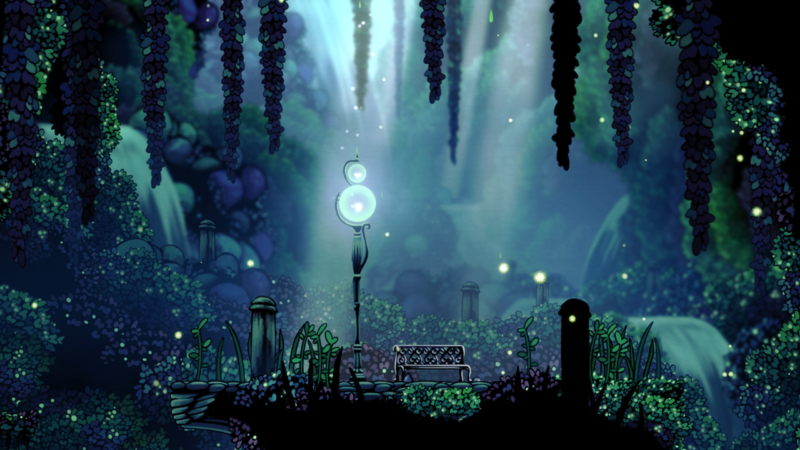

- 구분: 녹색 거리 · 출시판 스크린샷 · 800×450 · 휴식, 조명, 레이어
- 맵과 배치: 낮은 바닥과 비어 있는 중앙 위로 폭포가 높게 열린다.
- 스타일과 텍스처: 큰 둥근 돌 사이에 작은 잎 덩어리를 밀집시킨다.
- 전경과 배경: 천장 덩굴은 어둡고 가까우며 폭포와 기둥은 흐리고 멀다.
- 조명: 흰 등불의 작은 광원과 넓은 청록색 수직 빛이 겹친다.
- 프로젝트 적용안: 유물 획득 직후 쉬어 가는 구간에 작은 등불 하나와 넓은 빈 배경을 배치한다.
- [출처 페이지](https://hollowknight.wiki/w/File:Screenshot_HK_Greenpath_01.png) · [제공 이미지](https://cdn.wikimg.net/en/hkwiki/images/thumb/9/9c/Screenshot_HK_Greenpath_01.png/800px-Screenshot_HK_Greenpath_01.png) · Team Cherry / Hollow Knight Wiki

## GP02 웅덩이 위 철문과 수직 샛길

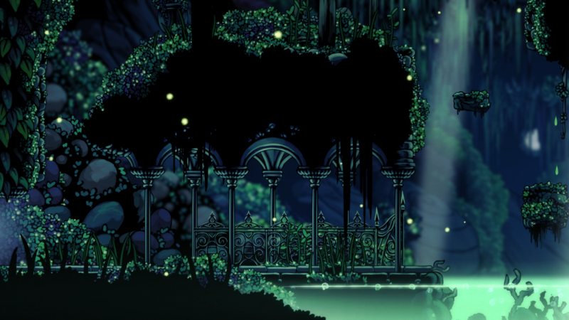

- 구분: 녹색 거리 · 출시판 스크린샷 · 800×450 · 맵, 위험, 레이어
- 맵과 배치: 왼쪽 낮은 문과 오른쪽 높은 발판이 수평·수직 경로를 함께 제시한다.
- 스타일과 텍스처: 철문의 얇은 선과 두꺼운 이끼 지형이 대비된다.
- 전경과 배경: 화면 위 검은 덩어리는 지형 내부이고 뒤의 낙수는 원경이다.
- 조명: 산성 액체의 밝은 수평면이 낙하 위험을 분명하게 만든다.
- 프로젝트 적용안: 경로를 바꿀 때 벽 표면보다 다음 발판과 위험 경계를 먼저 읽히게 한다.
- [출처 페이지](https://hollowknight.wiki/w/File:Screenshot_HK_Greenpath_02.png) · [제공 이미지](https://cdn.wikimg.net/en/hkwiki/images/thumb/d/dd/Screenshot_HK_Greenpath_02.png/800px-Screenshot_HK_Greenpath_02.png) · Team Cherry / Hollow Knight Wiki

## GP03 산성 호수 위 유적 회랑

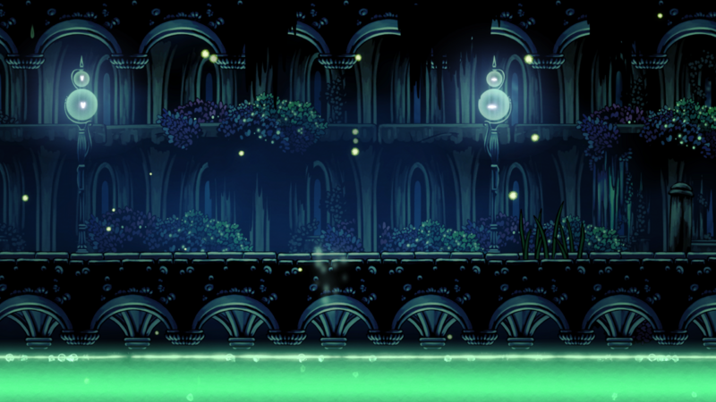

- 구분: 녹색 거리 · 출시판 스크린샷 · 800×450 · 유적, 텍스처, 조명
- 맵과 배치: 아치 두 층과 긴 수평 보행면이 반복된다.
- 스타일과 텍스처: 매끈한 곡선 석재 위에 잎이 부분적으로 침식한다.
- 전경과 배경: 뒤 회랑의 기둥은 낮은 대비로 반복되고 앞 가장자리가 선명하다.
- 조명: 차가운 등불과 밝은 녹색 액체가 서로 다른 높이에 놓인다.
- 프로젝트 적용안: 유적 장치 주변만 구조적 대칭을 쓰고 자연 지형과 구분한다.
- [출처 페이지](https://hollowknight.wiki/w/File:Screenshot_HK_Greenpath_03.png) · [제공 이미지](https://cdn.wikimg.net/en/hkwiki/images/thumb/2/22/Screenshot_HK_Greenpath_03.png/800px-Screenshot_HK_Greenpath_03.png) · Team Cherry / Hollow Knight Wiki

## GP04 가시로 둘러싸인 좁은 통로

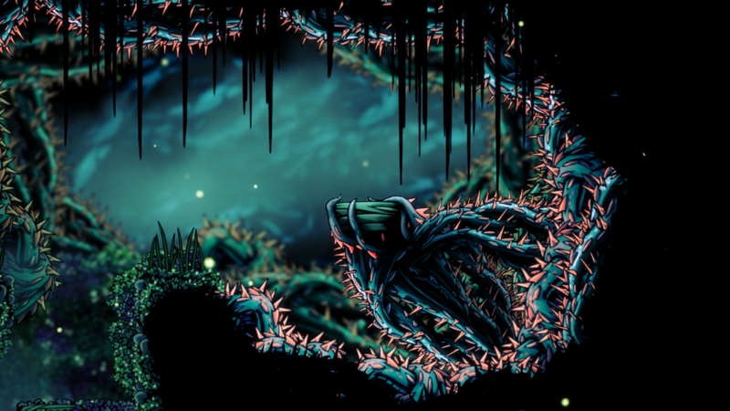

- 구분: 녹색 거리 · 출시판 스크린샷 · 800×450 · 위험, 맵, 텍스처
- 맵과 배치: 위·아래 가시 사이에 열린 이동 통로가 있다.
- 스타일과 텍스처: 주황·분홍 끝이 있는 뾰족한 가시가 둥근 이끼와 확실히 구별된다.
- 전경과 배경: 바깥 검은 덩어리와 안쪽 가시 테두리가 통로를 액자처럼 감싼다.
- 조명: 중앙 배경은 청록색으로 밝고 위험한 가시는 따뜻한 가장자리를 갖는다.
- 프로젝트 적용안: 위험물은 색뿐 아니라 뾰족한 외곽선으로도 식별하게 한다.
- [출처 페이지](https://hollowknight.wiki/w/File:Screenshot_HK_Greenpath_04.png) · [제공 이미지](https://cdn.wikimg.net/en/hkwiki/images/thumb/d/d0/Screenshot_HK_Greenpath_04.png/800px-Screenshot_HK_Greenpath_04.png) · Team Cherry / Hollow Knight Wiki

## GP05 이끼 기사의 평평한 전투 공간

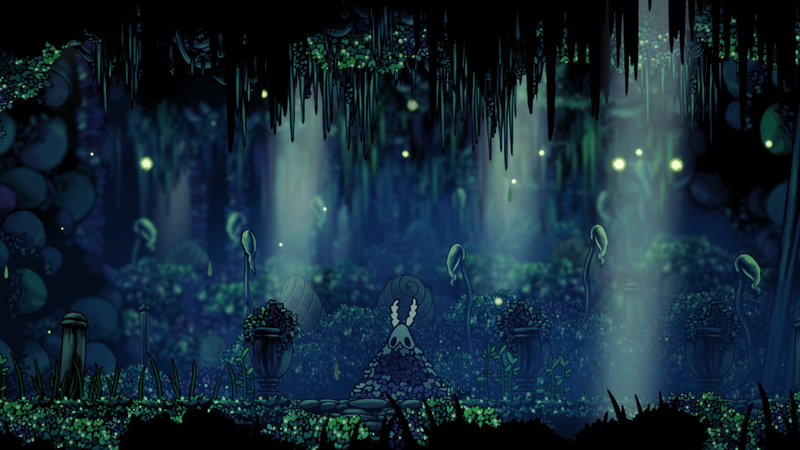

- 구분: 녹색 거리 · 출시판 스크린샷 · 800×450 · 전투, 몬스터, 조명
- 맵과 배치: 중앙 보행면을 길게 비우고 가장자리의 장식만 높인다.
- 스타일과 텍스처: 돌기둥과 잎 덩어리는 촘촘하지만 전투 공간은 단순하다.
- 전경과 배경: 위 덩굴은 검은 프레임이며 뒤 기둥은 흐리다.
- 조명: 두 줄기 이상의 세로 빛이 전투 공간 뒤를 나눈다.
- 프로젝트 적용안: 현재 전투방 중앙과 적 공격 궤적 뒤에는 조밀한 잎이나 밝은 점을 줄인다.
- [출처 페이지](https://hollowknight.wiki/w/File:Screenshot_HK_Greenpath_05.png) · [제공 이미지](https://cdn.wikimg.net/en/hkwiki/images/thumb/5/5d/Screenshot_HK_Greenpath_05.png/800px-Screenshot_HK_Greenpath_05.png) · Team Cherry / Hollow Knight Wiki

## GP06 유적 기둥과 매달린 검은 발판

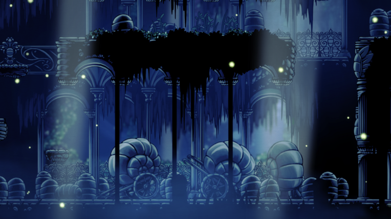

- 구분: 녹색 거리 · 출시판 스크린샷 · 800×450 · 유적, 레이어, 그림자
- 맵과 배치: 중앙 위쪽의 검은 발판 아래로 큰 기둥들이 이어진다.
- 스타일과 텍스처: 밝은 석재는 윤곽과 홈을 읽히게 하고 발판 속은 검게 묻힌다.
- 전경과 배경: 발판 검정은 충돌 지형의 내부이며 원경의 아치와 다르다.
- 조명: 기둥 뒤의 수직 광막과 앞쪽 작은 등불이 깊이를 만든다.
- 프로젝트 적용안: 검은 지형 코어를 유지하면서 장치 받침의 표면선만 드러낸다.
- [출처 페이지](https://hollowknight.wiki/w/File:Screenshot_HK_Greenpath_06.png) · [제공 이미지](https://cdn.wikimg.net/en/hkwiki/images/thumb/d/df/Screenshot_HK_Greenpath_06.png/800px-Screenshot_HK_Greenpath_06.png) · Team Cherry / Hollow Knight Wiki

## GP07 호넷 공간의 문양 비석

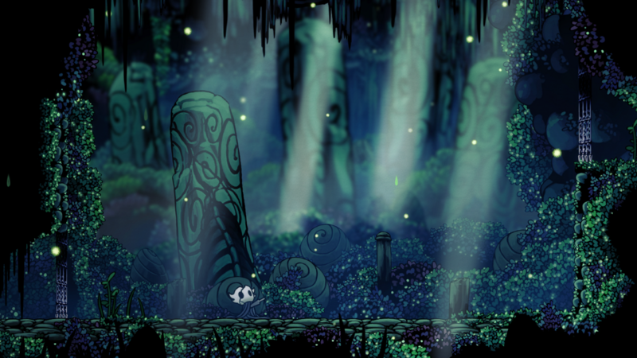

- 구분: 녹색 거리 · 출시판 스크린샷 · 800×450 · 전투, 랜드마크, 조명
- 맵과 배치: 평평한 바닥 위 큰 문양 돌 하나가 시각적 중심이 된다.
- 스타일과 텍스처: 굵은 소용돌이 문양과 덩굴이 돌의 큰 형태를 보조한다.
- 전경과 배경: 뒤의 식물과 수직 줄기는 비석보다 흐리고 덜 선명하다.
- 조명: 비스듬한 밝은 기둥이 비석과 빈 전투 공간을 비춘다.
- 프로젝트 적용안: 보스 도착점에 프로젝트 고유 문양석 하나를 두고 공격 공간을 남긴다.
- [출처 페이지](https://hollowknight.wiki/w/File:Screenshot_HK_Greenpath_07.png) · [제공 이미지](https://cdn.wikimg.net/en/hkwiki/images/thumb/8/81/Screenshot_HK_Greenpath_07.png/800px-Screenshot_HK_Greenpath_07.png) · Team Cherry / Hollow Knight Wiki

## GP08 대각선 가시와 낮은 유적 통로

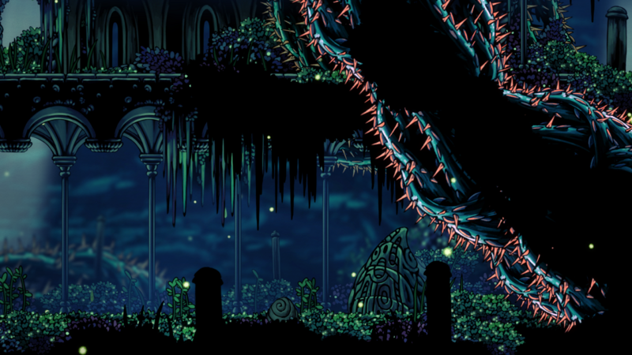

- 구분: 녹색 거리 · 출시판 스크린샷 · 800×450 · 위험, 맵, 유적
- 맵과 배치: 위에서 오른쪽 아래로 내려오는 가시가 이동 여유를 압축한다.
- 스타일과 텍스처: 유적 아치의 매끈한 곡선과 가시의 뾰족한 선이 대비된다.
- 전경과 배경: 상부 검은 지형 밑으로 뿌리가 매달리고 뒤 회랑이 비친다.
- 조명: 배경은 푸르게 눌러 가시 끝과 이동면이 먼저 읽힌다.
- 프로젝트 적용안: 천장이 낮은 구간의 장식과 실제 위험 경계를 섞지 않는다.
- [출처 페이지](https://hollowknight.wiki/w/File:Screenshot_HK_Greenpath_08.png) · [제공 이미지](https://cdn.wikimg.net/en/hkwiki/images/thumb/6/6a/Screenshot_HK_Greenpath_08.png/800px-Screenshot_HK_Greenpath_08.png) · Team Cherry / Hollow Knight Wiki

## GP09 역 입구와 벤치

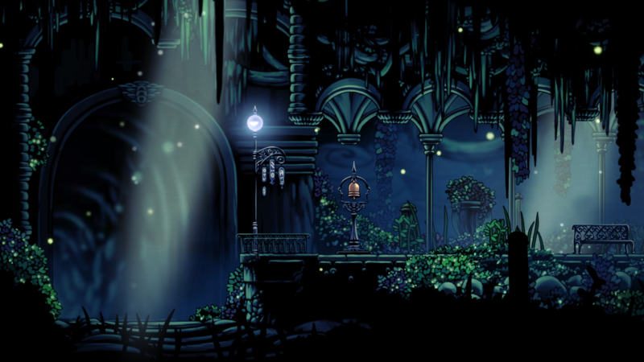

- 구분: 녹색 거리 · 출시판 스크린샷 · 800×450 · 휴식, 랜드마크, 유적
- 맵과 배치: 왼쪽 큰 원형 문과 오른쪽 벤치가 방향과 기능을 나눈다.
- 스타일과 텍스처: 부챗살 장식·문틀·얇은 기둥은 식생보다 규칙적이다.
- 전경과 배경: 아래 전경 난간과 뒤 기둥 사이에 보행면이 놓인다.
- 조명: 문과 벤치 근처의 작은 등불이 기능 지점을 표시한다.
- 프로젝트 적용안: 유물 장착기나 재시작 지점에 반복되는 고유 표식을 붙인다.
- [출처 페이지](https://hollowknight.wiki/w/File:Screenshot_HK_Greenpath_09.png) · [제공 이미지](https://cdn.wikimg.net/en/hkwiki/images/thumb/9/98/Screenshot_HK_Greenpath_09.png/800px-Screenshot_HK_Greenpath_09.png) · Team Cherry / Hollow Knight Wiki

## GP10 낮은 천장 아래 고립된 벤치

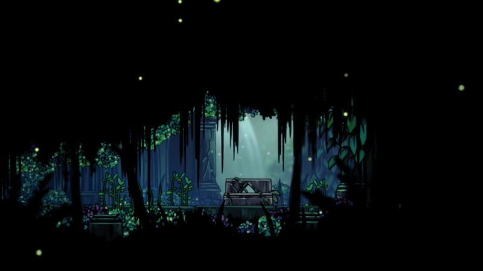

- 구분: 녹색 거리 · 출시판 스크린샷 · 800×450 · 휴식, 그림자, 레이어
- 맵과 배치: 대부분을 가린 검은 천장 아래 작은 밝은 공간이 열린다.
- 스타일과 텍스처: 천장의 돌 표면보다 아래로 뻗은 가는 뿌리 실루엣이 강하다.
- 전경과 배경: 검은 상부 코어와 가까운 뿌리, 푸른 배경을 구별한다.
- 조명: 벤치 주변만 낮은 대비의 푸른 빛으로 드러낸다.
- 프로젝트 적용안: 작은 휴식 포켓은 주변을 어둡게 하고 중앙 여백으로 위치를 기억시키자.
- [출처 페이지](https://hollowknight.wiki/w/File:Screenshot_HK_Greenpath_10.png) · [제공 이미지](https://cdn.wikimg.net/en/hkwiki/images/thumb/c/c9/Screenshot_HK_Greenpath_10.png/800px-Screenshot_HK_Greenpath_10.png) · Team Cherry / Hollow Knight Wiki

## GP11 안개 협곡으로 바뀌는 경계

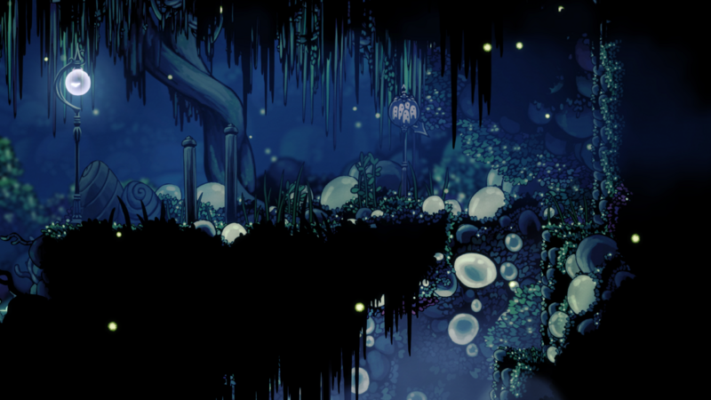

- 구분: 녹색 거리 · 출시판 스크린샷 · 800×450 · 전이, 레이어, 맵
- 맵과 배치: 왼쪽 넓은 땅이 오른쪽 수직 낙하 틈으로 끝난다.
- 스타일과 텍스처: 오른쪽 구형 식물이 잎 위주의 왼쪽과 다른 재질을 알린다.
- 전경과 배경: 검은 바닥 내부와 뒤의 식물층이 명확히 분리된다.
- 조명: 푸른 공간에 흰 둥근 발광체가 점진적으로 늘어난다.
- 프로젝트 적용안: 다음 구역의 색과 소품을 출구 이전부터 조금씩 섞는다.
- [출처 페이지](https://hollowknight.wiki/w/File:Screenshot_HK_Greenpath_11.png) · [제공 이미지](https://cdn.wikimg.net/en/hkwiki/images/thumb/d/df/Screenshot_HK_Greenpath_11.png/800px-Screenshot_HK_Greenpath_11.png) · Team Cherry / Hollow Knight Wiki

## GP12 사냥꾼의 식생 위장 은신처

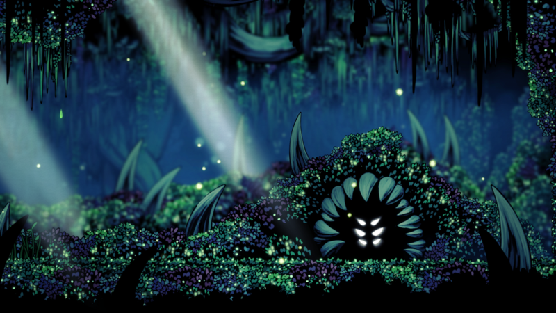

- 구분: 녹색 거리 · 출시판 스크린샷 · 800×450 · 몬스터, 랜드마크, 조명
- 맵과 배치: 낮은 잎 무더기에 큰 입과 눈이 묻혀 있다.
- 스타일과 텍스처: 겹친 작은 잎과 큰 흰 이빨의 스케일 차이가 인상을 만든다.
- 전경과 배경: 멀리 가는 큰 줄기와 가까운 둥근 잎 덩어리가 겹친다.
- 조명: 위에서 내려오는 사선 광선은 눈과 잎 표면을 읽히게 한다.
- 프로젝트 적용안: 위장형 오브젝트는 재질을 공유하되 눈·균열·움직임으로 식별 신호를 둔다.
- [출처 페이지](https://hollowknight.wiki/w/File:Screenshot_HK_The_Hunter_01.png) · [제공 이미지](https://cdn.wikimg.net/en/hkwiki/images/thumb/8/8f/Screenshot_HK_The_Hunter_01.png/800px-Screenshot_HK_The_Hunter_01.png) · Team Cherry / Hollow Knight Wiki

## GP13 쉐오의 집과 가시 경계

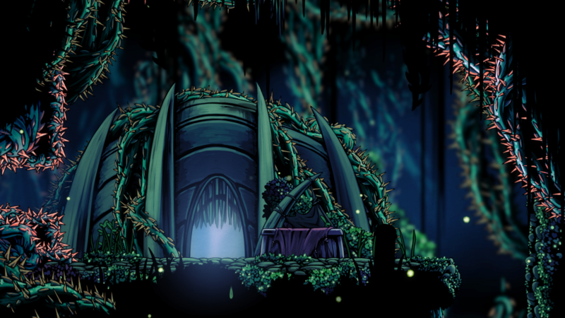

- 구분: 녹색 거리 · 출시판 스크린샷 · 800×450 · 랜드마크, 위험, 유적
- 맵과 배치: 중앙 둥근 집과 양옆 가시가 안전한 목적지를 감싼다.
- 스타일과 텍스처: 집의 큰 판형 곡면 위로 덩굴이 감기고 외곽에는 날카로운 가시가 있다.
- 전경과 배경: 어두운 전경 아래로 집 입구가 밝게 열린다.
- 조명: 하얀 출입구 빛과 차가운 외부 청록빛이 대비된다.
- 프로젝트 적용안: 유물 장치 방 입구는 고유 큰 형태 하나와 명확한 문틈으로 표시한다.
- [출처 페이지](https://hollowknight.wiki/w/File:Screenshot_HK_Nailmaster_Sheo_01.png) · [제공 이미지](https://cdn.wikimg.net/en/hkwiki/images/thumb/d/da/Screenshot_HK_Nailmaster_Sheo_01.png/800px-Screenshot_HK_Nailmaster_Sheo_01.png) · Team Cherry / Hollow Knight Wiki

## GP14 산성 호수 위 넓은 다리

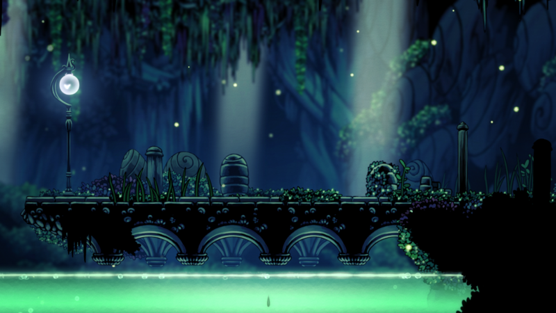

- 구분: 녹색 거리 · 출시판 스크린샷 · 800×450 · 맵, 위험, 조명
- 맵과 배치: 긴 평평한 다리가 웅덩이와 넓은 배경을 가른다.
- 스타일과 텍스처: 난간·아치의 가는 선과 잎의 작은 덩어리가 공존한다.
- 전경과 배경: 다리 아래 검은 코어와 뒤의 큰 줄기는 서로 다른 깊이다.
- 조명: 등불은 국소광이고 산성 수면은 넓은 가로 발광면이다.
- 프로젝트 적용안: 넓은 방에서는 점광원과 수평 위험 경계를 다른 크기로 읽히게 한다.
- [출처 페이지](https://hollowknight.wiki/w/File:Greenpath_South_Area.png) · [제공 이미지](https://cdn.wikimg.net/en/hkwiki/images/thumb/7/7f/Greenpath_South_Area.png/800px-Greenpath_South_Area.png) · Team Cherry / Hollow Knight Wiki

## GP15 우운 사당 안의 어두운 휴식 공간

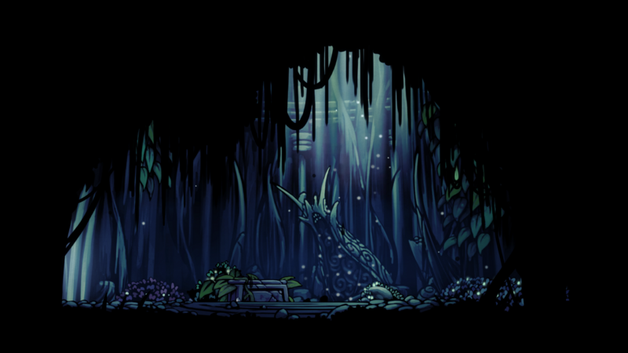

- 구분: 녹색 거리 · 출시판 스크린샷 · 800×450 · 휴식, 그림자, 조명
- 맵과 배치: 거의 검은 입구 테두리 안에 벤치가 작게 놓인다.
- 스타일과 텍스처: 안쪽 큰 조각과 긴 곡선 구조는 돌보다 나무 같은 유기 형태를 보인다.
- 전경과 배경: 입구를 두르는 검은 프레임과 뒤 벽의 푸른 층이 구분된다.
- 조명: 천장 틈의 좁은 빛이 벤치로 내려오고 주변은 깊게 어둡다.
- 프로젝트 적용안: 하강 착지 이후 회복 공간에 전체 밝기 상승 대신 좁은 빛의 통로를 쓴다.
- [출처 페이지](https://hollowknight.wiki/w/File:Lake_of_Unn_Shrine_Interior.png) · [제공 이미지](https://cdn.wikimg.net/en/hkwiki/images/thumb/7/72/Lake_of_Unn_Shrine_Interior.png/800px-Lake_of_Unn_Shrine_Interior.png) · Team Cherry / Hollow Knight Wiki

## GP16 이층 유적의 벤치 포켓

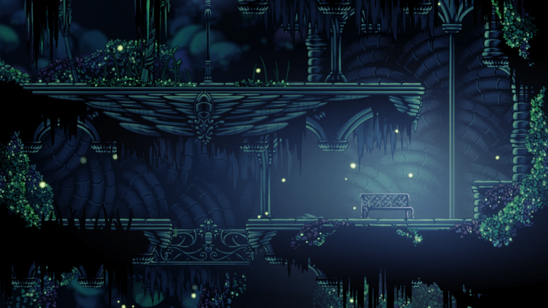

- 구분: 녹색 거리 · 출시판 스크린샷 · 800×450 · 휴식, 맵, 유적
- 맵과 배치: 위·아래 통로 사이 오른쪽에 벤치가 놓인 작은 공간이 있다.
- 스타일과 텍스처: 정교한 다리 하단 장식과 거친 잎 테두리가 겹친다.
- 전경과 배경: 전경 아래 실루엣과 여러 층의 유적 기둥이 깊이를 만든다.
- 조명: 벤치 뒤의 푸른 빛이 복잡한 건축에서 쉬는 지점을 분리한다.
- 프로젝트 적용안: 샛길의 휴식 지점은 주 경로와 연결되는 시야를 남기고 조명으로 구분한다.
- [출처 페이지](https://hollowknight.wiki/w/File:Greenpath_Central_Bench%282%29.png) · [제공 이미지](https://cdn.wikimg.net/en/hkwiki/images/thumb/8/88/Greenpath_Central_Bench%282%29.png/800px-Greenpath_Central_Bench%282%29.png) · Team Cherry / Hollow Knight Wiki

## GP17 오블 구역의 수직 발판

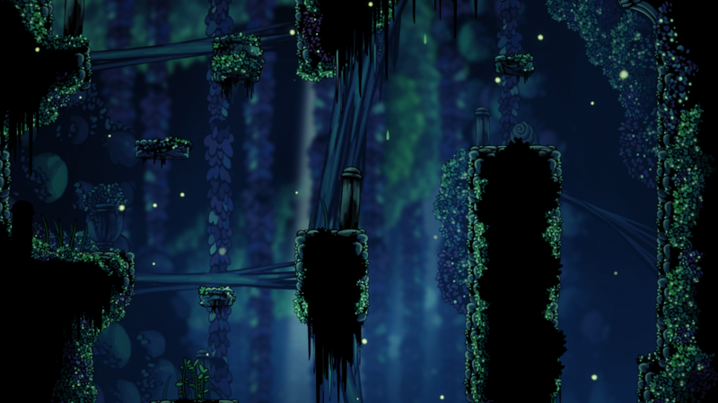

- 구분: 녹색 거리 · 출시판 스크린샷 · 800×450 · 수직, 맵, 레이어
- 맵과 배치: 작은 발판이 좌우 다른 높이로 흩어지고 긴 기둥이 시선을 세로로 끈다.
- 스타일과 텍스처: 발판 가장자리의 이끼 띠와 아래 뿌리는 크기가 짧고 불규칙하다.
- 전경과 배경: 큰 뒤 줄기는 흐리고 전면의 발판·벽 가장자리는 선명하다.
- 조명: 점 형태 포자와 부드러운 청록 광막이 빈 공중을 채운다.
- 프로젝트 적용안: 낙하 통로에서는 다음 착지면과 유물 목표가 장식 기둥보다 먼저 보이게 한다.
- [출처 페이지](https://hollowknight.wiki/w/File:Greenpath_Obble_Area%282%29.png) · [제공 이미지](https://cdn.wikimg.net/en/hkwiki/images/thumb/3/30/Greenpath_Obble_Area%282%29.png/800px-Greenpath_Obble_Area%282%29.png) · Team Cherry / Hollow Knight Wiki

## GP18 여왕의 정원으로 통하는 경계

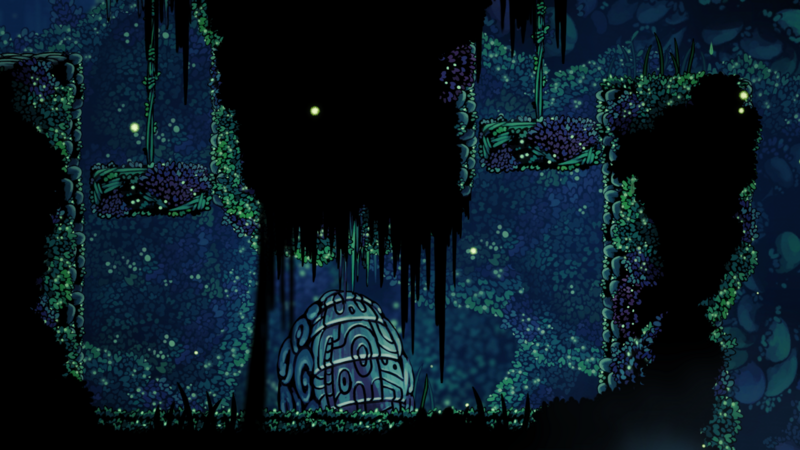

- 구분: 녹색 거리 · 출시판 스크린샷 · 800×450 · 전이, 맵, 그림자
- 맵과 배치: 좌우 높은 벽 아래 중앙 문양석이 목적지를 표시한다.
- 스타일과 텍스처: 둥근 잎 테두리와 규칙적 돌 문양이 섞인다.
- 전경과 배경: 중앙 위의 검은 코어와 먼 배경의 아치를 구분한다.
- 조명: 양옆 푸른 광막이 중앙 어두운 문양석을 감싼다.
- 프로젝트 적용안: 장치 도착점은 복잡한 광효과보다 고유 실루엣과 좌우 여백으로 표시한다.
- [출처 페이지](https://hollowknight.wiki/w/File:Greenpath_Queen%27s_Gardens_Connection.png) · [제공 이미지](https://cdn.wikimg.net/en/hkwiki/images/thumb/9/97/Greenpath_Queen%27s_Gardens_Connection.png/800px-Greenpath_Queen%27s_Gardens_Connection.png) · Team Cherry / Hollow Knight Wiki

## GP19 초기 개발판의 낮은 물가

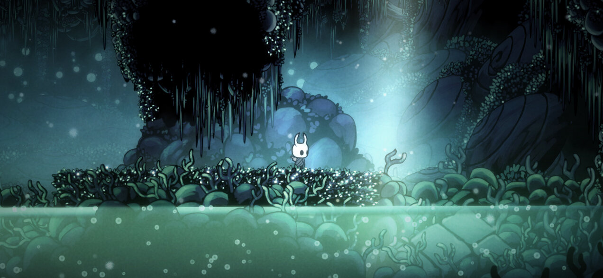

- 구분: 녹색 거리 · 개발 중 공식 자료 · 1272×588 · 개발판, 텍스처, 조명
- 맵과 배치: 낮은 보행 띠와 큰 빈 배경을 공유한다.
- 스타일과 텍스처: 현재 출시판보다 알갱이·기포 같은 점묘가 두드러진다.
- 전경과 배경: 앞의 검은 덩어리와 뒤의 푸른 돌층이 겹친다.
- 조명: 사선으로 내려오는 넓은 빛과 밝은 수면이 보인다.
- 프로젝트 적용안: 참고용 초기안으로만 사용하고 최종 녹색 거리의 자산 규칙과 혼합하지 않는다.
- [출처 페이지](https://www.teamcherry.com.au/blog/the-green-path-a-hollow-knight-tour) · [제공 이미지](https://images.squarespace-cdn.com/content/v1/606d4deb4db8c15ea53b3624/1618900856929-F475LO4VJ8XCI406TX0X/Fungus_05.jpg) · Team Cherry

## GP20 초기 개발판의 거대 유해

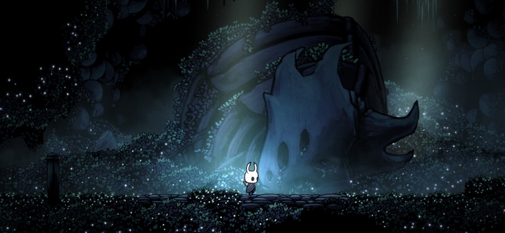

- 구분: 녹색 거리 · 개발 중 공식 자료 · 1272×588 · 개발판, 랜드마크, 레이어
- 맵과 배치: 작은 주인공 옆에 거대한 껍질 또는 유해가 배치된다.
- 스타일과 텍스처: 큰 곡면의 몇 개 구멍만으로 낡은 생물의 규모를 만든다.
- 전경과 배경: 앞쪽 어둠과 뒤의 푸른 큰 형태 사이에 작은 캐릭터가 있다.
- 조명: 차가운 대기광이 유해의 윤곽만 드러낸다.
- 프로젝트 적용안: 프로젝트 유적에 거대한 장치 파편 한 점을 두어 공간 규모를 암시한다.
- [출처 페이지](https://www.teamcherry.com.au/blog/the-green-path-a-hollow-knight-tour) · [제공 이미지](https://images.squarespace-cdn.com/content/v1/606d4deb4db8c15ea53b3624/1618900873629-BB8YVWYVVEMOZ7XQHEAF/Fungus_04.jpg) · Team Cherry

## GP21 초기 개발판의 호숫가 난간

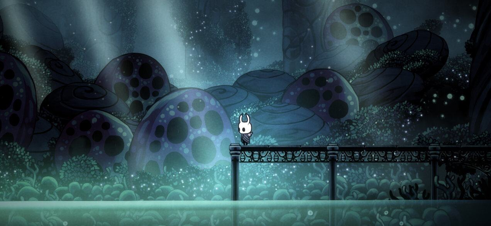

- 구분: 녹색 거리 · 개발 중 공식 자료 · 1272×588 · 개발판, 맵, 조명
- 맵과 배치: 가느다란 다리와 넓은 물가가 수평으로 이어진다.
- 스타일과 텍스처: 구멍 난 큰 유기체와 문양 수면이 초기판 특징이다.
- 전경과 배경: 앞 난간·중앙 보행면·뒤 큰 유기체가 분리된다.
- 조명: 청록빛 수면과 사선 빛이 화면 아래와 위를 연결한다.
- 프로젝트 적용안: 물이나 낭떠러지 주변에 열린 시야를 만들되 고유한 구조물로 재해석한다.
- [출처 페이지](https://www.teamcherry.com.au/blog/the-green-path-a-hollow-knight-tour) · [제공 이미지](https://images.squarespace-cdn.com/content/v1/606d4deb4db8c15ea53b3624/1618900771877-ZNK32GKBU2AR3OGN1EUO/Fungus_03.jpg) · Team Cherry

## GP22 비행 적과 수직 발판

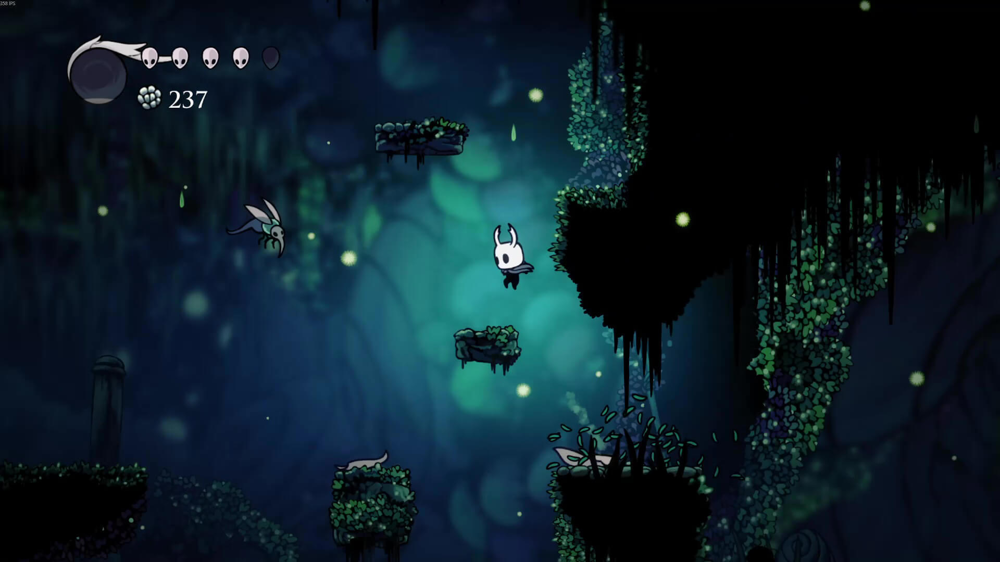

- 구분: 녹색 거리 · 출시판 플레이 스크린샷 · 1920×1080 · 몬스터, 수직, 맵
- 맵과 배치: 작은 발판 사이 공중에 돌진형 적이 놓인다.
- 스타일과 텍스처: 작은 발판은 잎 테두리와 아래 뿌리로 한 덩어리가 된다.
- 전경과 배경: 오른쪽 검은 벽과 뒤 큰 식물의 대비가 뚜렷하다.
- 조명: 청록색 밝은 공간 안에 캐릭터와 비행 적이 보인다.
- 프로젝트 적용안: 벽점프 첫 학습 공간은 비운 뒤 숙련 구간에서 비행 적을 조합한다.
- [출처 페이지](https://www.monster-soluce.com/jeux/hollow-knight/guide-solution/vertchemin-guide-exploration-et-secrets-boss-personnages) · [제공 이미지](https://www.monster-soluce.com/uploads/scale-max/7f/7d/14249-hollow-knight-077-grub-1-verchemin-1.jpg) · Team Cherry / Monster Soluce

## GP23 잎 단서가 있는 높은 길

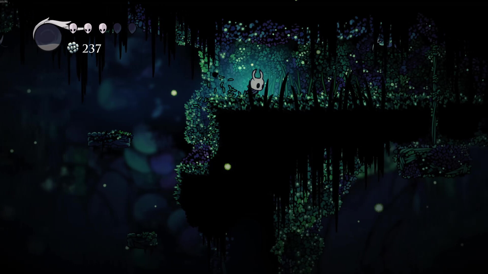

- 구분: 녹색 거리 · 출시판 플레이 스크린샷 · 1920×1080 · 탐색, 텍스처, 그림자
- 맵과 배치: 상부 통로와 아래 발판이 겹쳐 샛길의 높이 차를 보여준다.
- 스타일과 텍스처: 흩어진 잎과 빽빽한 가장자리 이끼가 방향의 단서가 된다.
- 전경과 배경: 중앙 검은 지형 속과 그 아래 선명한 뿌리가 보인다.
- 조명: 화면 우측 위의 작은 밝은 영역이 열린 길을 읽히게 한다.
- 프로젝트 적용안: 샛길 앞에는 동일한 잎·문양 파편을 반복해 탐색 단서를 준다.
- [출처 페이지](https://www.monster-soluce.com/jeux/hollow-knight/guide-solution/vertchemin-guide-exploration-et-secrets-boss-personnages) · [제공 이미지](https://www.monster-soluce.com/uploads/scale-max/8a/24/14250-hollow-knight-077-grub-1-verchemin-2-bis.jpg) · Team Cherry / Monster Soluce

## GP24 덩굴을 타격하는 장면

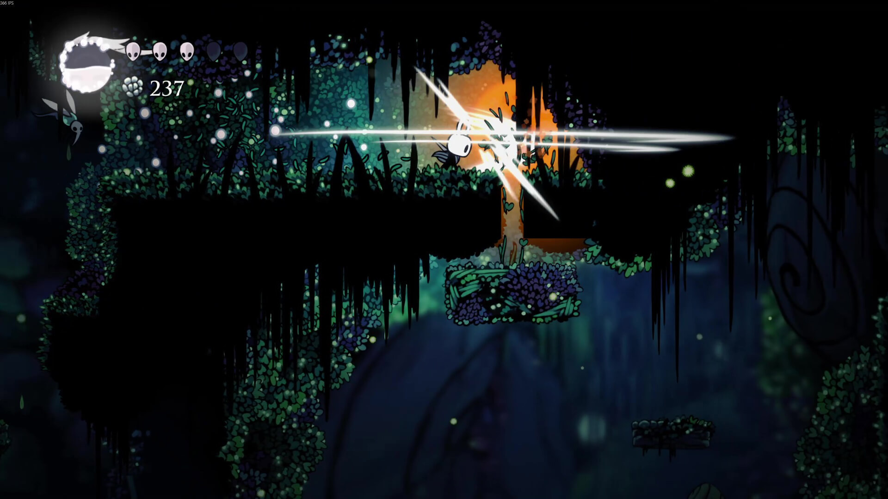

- 구분: 녹색 거리 · 출시판 플레이 스크린샷 · 1920×1080 · 상호작용, 조명, 맵
- 맵과 배치: 공격이 닿는 덩굴 근처에 발판과 길이 모인다.
- 스타일과 텍스처: 얇은 덩굴과 잎 조각이 무거운 지형에서 분리된다.
- 전경과 배경: 검은 상부 코어 뒤로 큰 푸른 줄기가 있다.
- 조명: 짧은 흰 공격선과 주황색 타격 광점이 배경보다 강하다.
- 프로젝트 적용안: 상호작용 대상은 사전 표식과 타격 후 파편으로 확인시킨다. 정지 화면만으로 정확한 지속시간은 판단하지 않는다.
- [출처 페이지](https://www.monster-soluce.com/jeux/hollow-knight/guide-solution/vertchemin-guide-exploration-et-secrets-boss-personnages) · [제공 이미지](https://www.monster-soluce.com/uploads/scale-max/48/77/14251-hollow-knight-077-grub-1-verchemin-2.jpg) · Team Cherry / Monster Soluce

## GP25 높은 곳의 구출 보상

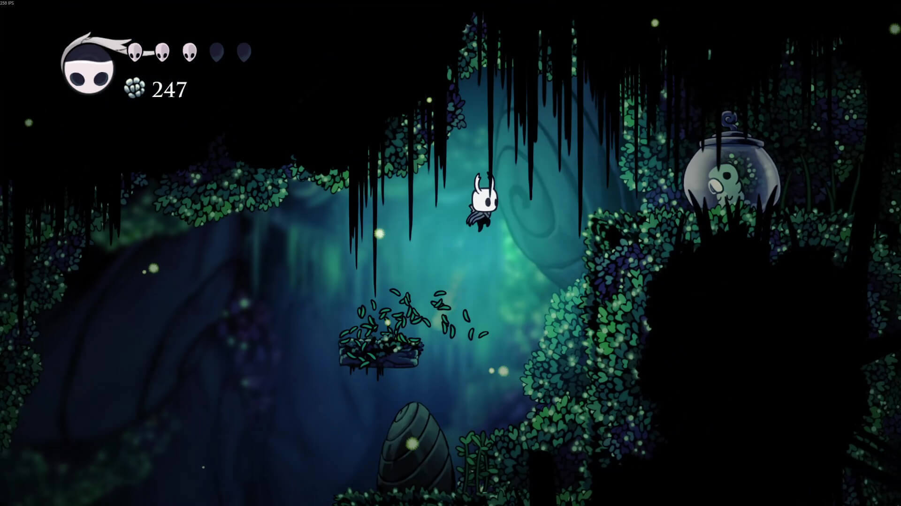

- 구분: 녹색 거리 · 출시판 플레이 스크린샷 · 1920×1080 · 탐색, 맵, 조명
- 맵과 배치: 오른쪽 높은 지점의 병과 아래 발판이 목적·접근로를 나눈다.
- 스타일과 텍스처: 벽의 잎 띠와 둥근 문양 돌이 반복된다.
- 전경과 배경: 앞의 검은 위쪽 천장과 아래 푸른 원경이 열린다.
- 조명: 목표 부근이 주변 잎보다 밝게 보여 보상을 찾게 한다.
- 프로젝트 적용안: 수집물은 미리 보여 주고 유물로 도달할 경로를 이후에 찾게 한다.
- [출처 페이지](https://www.monster-soluce.com/jeux/hollow-knight/guide-solution/vertchemin-guide-exploration-et-secrets-boss-personnages) · [제공 이미지](https://www.monster-soluce.com/uploads/scale-max/ff/87/14252-hollow-knight-077-grub-1-verchemin-3.jpg) · Team Cherry / Monster Soluce

## GP26 잘린 덩굴 아래 이동 발판

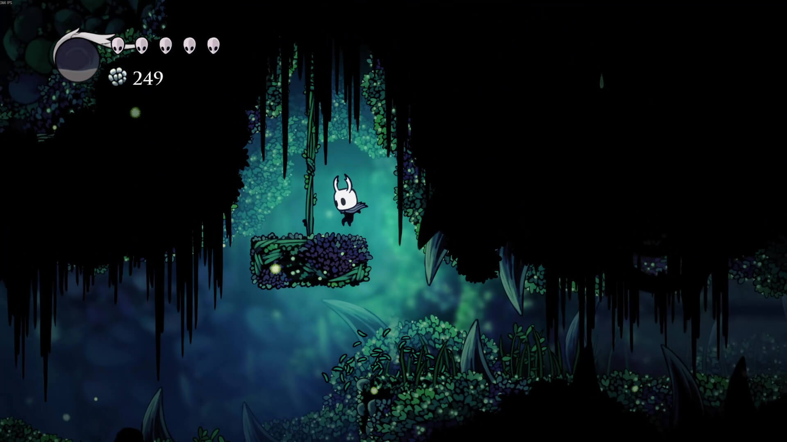

- 구분: 녹색 거리 · 출시판 플레이 스크린샷 · 1920×1080 · 상호작용, 맵, 텍스처
- 맵과 배치: 중앙 큰 발판과 옆의 작은 발판이 단계적인 이동을 만든다.
- 스타일과 텍스처: 부서지는 덩굴 잎과 발판 아래 뿌리가 다른 밀도로 표현된다.
- 전경과 배경: 위 검은 천장과 뒤 청록색 여백이 충돌면을 둘러싼다.
- 조명: 착지할 발판을 둘러싼 배경이 밝아 외곽이 잘 읽힌다.
- 프로젝트 적용안: 이동 장치는 경로와 정지점을 먼저 설계하고 장식으로 가리지 않는다.
- [출처 페이지](https://www.monster-soluce.com/jeux/hollow-knight/guide-solution/vertchemin-guide-exploration-et-secrets-boss-personnages) · [제공 이미지](https://www.monster-soluce.com/uploads/scale-max/22/00/14253-hollow-knight-078-grub-2-verchemin-1.jpg) · Team Cherry / Monster Soluce

## GP27 가시 위에 남는 안전 공간

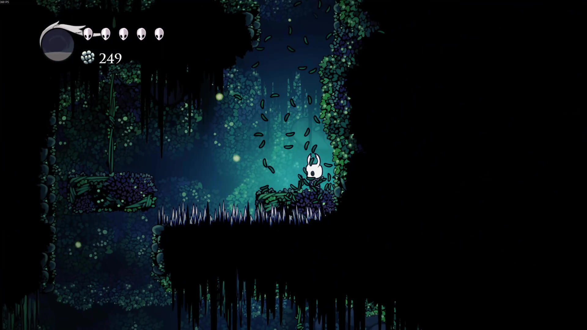

- 구분: 녹색 거리 · 출시판 플레이 스크린샷 · 1920×1080 · 위험, 맵, 텍스처
- 맵과 배치: 작은 안전면과 가시 바닥이 가까워 이동 판단을 요구한다.
- 스타일과 텍스처: 밝고 날카로운 가시와 둥근 이끼가 재질로 분리된다.
- 전경과 배경: 오른쪽과 아래 검은 지형 내부가 통로의 끝을 만든다.
- 조명: 위험물 끝은 흐리지 않고 중앙만 청록색으로 연다.
- 프로젝트 적용안: 안전면의 실제 너비를 장식 잎으로 넓어 보이게 만들지 않는다.
- [출처 페이지](https://www.monster-soluce.com/jeux/hollow-knight/guide-solution/vertchemin-guide-exploration-et-secrets-boss-personnages) · [제공 이미지](https://www.monster-soluce.com/uploads/scale-max/57/30/14254-hollow-knight-078-grub-2-verchemin-2.jpg) · Team Cherry / Monster Soluce

## GP28 가시 구덩이를 건너는 발판

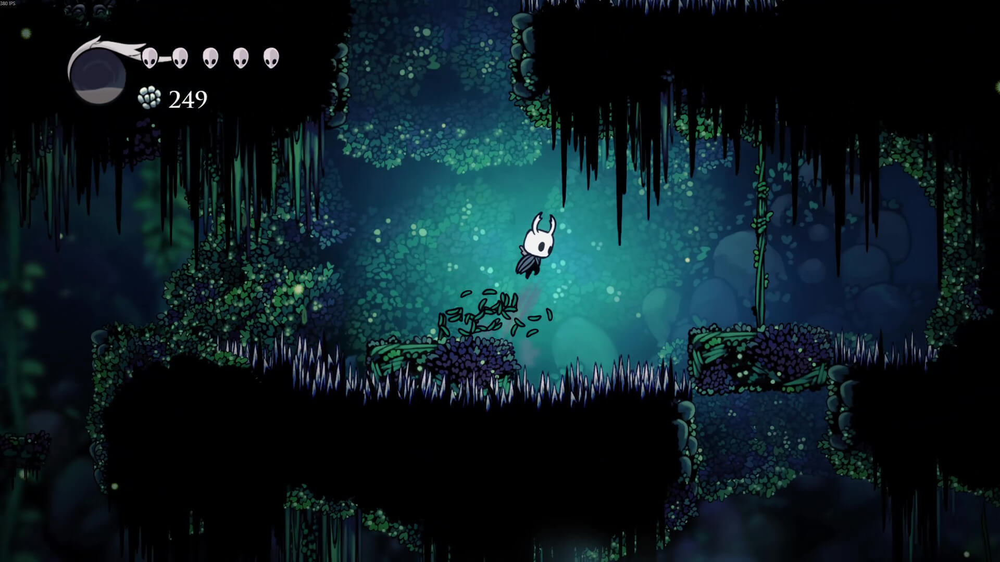

- 구분: 녹색 거리 · 출시판 플레이 스크린샷 · 1920×1080 · 위험, 수직, 맵
- 맵과 배치: 양옆 안전면 사이 가시와 발판이 놓여 이동 순서를 만든다.
- 스타일과 텍스처: 매달린 뿌리와 뾰족한 가시의 방향성이 서로 다르다.
- 전경과 배경: 상하 검은 덩어리가 가운데 밝은 통로를 감싼다.
- 조명: 경로 중앙의 부드러운 푸른 빛이 이동 공간을 드러낸다.
- 프로젝트 적용안: 순간이동 퍼즐은 출발·중간 정지점·도착을 한 장면에서 읽히게 한다.
- [출처 페이지](https://www.monster-soluce.com/jeux/hollow-knight/guide-solution/vertchemin-guide-exploration-et-secrets-boss-personnages) · [제공 이미지](https://www.monster-soluce.com/uploads/scale-max/54/53/14255-hollow-knight-078-grub-2-verchemin-3.jpg) · Team Cherry / Monster Soluce

## GP29 산성 웅덩이의 작은 섬

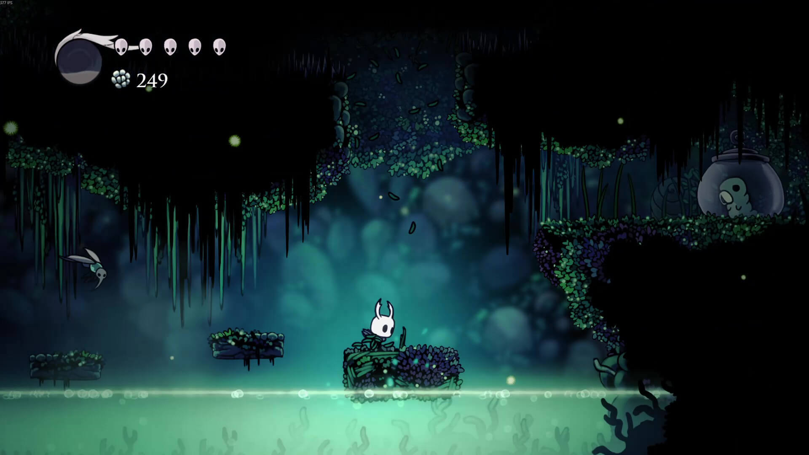

- 구분: 녹색 거리 · 출시판 플레이 스크린샷 · 1920×1080 · 위험, 맵, 조명
- 맵과 배치: 물 위 두 작은 발판과 우측 보상 높이가 단계적으로 이어진다.
- 스타일과 텍스처: 떠 있는 발판의 불규칙한 잎 덩어리가 배경과 분리된다.
- 전경과 배경: 아래 수면은 넓고 상부 천장은 검은 실루엣이다.
- 조명: 밝은 액체 면과 어두운 발판의 명암 대비가 위험을 알린다.
- 프로젝트 적용안: 하강 뒤에는 위험 경계와 첫 안전 발판을 카메라가 함께 보여 주게 한다.
- [출처 페이지](https://www.monster-soluce.com/jeux/hollow-knight/guide-solution/vertchemin-guide-exploration-et-secrets-boss-personnages) · [제공 이미지](https://www.monster-soluce.com/uploads/scale-max/e8/19/14256-hollow-knight-078-grub-2-verchemin-4.jpg) · Team Cherry / Monster Soluce

## GP30 구출 직후의 작은 보상방

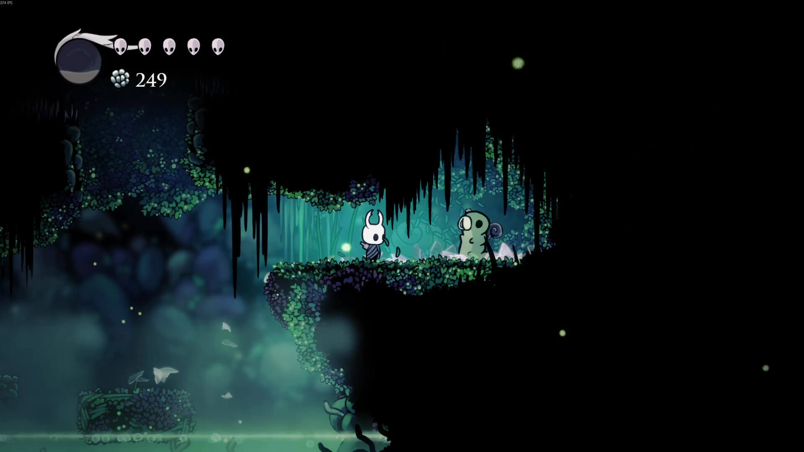

- 구분: 녹색 거리 · 출시판 플레이 스크린샷 · 1920×1080 · 탐색, 휴식, 맵
- 맵과 배치: 오른쪽 끝의 안전한 바닥에 캐릭터와 보상이 모인다.
- 스타일과 텍스처: 둥근 돌과 잎이 좁은 방을 감싼다.
- 전경과 배경: 바닥 속은 검고 배경은 푸른 대기층으로 물러난다.
- 조명: 보상 주변의 밝기를 유지하고 위 천장은 어둡게 닫는다.
- 프로젝트 적용안: 보상 획득 직후 공격보다 공간 인지와 귀환 경로를 먼저 확인하게 한다.
- [출처 페이지](https://www.monster-soluce.com/jeux/hollow-knight/guide-solution/vertchemin-guide-exploration-et-secrets-boss-personnages) · [제공 이미지](https://www.monster-soluce.com/uploads/scale-max/90/5b/14257-hollow-knight-078-grub-2-verchemin-5.jpg) · Team Cherry / Monster Soluce

## GP31 이끼 돌진충의 큰 잎 덩어리

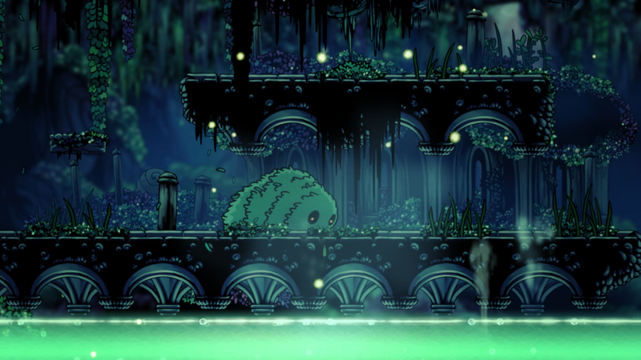

- 구분: 녹색 거리 · 출시판 스크린샷 · 800×450 · 몬스터, 전투, 텍스처
- 맵과 배치: 긴 평평한 보행면에 가로로 긴 적이 놓인다.
- 스타일과 텍스처: 잎 위장 덩어리에 얼굴이 드러나 배경 식생과 몸체를 구별한다.
- 전경과 배경: 위 유적 발판의 검은 코어와 하단 적의 밝은 외곽이 대비된다.
- 조명: 차가운 빛 속에서 적 얼굴의 밝은 점이 시선을 끈다.
- 프로젝트 적용안: 공벌레의 등갑은 배경과 재질을 공유하되 얼굴·실루엣은 독립시킨다.
- [출처 페이지](https://hollowknight.wiki/w/File:Screenshot_HK_Moss_Charger_01.png) · [제공 이미지](https://cdn.wikimg.net/en/hkwiki/images/thumb/8/8d/Screenshot_HK_Moss_Charger_01.png/800px-Screenshot_HK_Moss_Charger_01.png) · Team Cherry / Hollow Knight Wiki

## GP32 작은 이끼족 무리

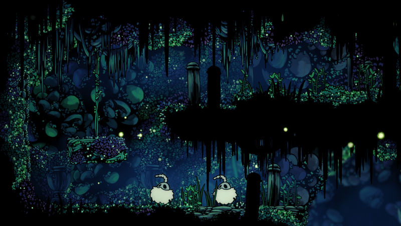

- 구분: 녹색 거리 · 출시판 스크린샷 · 800×450 · 몬스터, 전투, 레이어
- 맵과 배치: 낮은 통로에 비슷한 체형 둘이 배치된다.
- 스타일과 텍스처: 털·잎처럼 일어난 외곽과 밝은 몸통이 특징이다.
- 전경과 배경: 검은 중간 지형 때문에 적은 아래 통로에 또렷하게 보인다.
- 조명: 큰 원형 효과 없이 몸통 명암만으로 적을 분리한다.
- 프로젝트 적용안: 약한 적 무리는 수보다 간격과 밝은 식별 부분을 먼저 조절한다.
- [출처 페이지](https://hollowknight.wiki/w/File:Screenshot_HK_Mosskin_01.png) · [제공 이미지](https://cdn.wikimg.net/en/hkwiki/images/thumb/5/55/Screenshot_HK_Mosskin_01.png/800px-Screenshot_HK_Mosskin_01.png) · Team Cherry / Hollow Knight Wiki

## GP33 폭발하는 이끼족의 주황 신호

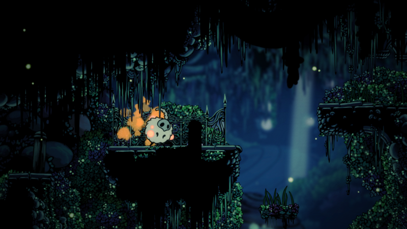

- 구분: 녹색 거리 · 출시판 스크린샷 · 800×450 · 몬스터, 조명, 위험
- 맵과 배치: 좁은 발판의 둥근 적과 주황 구름이 결합한다.
- 스타일과 텍스처: 둥근 몸에 점 같은 돌기가 있고 큰 주황 덩어리가 녹색을 깨뜨린다.
- 전경과 배경: 검은 천장과 푸른 배경이 폭발 신호의 대비를 높인다.
- 조명: 따뜻한 주황색은 차가운 지역 팔레트에서 위험 신호가 된다.
- 프로젝트 적용안: 골렘의 공격 경고는 색과 자세 변화로 구별하고 유물의 푸른빛과 혼동시키지 않는다.
- [출처 페이지](https://hollowknight.wiki/w/File:Screenshot_HK_Volatile_Mosskin_01.png) · [제공 이미지](https://cdn.wikimg.net/en/hkwiki/images/thumb/a/a3/Screenshot_HK_Volatile_Mosskin_01.png/800px-Screenshot_HK_Volatile_Mosskin_01.png) · Team Cherry / Hollow Knight Wiki

## GP34 방패와 긴 무기의 이끼 기사

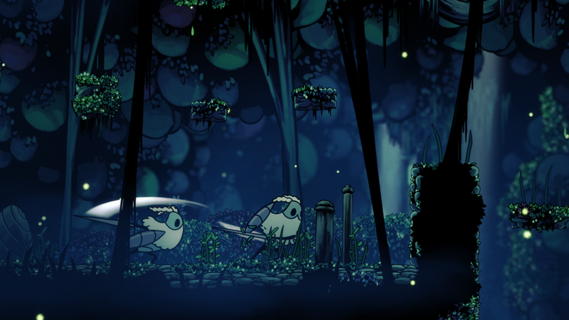

- 구분: 녹색 거리 · 출시판 스크린샷 · 800×450 · 몬스터, 전투, 텍스처
- 맵과 배치: 낮고 긴 무기 실루엣이 이동·공격 방향을 가리킨다.
- 스타일과 텍스처: 둥근 방패와 잘게 갈라진 잎 갑옷이 다른 크기로 읽힌다.
- 전경과 배경: 뒤 큰 나무줄기는 어두워 무기 윤곽을 과도하게 방해하지 않는다.
- 조명: 낮은 채도의 배경 위 밝은 갑옷과 흰 무기가 보인다.
- 프로젝트 적용안: 골렘 공격은 팔과 투사체의 큰 방향성이 멀리서도 읽히게 한다.
- [출처 페이지](https://hollowknight.wiki/w/File:Screenshot_HK_Moss_Knight_01.png) · [제공 이미지](https://cdn.wikimg.net/en/hkwiki/images/thumb/0/0e/Screenshot_HK_Moss_Knight_01.png/800px-Screenshot_HK_Moss_Knight_01.png) · Team Cherry / Hollow Knight Wiki

## GP35 통로 옆 고정형 식물 적

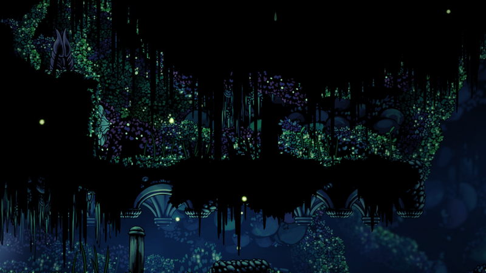

- 구분: 녹색 거리 · 출시판 스크린샷 · 800×450 · 몬스터, 맵, 그림자
- 맵과 배치: 좌상단 작은 식물과 아래 이동 공간이 분리된다.
- 스타일과 텍스처: 배경 잎과 비슷한 형상에 얼굴·입 부분이 작게 보인다.
- 전경과 배경: 큰 검은 중앙 코어가 통로를 위아래로 나눈다.
- 조명: 푸른 주변광 위로 적의 작은 밝은 얼굴이 대비된다.
- 프로젝트 적용안: 벽부착 적 제안은 첫 등장 위치를 넓은 시야 안에 두고 사전 신호를 준다.
- [출처 페이지](https://hollowknight.wiki/w/File:Screenshot_HK_Gulka_01.png) · [제공 이미지](https://cdn.wikimg.net/en/hkwiki/images/thumb/c/cd/Screenshot_HK_Gulka_01.png/800px-Screenshot_HK_Gulka_01.png) · Team Cherry / Hollow Knight Wiki

## GP36 상하 지형 사이 바보잡이풀

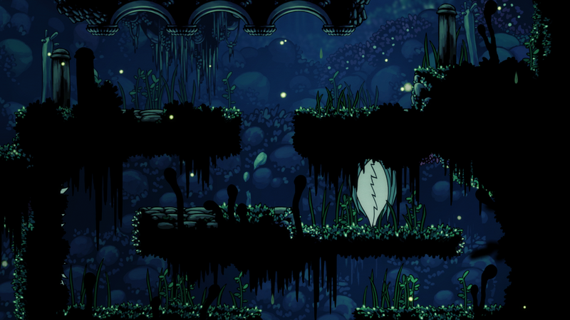

- 구분: 녹색 거리 · 출시판 스크린샷 · 800×450 · 몬스터, 위험, 레이어
- 맵과 배치: 위아래 통로 틈의 큰 벌어진 입이 이동 경계와 겹친다.
- 스타일과 텍스처: 식물 잎과 이빨의 날카로운 외곽을 함께 쓴다.
- 전경과 배경: 검은 지형 내부와 입의 밝은 면이 대비되어 위치가 드러난다.
- 조명: 밝은 입 내부가 푸른 배경에서 눈에 띈다.
- 프로젝트 적용안: 숨은 위험은 반복 학습용 단서를 두고 최초 착지면·유물 도착점을 바로 덮지 않는다.
- [출처 페이지](https://hollowknight.wiki/w/File:Screenshot_HK_Fool_Eater_01.png) · [제공 이미지](https://cdn.wikimg.net/en/hkwiki/images/thumb/7/7f/Screenshot_HK_Fool_Eater_01.png/800px-Screenshot_HK_Fool_Eater_01.png) · Team Cherry / Hollow Knight Wiki

## GP37 오블의 공중 탄막

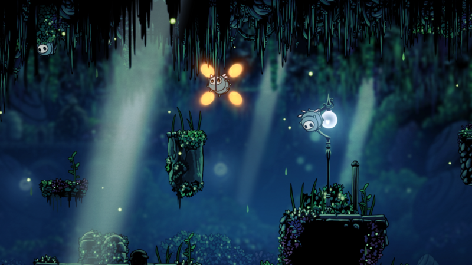

- 구분: 녹색 거리 · 출시판 스크린샷 · 800×450 · 몬스터, 전투, 조명
- 맵과 배치: 작은 발판 주변의 둥근 비행 적과 여러 발사체가 공중을 나눈다.
- 스타일과 텍스처: 둥근 적 몸과 둥근 탄환이 같은 계열 형태를 쓴다.
- 전경과 배경: 뒤 수직 빛줄기는 흐리고 탄환 가장자리는 선명하다.
- 조명: 따뜻한 발사체가 차가운 청록 배경에서 강하게 보인다.
- 프로젝트 적용안: 현재 골렘 탄환 뒤에는 낮은 대비의 배경을 두고 포자를 줄인다.
- [출처 페이지](https://hollowknight.wiki/w/File:Screenshot_HK_Obble_01.png) · [제공 이미지](https://cdn.wikimg.net/en/hkwiki/images/thumb/c/ca/Screenshot_HK_Obble_01.png/800px-Screenshot_HK_Obble_01.png) · Team Cherry / Hollow Knight Wiki

## GP38 모기의 가늘고 뾰족한 몸

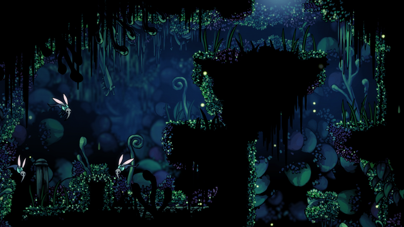

- 구분: 녹색 거리 · 출시판 스크린샷 · 800×450 · 몬스터, 맵, 전투
- 맵과 배치: 왼쪽 공중의 길쭉한 적이 작은 발판 사이 경로를 가로지른다.
- 스타일과 텍스처: 침 모양 주둥이와 얇은 날개가 둥근 이끼와 다른 외곽을 만든다.
- 전경과 배경: 오른쪽 검은 지형 코어가 비행 경로의 끝을 또렷하게 한다.
- 조명: 별도 강한 광원보다 가는 밝은 몸체 윤곽이 중요하다.
- 프로젝트 적용안: 비행 적을 추가한다면 돌진 방향이 자세로 먼저 드러나게 한다.
- [출처 페이지](https://hollowknight.wiki/w/File:Screenshot_HK_Squit_01.png) · [제공 이미지](https://cdn.wikimg.net/en/hkwiki/images/thumb/1/11/Screenshot_HK_Squit_01.png/800px-Screenshot_HK_Squit_01.png) · Team Cherry / Hollow Knight Wiki

## GP39 가시 틈의 단단한 비행체

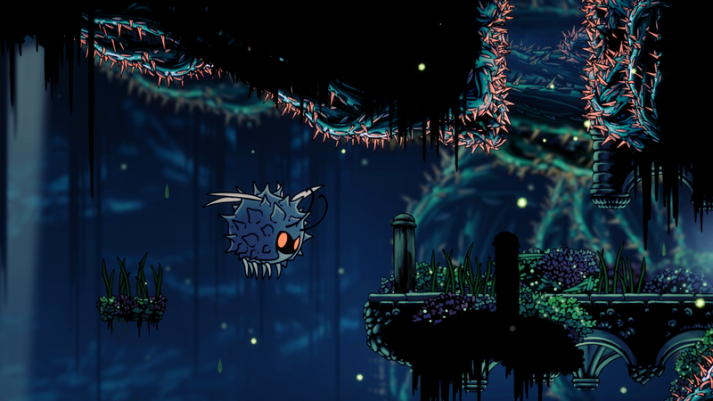

- 구분: 녹색 거리 · 출시판 스크린샷 · 800×450 · 몬스터, 위험, 텍스처
- 맵과 배치: 위·아래 가시 사이의 비행체가 좁은 이동 공간을 차지한다.
- 스타일과 텍스처: 단단한 껍질의 가시와 둥근 중앙 몸체가 위험 형태를 반복한다.
- 전경과 배경: 배경의 흐린 유적과 선명한 적 껍질이 분리된다.
- 조명: 밝은 주황색 눈과 차가운 껍질이 구별된다.
- 프로젝트 적용안: 위험을 겹치는 조합은 숙련 구간 제안으로 남기고 현재 방에 즉시 추가하지 않는다.
- [출처 페이지](https://hollowknight.wiki/w/File:Screenshot_HK_Duranda_01.png) · [제공 이미지](https://cdn.wikimg.net/en/hkwiki/images/thumb/c/c6/Screenshot_HK_Duranda_01.png/800px-Screenshot_HK_Duranda_01.png) · Team Cherry / Hollow Knight Wiki

## EX01 여왕의 정원의 큰 전경 잎

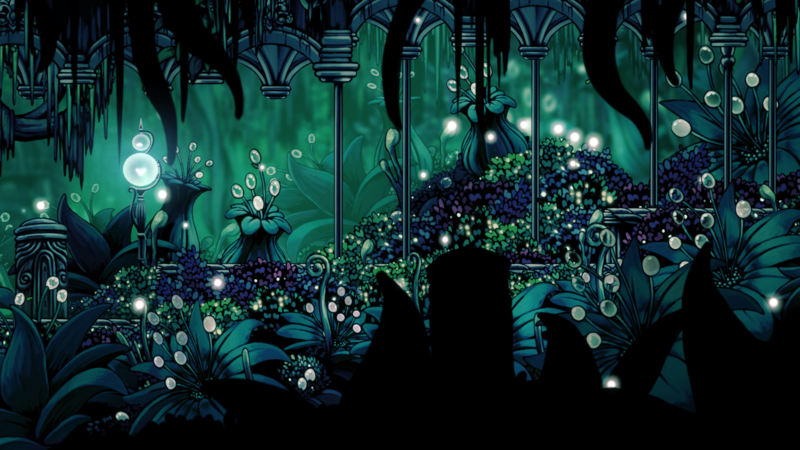

- 구분: 여왕의 정원 · 출시판 스크린샷 · 800×450 · 레이어, 그림자, 비교
- 맵과 배치: 큰 식물과 유적 기둥이 화면 양끝을 채운다.
- 스타일과 텍스처: 넓은 잎 면·작은 꽃·가느다란 건축 선이 크기로 구분된다.
- 전경과 배경: 하단의 거의 검은 큰 잎은 카메라 가까운 가림물로 읽힌다.
- 조명: 중앙 청록 빛과 점 발광 식물이 겹친다.
- 프로젝트 적용안: 전경은 가장자리에 큰 덩어리로 두고 작은 잎을 화면 전체에 균일하게 채우지 않는다.
- [출처 페이지](https://hollowknight.wiki/w/File:Screenshot_HK_Queen%27s_Gardens_01.png) · [제공 이미지](https://cdn.wikimg.net/en/hkwiki/images/thumb/9/91/Screenshot_HK_Queen%27s_Gardens_01.png/800px-Screenshot_HK_Queen%27s_Gardens_01.png) · Team Cherry / Hollow Knight Wiki

## EX02 여왕의 정원의 매달린 발판

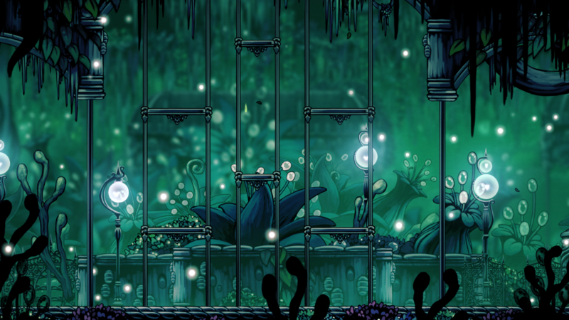

- 구분: 여왕의 정원 · 출시판 스크린샷 · 800×450 · 맵, 레이어, 조명
- 맵과 배치: 얇은 줄과 발판이 수직 이동의 규칙을 만든다.
- 스타일과 텍스처: 규칙적인 금속·돌 테두리에 자연 식물이 끼어든다.
- 전경과 배경: 앞쪽 검은 식물, 중앙 매달린 구조, 흐린 초록 배경을 구분한다.
- 조명: 여러 작은 발광체가 층마다 다른 크기로 배치된다.
- 프로젝트 적용안: 레일 장치는 규칙적인 형태로 자연 지형과 구분하되 배경 장식 줄과 혼동시키지 않는다.
- [출처 페이지](https://hollowknight.wiki/w/File:Screenshot_HK_Queen%27s_Gardens_02.png) · [제공 이미지](https://cdn.wikimg.net/en/hkwiki/images/thumb/9/94/Screenshot_HK_Queen%27s_Gardens_02.png/800px-Screenshot_HK_Queen%27s_Gardens_02.png) · Team Cherry / Hollow Knight Wiki

## EX03 안개 협곡의 발광 생물과 흐린 전경

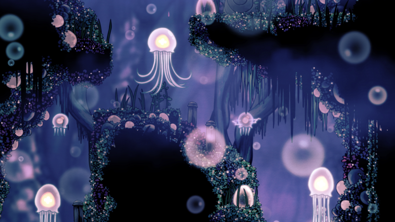

- 구분: 안개 협곡 · 출시판 스크린샷 · 800×450 · 레이어, 조명, 비교
- 맵과 배치: 구불거리는 지형 사이 열린 공간에 발광 생물이 뜬다.
- 스타일과 텍스처: 둥근 기포와 부드러운 생물 표면이 돌과 다른 감촉을 만든다.
- 전경과 배경: 크고 흐린 원은 가까운 입자처럼 읽히며 지형 속의 검정과 다르다.
- 조명: 흰 중심·분홍 후광·보랏빛 안개가 겹친다.
- 프로젝트 적용안: 근접 입자와 유물의 후광은 소수만 사용하고 실제 충돌체와 구별한다.
- [출처 페이지](https://hollowknight.wiki/w/File:Screenshot_HK_Fog_Canyon_01.png) · [제공 이미지](https://cdn.wikimg.net/en/hkwiki/images/thumb/b/b3/Screenshot_HK_Fog_Canyon_01.png/800px-Screenshot_HK_Fog_Canyon_01.png) · Team Cherry / Hollow Knight Wiki

## EX04 버섯 황무지의 하단 실루엣

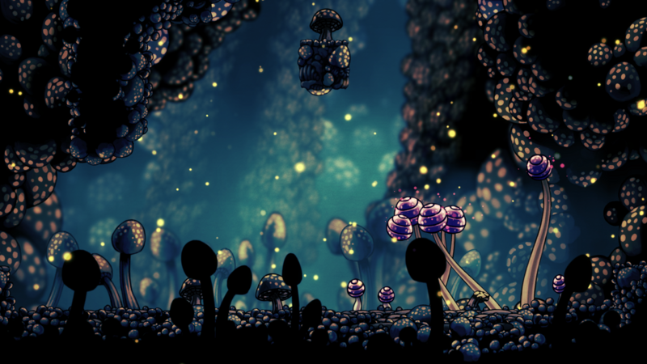

- 구분: 버섯 황무지 · 출시판 스크린샷 · 800×450 · 레이어, 그림자, 비교
- 맵과 배치: 천장과 바닥이 가운데 큰 푸른 빈 공간을 감싼다.
- 스타일과 텍스처: 둥근 버섯 갓과 가는 줄기라는 단순 형태를 반복한다.
- 전경과 배경: 앞 하단 버섯은 검고 뒤 버섯은 청록색으로 물러난다.
- 조명: 중앙 황록색 작은 빛무리가 깊이를 만든다.
- 프로젝트 적용안: 화면 아래 전경을 추가할 때 하단 외곽에 한정하고 플레이어의 발과 착지면을 비운다.
- [출처 페이지](https://hollowknight.wiki/w/File:Screenshot_HK_Fungal_Wastes_01.png) · [제공 이미지](https://cdn.wikimg.net/en/hkwiki/images/thumb/1/1f/Screenshot_HK_Fungal_Wastes_01.png/800px-Screenshot_HK_Fungal_Wastes_01.png) · Team Cherry / Hollow Knight Wiki

## EX05 눈물의 도시의 층진 건축

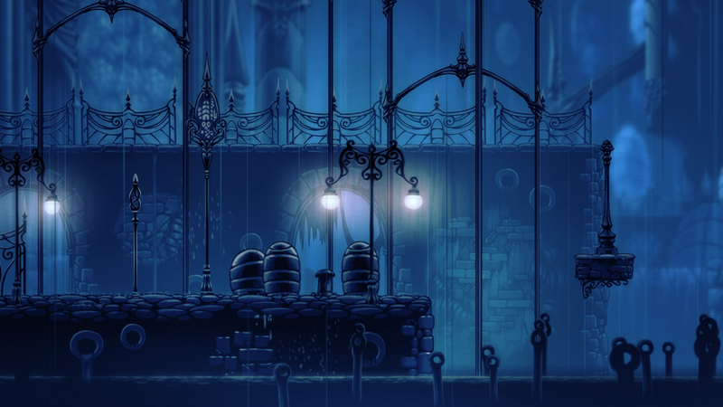

- 구분: 눈물의 도시 · 출시판 스크린샷 · 800×450 · 유적, 레이어, 조명
- 맵과 배치: 긴 수평 발판과 큰 수직 기둥이 도시 깊이를 만든다.
- 스타일과 텍스처: 금속 장식의 얇은 선과 돌 받침의 큰 면이 대비된다.
- 전경과 배경: 앞 난간·중앙 가로등·먼 건물의 명암 차가 뚜렷하다.
- 조명: 흰 작은 가로등 주변으로 푸른 안개가 번진다.
- 프로젝트 적용안: 인공 장치 방의 먼 구조물은 얇고 낮은 대비로 반복해 깊이를 만든다.
- [출처 페이지](https://hollowknight.wiki/w/File:Screenshot_HK_City_of_Tears_01.png) · [제공 이미지](https://cdn.wikimg.net/en/hkwiki/images/thumb/2/2b/Screenshot_HK_City_of_Tears_01.png/800px-Screenshot_HK_City_of_Tears_01.png) · Team Cherry / Hollow Knight Wiki

## EX06 수정 봉우리의 보랏빛 광막

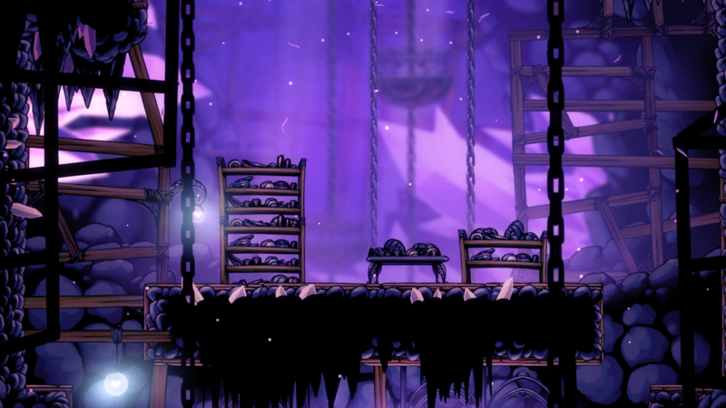

- 구분: 수정 봉우리 · 출시판 스크린샷 · 800×450 · 유적, 조명, 비교
- 맵과 배치: 중앙 발판과 긴 사슬이 밝은 배경 앞에 놓인다.
- 스타일과 텍스처: 각진 수정과 격자 구조가 유기적 이끼와 반대되는 형태다.
- 전경과 배경: 검은 사슬·중앙 발판·보라 원경이 층으로 겹친다.
- 조명: 넓은 보라 빛과 작은 흰 등불은 서로 다른 범위를 갖는다.
- 프로젝트 적용안: 지역 변화는 장식 교체와 팔레트로 표현하되 현재 이끼 구간에 보라빛을 무작정 섞지 않는다.
- [출처 페이지](https://hollowknight.wiki/w/File:Screenshot_HK_Crystal_Peak_01.png) · [제공 이미지](https://cdn.wikimg.net/en/hkwiki/images/thumb/6/60/Screenshot_HK_Crystal_Peak_01.png/800px-Screenshot_HK_Crystal_Peak_01.png) · Team Cherry / Hollow Knight Wiki

